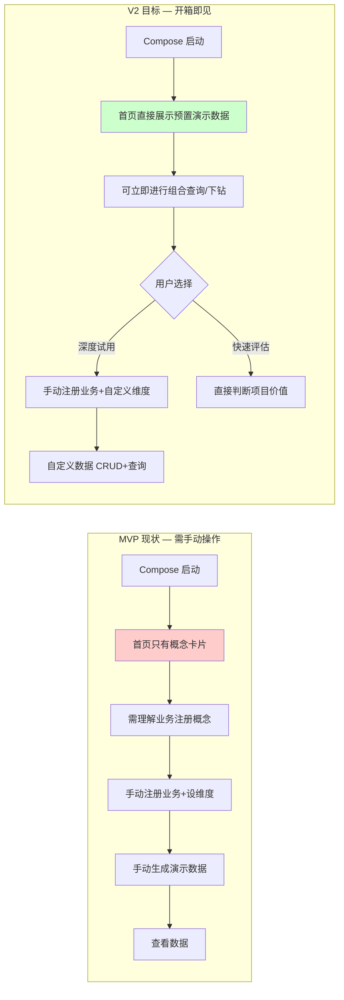
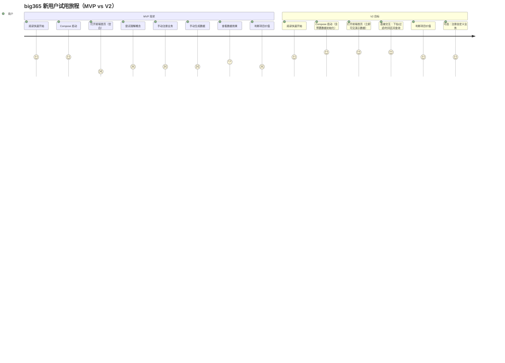
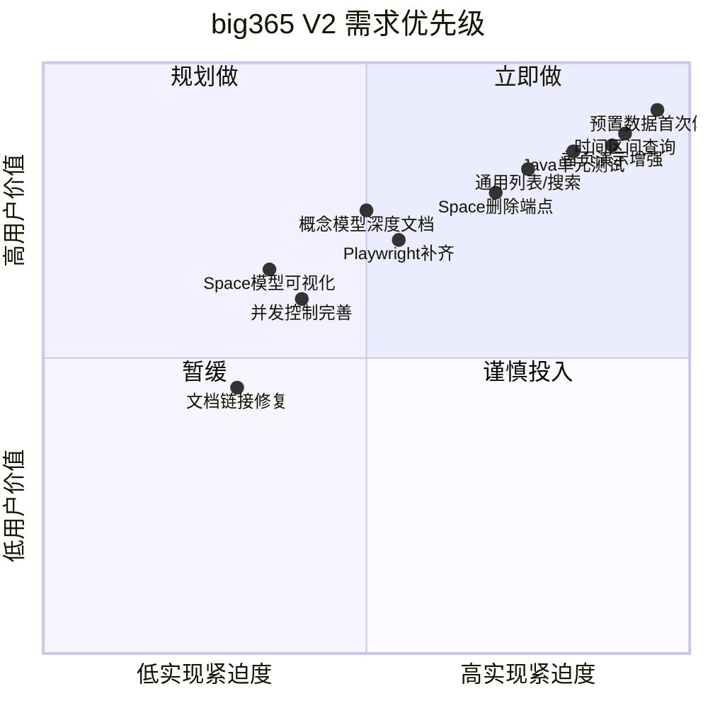
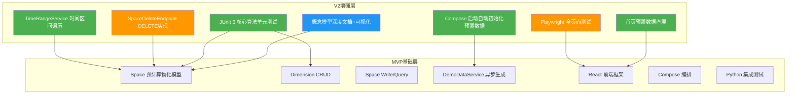
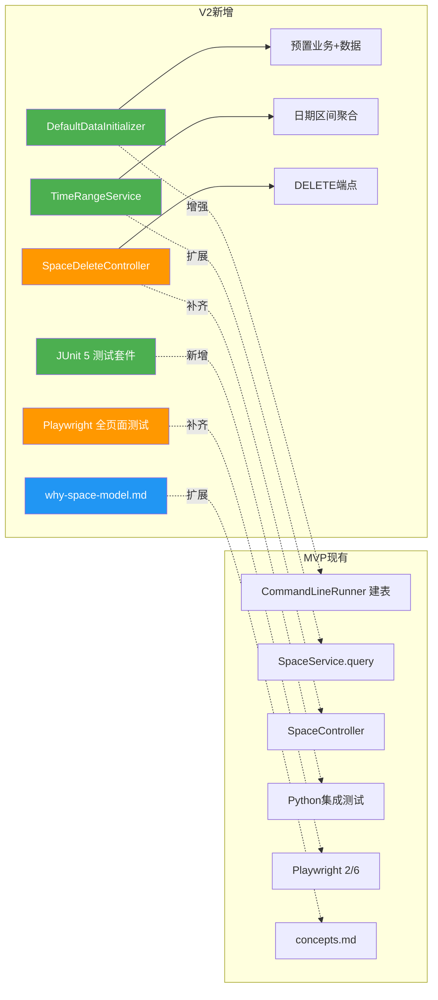
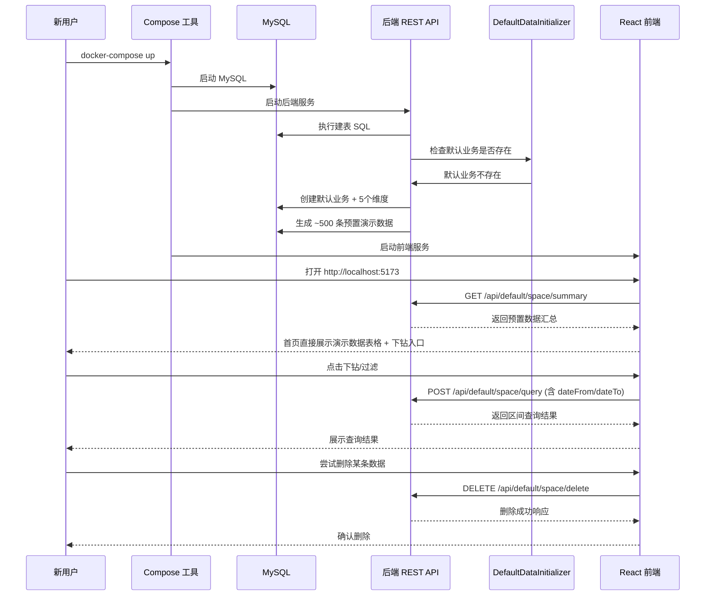
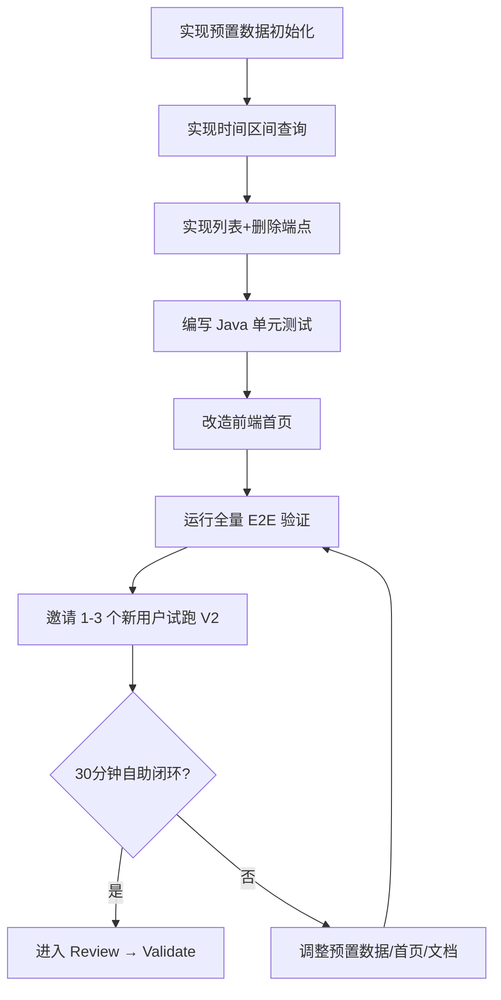

# 需求挖掘报告：big365-v2

> Feature: `big365-v2`
> 标识符: `FR-BIG365-V2`
> 阶段: Discovery 需求挖掘
> 输入来源: MVP 评价 5 类核心问题 + MVP 全部阶段产物（spec.md/plan.md/build.md/review.md/validation-report.md）+ 现有代码资产分析
> 结论摘要: big365-v2 应以"首次体验闭环、核心能力补全、测试均衡、模型亲和力增强"为四大主攻方向，在 MVP 已验证的架构基础上增量增强，不做架构推翻。

---

## 0. Discovery 结论总览

### 0.1 一句话定位

big365-v2 是 MVP 的增强版本，聚焦首次用户体验闭环（Compose 启动即见演示数据）、核心查询能力补全（时间区间查询 + 通用列表/搜索）、CRUD 删除能力补齐、测试覆盖均衡（Java 单元测试 + Playwright 全覆盖）、以及概念模型亲和力增强（降低"Space 预计算模型"理解门槛）。

### 0.2 关键决策

| 维度 | 访谈/分析结论 |
|---|---|
| V2 定位 | MVP 增强版，在现有架构上增量改进，不做架构推翻 |
| 首要目标 | 修复 MVP 评价中识别的 5 类核心差距 |
| 北极星指标修正 | "新用户 30 分钟自助闭环"需要预置数据才能现实化 |
| 架构红线 | 不推翻 ADR-002（Space 预计算模型），但增强文档和 API 表达 |
| 首次体验 | Compose 启动后首页必须展示预置演示数据（约 500 条小样例），用户无需手动操作即可理解 big365 用途 |
| 组合查询 | 补齐时间区间 from→to 查询能力和通用列表/搜索端点 |
| CRUD 闭环 | 补齐 Space Cell 删除端点 |
| 测试 | 补齐 Java 单元测试（核心算法层）+ Playwright 全部 6 页面测试 |
| 概念模型亲和力 | 丰富文档（为什么不是普通表、Space 模型独特价值）、前端增加可视化解释层 |

### 0.3 V2 用户体验闭环（目标状态 vs MVP 现状）



---

## 1. 问题定义

### 1.1 核心问题

big365 MVP 完成了端到端功能闭环（51 个 FR 中 43 个完全通过，90.2% 覆盖率），但在实际验证和深层分析中暴露出 5 类核心差距，阻碍了"新用户 30 分钟自助闭环"的北极星指标的真正实现。

**这 5 类差距不是功能的缺失，而是用户体验链路和核心能力完整度的缺口**。V2 的目标是在不推翻 MVP 架构的前提下，将这些缺口逐一补齐。

### 1.2 五类核心差距详析

#### 差距 1：首次用户体验路径不闭环（严重程度：高）

| 项目 | 说明 |
|---|---|
| **现状** | Compose 启动后，前端首页仅展示概念卡片和健康检查状态（HomePage.tsx），无预置演示数据。用户必须先理解"业务注册"概念、手动创建业务和定义维度、再手动触发演示数据生成，才能看到任何有效数据。 |
| **Spec 要求** | FR-033 明确要求"前端首页必须先展示默认演示效果或示例查询结果" |
| **根因** | MVP 的演示数据生成是用户主动触发的异步 Job（`POST /api/demo-data/jobs`），没有在 Compose 启动时自动预填充小样例数据 |
| **影响** | 北极星指标"新用户 30 分钟自助完成闭环"在缺乏预置数据的情况下，用户在前 15 分钟处于'不知道该做什么'的状态。Review 阶段标记为 MVP 可接受，但对 V2 而言是最高优先级改进项 |

#### 差距 2：组合查询核心能力缺位（严重程度：高）

| 项目 | 说明 |
|---|---|
| **现状** | FR-022（时间范围查询）仅支持单日精确查询（`date=yyyyMMdd`），不支持 `from→to` 区间遍历。FR-017（通用列表/搜索）未实现，Space 查询仅支持精确坐标定位，无通用列表搜索功能。 |
| **Spec 要求** | FR-022 "系统必须支持时间或周期范围查询"；FR-017 "系统必须支持分页或条件列表查询业务数据记录" |
| **根因** | ADR-002 预计算物化数据空间模型（宽列日期表设计）天然支持单日 O(1) 查询，日期范围需遍历多列。通用列表搜索非 Space 模型的典型使用场景（模型哲学为"精确查询、零聚合"） |
| **影响** | 日志分析作为贯穿示例场景，"按时间范围查询日志指标"是用户最本能的查询需求。不能做时间区间查询是 showstopper 级别的体验缺陷。通用列表搜索的缺失使 CRUD 的 R（读取/列表）和 D（删除前查找）体验不完整 |

#### 差距 3：CRUD 缺 D — 删除端点未实现（严重程度：中）

| 项目 | 说明 |
|---|---|
| **现状** | FR-019 要求删除业务数据记录，但 Space Cell 删除端点（`DELETE /api/{biz}/space/delete`）未实现。MVP 采用覆盖写入策略（重新写入零值或新值）作为替代方案 |
| **Spec 要求** | FR-019 "系统必须支持删除业务数据记录" |
| **根因** | Space 模型以坐标组合为主键的三表设计（坐标组合表、日期值表、空间配置表），删除操作涉及多表联动，MVP 阶段优先保证写入和查询闭环 |
| **影响** | 用户对"删除"有直观的 UX 期望。虽然覆盖写入可实现语义等价的"归零"，但缺失显式的 DELETE 端点会让用户在 API 文档和前端探索时产生困惑。Review 和 Validation 均标记为建议 V2 补齐 |

#### 差距 4：测试覆盖不均衡（严重程度：中）

| 项目 | 说明 |
|---|---|
| **现状** | Java 单元测试 0 个（FR-048 要求必须提供）；Playwright 前端测试仅 2/6 文件（缺 dimensions/space/demo 页面测试）；核心算法（如笛卡尔积级联更新 `generateCoordinateCombinations()`）缺少底层单元验证 |
| **Spec 要求** | FR-048 "系统必须提供后端核心模型和服务逻辑测试"；FR-050 "系统必须提供前端基础可用性测试或等效验证" |
| **根因** | MVP 以功能交付为优先，测试通过 Python 集成测试（5 文件 30+ 用例）和 E2E 脚本做主要补偿 |
| **影响** | 核心业务逻辑（Space 级联更新算法、维度校验、演示数据生成逻辑）缺少贴近代码的细粒度单元验证。当后续版本修改这些核心算法时，没有快速反馈的单元测试屏障 |

#### 差距 5：概念模型与"简单接入"定位的张力（严重程度：中低）

| 项目 | 说明 |
|---|---|
| **现状** | Space 预计算物化数据空间模型（0=ALL 哨兵、级联更新 2^d 行、零聚合 O(1) 查询）是 ADR-002 的核心设计。模型精巧，但对目标用户（中小业务，不想引入复杂平台）来说理解门槛不低。"为什么不是普通表"、"这个 Space 模型与普通 CRUD 有什么区别"等疑问需要更好的文档和前端可视化来解释 |
| **根因** | MVP 文档（concepts.md 178 行）已覆盖核心概念，但对"为什么这样设计"的动机解释不够，前端缺少对 Space 模型结构的可视化展示 |
| **影响** | 用户在试用过程中可能因不理解模型而产生"这个项目对我不适用"的误判，降低试用转化率 |

### 1.3 业务价值

big365-v2 的业务价值在于**将 MVP 的功能闭环升级为体验闭环**：

1. **降低试用流失**：新用户 Compose 启动后 30 秒内即可看到预置演示数据和可交互查询，无需经历"空白页 → 理解概念 → 手动操作"的冷启动过程
2. **补全核心查询能力**：时间区间查询和通用列表/搜索是业务数据服务的基础能力，补齐后 big365 的查询能力才能支撑真实的业务场景
3. **提升代码质量信心**：Java 单元测试覆盖核心算法，Playwright 测试覆盖所有页面，为后续迭代提供安全网
4. **增强模型亲和力**：更好的文档和可视化帮助用户快速理解 Space 模型的独特价值，降低"不理解而流失"的概率

### 1.4 不做的成本

如果不做 V2 增强：

- **试用转化率低**：新用户打开空白首页后可能在 5 分钟内流失，无法达到北极星指标的"30 分钟自助闭环"
- **查询能力不足**：潜在的 API 接入用户发现无法按时间区间查询数据后，会认为 big365 无法满足基本需求而放弃评估
- **技术债务累积**：缺失的单元测试和前端测试会增加后续版本的风险，核心算法修改没有安全网
- **模型理解障碍**：用户可能因不理解 Space 模型而选择其他更简单（但可能更重）的方案
- **代码质量退化风险**：没有单元测试的代码库在持续迭代中更容易引入回归 bug

---

## 2. 用户画像

### 2.1 主要用户

V2 的用户画像与 MVP 一致，但针对五类差距做更精细的体验诉求分析：

| 用户角色 | MVP 核心诉求 | V2 新增/增强诉求 | 成功判断 |
|---|---|---|---|
| 潜在中小业务用户 | 不引入复杂平台也能管理多维数据 | Compose 启动后立即可见演示效果，无需先理解"业务注册"等概念就能判断 big365 的价值 | 打开首页 30 秒内看到可交互的数据和查询 |
| 后端开发者 / 业务系统开发者 | 通过 REST API 写入、查询业务数据 | 支持按时间区间查询（from→to），支持通用列表/搜索，支持显式 DELETE 端点 | API 覆盖时间区间查询、列表搜索、删除操作 |
| 开源项目评估者 | 快速判断项目是否值得试用或二开 | 无需手动操作即可看到完整演示效果，文档清晰解释"为什么 Space 模型不是普通表" | Compose 启动后前端自动展示演示数据，文档解答核心疑问 |
| 项目维护者 | 保持模型、API、前端、文档、测试一致 | Java 单元测试覆盖核心算法，Playwright 测试覆盖全部页面，降低回归风险 | 单元测试可快速验证核心算法变更，E2E 覆盖全页面 |

### 2.2 典型用户场景

#### 场景 A：V2 理想的新用户首次试用（对比 MVP）

| 步骤 | MVP 现状 | V2 目标 |
|---|---|---|
| 1. 阅读快速开始 | 同 | 同 |
| 2. Compose 启动 | 同（约 2-5 分钟） | 同 |
| 3. 打开前端首页 | ⚠️ 仅概念卡片+健康检查，无数据 | ✅ 预置演示数据自动展示：一张汇总查询结果表 + 可交互的下钻入口 |
| 4. 理解 big365 | 需要先看概念文档 | ✅ 首页数据可直接操作（下钻、过滤），边用边理解 |
| 5. 尝试组合查询 | ⚠️ 需要先注册业务+生成数据 | ✅ 直接在预置数据上尝试时间区间查询、多维过滤 |
| 6. 判断价值 | 需要多步操作后才可见 | ✅ 3 分钟内形成判断 |

#### 场景 B：后端开发者深度接入

| 步骤 | MVP 现状 | V2 目标 |
|---|---|---|
| 1. 快速启动 | ✅ | ✅ 不变 |
| 2. 查看 API 文档 | ✅ Swagger + api.md | ✅ 不变 |
| 3. 时间区间查询 | ❌ 仅支持单日查询 | ✅ `POST /api/{biz}/space/query` 支持 `dateFrom`/`dateTo` |
| 4. 通用列表搜索 | ❌ 仅精确坐标定位 | ✅ `GET /api/{biz}/space/list` 分页列表 |
| 5. 删除数据 | ❌ 无 DELETE 端点 | ✅ `DELETE /api/{biz}/space/delete` |

#### 场景 C：项目维护者日常迭代

| 步骤 | MVP 现状 | V2 目标 |
|---|---|---|
| 修改核心算法 | ⚠️ 无 JUnit 快速反馈 | ✅ 在 IDE 中运行 JUnit 测试秒级反馈 |
| 修改前端页面 | ⚠️ 仅 2/6 页面有 Playwright 测试 | ✅ 全部 6 页面有 Playwright 回归测试 |
| 发布前验证 | ✅ E2E 脚本 | ✅ 增强的测试矩阵 |

### 2.3 当前用户旅程与目标用户旅程



### 2.4 关键痛点

1. "Compose 启动后首页是空的，我不知道这个项目能做什么" — **从空白到有数据的体验跳跃**
2. "我想按时间区间查询日志，但发现只能查某一天" — **时间区间查询是基础设施级的能力缺失**
3. "我创建了一条错误数据，找不到删除按钮" — **CRUD 四缺一，打破用户对数据管理的基本心理模型**
4. "Space 预计算模型虽然精巧，但我一开始不理解为什么要这样设计" — **概念模型需要更好的解释和可视化**
5. "修改了 Space 写入逻辑后，不知道有没有引入 bug" — **缺失的单元测试是持续迭代的风险放大器**

---

## 3. 需求清单

### 3.1 Must Have（必备）

| 编号 | 需求 | 说明 | 关联 MVP 差距 |
|---|---|---|---|
| M1 | **首次体验预置数据** | Compose 启动时自动初始化一个默认业务和预置演示数据（~500 条小样例），前端首页直接展示数据汇总和可交互下钻入口 | 差距 1 (FR-033) |
| M2 | **时间区间查询** | Space 查询支持 `dateFrom`/`dateTo` 区间，返回范围内所有日期的汇总数据 | 差距 2 (FR-022) |
| M3 | **通用列表/搜索端点** | 提供 `GET /api/{biz}/space/list` 分页列表端点，支持按维度条件过滤 | 差距 2 (FR-017) |
| M4 | **Space Cell 删除端点** | 实现 `DELETE /api/{biz}/space/delete`，支持按坐标定位删除数据记录 | 差距 3 (FR-019) |
| M5 | **Java 单元测试** | 至少覆盖 `SpaceService.generateCoordinateCombinations()` 核心算法、`DimensionService` 核心逻辑、`DemoDataService` 生成逻辑 | 差距 4 (FR-048) |
| M6 | **首页默认演示效果增强** | 前端 HomePage 改造：预置数据场景直接展示汇总查询结果（不需要手动操作即可见到数据），提供快速下钻入口 | 差距 1 (FR-033) |

### 3.2 Should Have（期望）

| 编号 | 需求 | 说明 | 关联 MVP 差距 |
|---|---|---|---|
| S1 | **Playwright 测试补齐** | 补充 `test_dimensions.py`、`test_space.py`、`test_demo_data.py` 三个前端页面测试文件 | 差距 4 (FR-050) |
| S2 | **概念模型深度文档** | 新增或扩展 `docs/why-space-model.md`：解释"为什么不是普通表"、"预计算物化数据空间的独特价值"、"0=ALL 哨兵机制" | 差距 5 |
| S3 | **Space 模型前端可视化** | 在首页或 SpacePage 中增加 Space 模型结构可视化（维度组合树/坐标空间示意图），帮助用户理解预计算模型 | 差距 5 |
| S4 | **预置业务定义优化** | 默认业务使用更直观的名称/维度（如"日志分析示例"），预置 5 个维度（app/endpoint/statusCode/env/region）和 3 个指标（请求量/错误数/平均耗时） | 差距 1 |
| S5 | **并发控制完善** | 为维度创建添加数据库级唯一约束 + 应用层乐观锁；为 Space 数据更新/删除添加并发控制 | Review 建议 (EC-011, EC-012) |
| S6 | **文档链接修复** | 修复 `DocsPage.tsx` 中 Markdown 文档链接为可渲染格式或新窗口打开 | Review 残留项 (R-006) |

### 3.3 Could Have（惊喜）

| 编号 | 需求 | 说明 |
|---|---|---|
| C1 | **预置数据多样化** | 除了日志分析场景，预置电商订单或 IoT 设备数据场景 |
| C2 | **Swagger 示例增强** | API 文档中增加更多真实场景的请求/响应示例 |
| C3 | **前端 TypeScript 类型完善** | 移除 `any` 类型擦除（`client.ts` 拦截器、`space.ts` 查询参数） |
| C4 | **MyBatis SQL 日志按 Profile 分离** | 通过 Spring Profile 分离 SQL 日志输出（`StdOutImpl`） |
| C5 | **内联 CSS 动画提升** | `DemoDataPage.tsx` 中 `@keyframes pulse` 提升至全局样式 |
| C6 | **演示数据生成去重策略** | 对同一业务的重复生成请求提供覆盖或拒绝策略 |

### 3.4 MoSCoW 优先级关系



---

## 4. 推荐方案

### 4.1 方案概述

**big365-v2 采用 MVP 增量增强策略**：在 MVP 已验证的架构（Spring Boot + MyBatis + Space 预计算模型 + React + Compose）基础上，进行以下增强：



#### 4.1.1 增强 1：首次体验预置数据（M1 + M6 + S4）

**核心思路**：Compose 启动时，后端 `CommandLineRunner` 在数据库初始化后自动检查是否存在默认业务。若不存在，自动创建名为"日志分析示例"的默认业务（含 app/endpoint/statusCode/env/region 5 个维度），并同步生成 ~500 条小样例演示数据。

**技术方案**：
- 新增 `DefaultDataInitializer`（实现 `CommandLineRunner`，优先级低于建表 Runner）
- 在 `BizService` 中增加 `initDefaultBiz()` 方法，幂等操作（检查默认业务是否已存在）
- 前端 `HomePage` 改造：首次加载时查询默认业务数据并展示汇总结果 + 快速下钻入口

**关键设计决策**：
- 预置数据量：~500 条（小样例规模），确保在低配机器上也能快速完成初始化
- 幂等性：多次重启不重复创建默认业务和数据
- 不影响用户自定义业务：默认业务仅作为演示入口，用户仍可创建自己的业务

#### 4.1.2 增强 2：时间区间查询（M2）

**核心思路**：在 Space 查询中增加 `dateFrom`/`dateTo` 参数，后端遍历日期范围内的所有列并聚合结果。

**技术方案**：
- `SpaceService.query()` 方法扩展：当 `dateFrom` 和 `dateTo` 同时存在时，遍历日期列（`val_20260601` ~ `val_20260610`），执行多次 SUM 查询后汇总
- 查询请求 DTO 扩展：`SpaceQueryRequest` 增加 `dateFrom`/`dateTo` 可选字段
- 日期范围校验：from ≤ to，最大跨度建议 ≤ 365 天（防止超大范围查询）

**关键设计决策**：
- 不改变 Space 模型的宽列表结构（保持 ADR-002 不变）
- 日期范围查询本质上是"多次 O(1) 查询 + 内存聚合"，而非真正的区间查询
- 对百万级数据和超大日期范围提供性能提示

#### 4.1.3 增强 3：通用列表/搜索端点（M3）

**核心思路**：新增 `GET /api/{biz}/space/list` 端点，支持分页和按维度条件（可选）过滤。

**技术方案**：
- 新建 `SpaceController.listSpace()` 方法
- `SpaceService.listRecords()` 方法：从坐标组合表 + 日期值表分页查询
- 支持可选过滤条件：`dimensions`（多选）、分页参数（`pageNo`、`pageSize`）

**关键设计决策**：
- 列表端点的设计哲学不同于 Space 模型的"精确坐标查询"：列表是浏览/查找场景，不要求用户知道精确坐标
- 列表结果按时间倒序，便于用户查看最近的数据

#### 4.1.4 增强 4：Space Cell 删除端点（M4）

**核心思路**：实现 `DELETE /api/{biz}/space/delete` 端点，按坐标定位删除数据记录。

**技术方案**：
- `SpaceMapper.deleteByCoordinates()`：从坐标组合表中删除指定坐标的行
- 级联删除日期值表中对应的行（按 `coordinate_id`）
- 清理无数据引用的坐标组合记录

**关键设计决策**：
- 删除策略：硬删除（从坐标组合表和日期值表中物理删除行），而非软删除
- 如果删除的是"0=ALL"汇总行，需要评估是否应该阻止（避免破坏预计算一致性）或级联重算

#### 4.1.5 增强 5：Java 单元测试（M5）

**核心思路**：为至少 3 个核心服务类添加 JUnit 5 + Mockito 单元测试。

**技术方案**：
- `SpaceServiceTest`：测试 `generateCoordinateCombinations()` 笛卡尔积生成逻辑、级联更新行数计算
- `DimensionServiceTest`：测试维度创建/更新/校验逻辑、编码唯一性校验
- `DemoDataServiceTest`：测试数据生成逻辑（Mock Mapper，验证生成算法正确性）

**关键设计决策**：
- 测试框架：JUnit 5 + Mockito（Spring Boot Test）
- 覆盖率目标：核心服务类行覆盖 > 80%
- 不替代 Python 集成测试，而是互补（单元测试验证逻辑，集成测试验证端到端）

#### 4.1.6 增强 6：概念模型亲和力增强（S2 + S3）

**核心思路**：通过新文档和前端可视化降低 Space 模型的理解门槛。

**技术方案**：
- 新增 `docs/why-space-model.md`：用对比表（普通表 vs Space 预计算表）说明设计动机
- 前端 SpacePage 或 HomePage 中增加一个可折叠的 "模型原理" 区域，用简单图示展示维度组合树

#### 4.1.7 Review 残留项修复（S5 + S6）

直接修复 MVP Review 阶段已识别但未处理的改进项：
- 文档链接修复（R-006）
- 并发控制完善（R-001 + EC-011/012）
- 前端 TypeScript 类型完善（R-003/R-004/R-007）

### 4.2 选择理由

选择"增量增强"而非"架构改造"的理由：

1. **MVP 架构已通过验证**：ADR-002 的 Space 预计算模型在 MVP 验证中表现稳定，零聚合 O(1) 查询是核心差异化优势，不值得为时间区间查询推倒重来
2. **五类差距都是增量性质**：没有一个差距需要重构核心架构，都可以在现有边界内实现
3. **降低 V2 风险**：增量增强意味着改动范围可控，不会引入大规模回归
4. **保留 MVP 资产**：所有 MVP 代码、文档、测试继续有效，V2 在其上叠加增强

### 4.3 差异化优势

V2 相比 MVP 的差异化增强：

| 增强维度 | MVP | V2 | 用户体验提升 |
|---|---|---|---|
| 首次体验 | Compose → 空白首页 | Compose → 预置数据立即可见 | **从"要学才会用"到"打开即理解"** |
| 查询能力 | 单日精确查询 | 时间区间查询 + 通用列表 | **覆盖真实业务场景的查询需求** |
| CRUD 完整度 | CRU（缺 D） | CRUD（完整） | **满足用户对数据管理的基本心理模型** |
| 测试信心 | 集成测试为主 | 单元测试 + 集成测试 + E2E 全覆盖 | **持续迭代有安全网** |
| 模型理解 | 需要阅读 178 行概念文档 | 文档 + 前端可视化双重降低门槛 | **降低"不理解而流失"的概率** |

### 4.4 V2 架构增量图示



---

## 5. 成功指标

### 5.1 北极星指标（修正）

**原 MVP 北极星指标**：新用户仅依赖文档，能够自助完成 big365 的启动、模型理解、数据 CRUD、组合查询和前端演示。

**V2 修正**：新用户 Compose 启动后 **3 分钟内** 可在前端首页看到预置演示数据并进行交互式查询；**15 分钟内** 可完成自定义业务的注册、数据写入和时间区间组合查询。

### 5.2 目标数值

| 指标 | MVP 目标 | V2 目标 | 变化说明 |
|---|---|---|---|
| 首次可见数据 | 手动操作后才可见（~15 分钟） | Compose 启动后 3 分钟（含预置数据初始化） | 从"需手动操作"到"自动可见" |
| 自助闭环时间 | 30 分钟 | 15 分钟（预置数据路径） / 30 分钟（自定义业务路径） | 预置数据路径大幅缩短 |
| 时间区间查询 | 不支持 | 支持 1-365 天区间查询，典型查询 < 3 秒 | 新增能力 |
| Space 删除 | 不支持 | DELETE 端点可用 | 补齐 CRUD |
| Java 单元测试覆盖 | 0 个测试类 | ≥ 3 个核心服务类测试，行覆盖 > 80% | 从无到有 |
| Playwright 测试覆盖 | 2/6 页面 | 6/6 页面全覆盖 | 补齐测试矩阵 |
| 概念模型理解 | 需要阅读 178 行文档 | 前端首页可直接看到数据效果，文档提供"为什么"解释 | 降低理解门槛 |

### 5.3 验收路径



---

## 6. 范围边界

### 6.1 V2 范围（Must Have）

| 范围 | 内容 |
|---|---|
| 预置数据初始化 | Compose 启动时自动创建默认业务 + 5 个维度（app/endpoint/statusCode/env/region）+ 生成 ~500 条演示数据；前端首页直展数据汇总 |
| 时间区间查询 | Space 查询接口扩展 `dateFrom`/`dateTo` 参数，支持 1-365 天区间遍历和聚合 |
| 通用列表/搜索 | 新增 `GET /api/{biz}/space/list` 分页列表端点，支持按维度条件过滤 |
| Space 删除端点 | 实现 `DELETE /api/{biz}/space/delete`，支持按坐标删除数据（含级联处理） |
| Java 单元测试 | 至少 3 个核心服务类的 JUnit 5 单元测试（SpaceService/DimensionService/DemoDataService） |
| 首页演示增强 | 前端 HomePage 改造为预置数据场景直展模式 |

### 6.2 V2 范围（Should Have）

| 范围 | 内容 |
|---|---|
| Playwright 测试补齐 | 补充 3 个缺失页面测试（dimensions/space/demo） |
| 概念模型深度文档 | `docs/why-space-model.md` |
| 前端模型可视化 | Space/Home 页面的 Space 模型简单可视化 |
| 并发控制完善 | 维度唯一约束 + Space 更新/删除乐观锁 |
| 文档链接修复 | DocsPage Markdown 链接修复 |

### 6.3 V2 范围（Could Have）

| 范围 | 内容 |
|---|---|
| 预置数据多样化场景 | 电商/IoT 场景 |
| Swagger 示例增强 | 更多真实请求/响应示例 |
| TypeScript 类型完善 | 移除 `any` 类型擦除 |
| SQL 日志 Profile 分离 | Spring Profile 控制 SQL 日志 |
| 内联 CSS 提升 | `@keyframes` 移至全局样式 |
| 演示数据去重策略 | 覆盖/拒绝策略 |

### 6.4 明确不做

| 编号 | 不做事项 | 排除原因 |
|---|---|---|
| NG-001 | 不推翻 ADR-002 的 Space 预计算模型 | 模型已验证有效，时间区间查询通过遍历日期列实现即可 |
| NG-002 | 不做 MySQL 分区表迁移 | 属于 V2 后续版本（原计划 V2 路线图中的分区表/宽表） |
| NG-003 | 不做多数据库适配 | 保持 MVP 的 MySQL 单存储策略 |
| NG-004 | 不做权限/多租户/审计 | 保持 MVP 的 Non-Goals |
| NG-005 | 不做 Java SDK / Spring Boot Starter | 属于原计划 V1 范围，本次 V2 不纳入 |
| NG-006 | 不做批量导入（CSV/JSON） | 属于原计划 V1 范围 |
| NG-007 | 不新增独立工程 | 在现有 `big365-api` 和 `big365-web` 内部增强 |
| NG-008 | 不做大规模重构或代码搬迁 | 所有改动在现有包结构内增量进行 |

### 6.5 V2 与原始路线图的关系


> **说明**：本次 V2 定位为 MVP 的直接增强版，不等同于原 Discovery 中规划的 V1（Java SDK 等）或 V2（分区表/宽表）。原路线图建议的功能（Java SDK、批量导入等）可在后续版本中继续推进。本次 V2 聚焦 MVP 评价中识别的五大核心差距。

---

## 7. 风险与假设

### 7.1 关键假设

| 假设 | 验证方式 |
|---|---|
| 新用户在 Compose 启动后看到预置数据，能显著提升试用转化率 | 邀请 1-3 个新用户试用 V2 版本并对比 MVP 体验 |
| 时间区间查询通过遍历日期列的方式，在 500 条数据范围内性能可接受 | 对预置数据（500 条/30 天区间）和万级数据执行区间查询并记录耗时 |
| Space 删除端点的级联删除不会破坏预计算一致性 | 单元测试 + 集成测试覆盖删除后查询正确性 |
| Java 单元测试能有效捕获核心算法回归 | 模拟算法变更 → 运行单元测试 → 确认失败后再验证正确逻辑 |
| 用户对 Space 模型的理解门槛可通过文档和可视化有效降低 | 对比新旧文档/页面的用户理解测试 |

### 7.2 主要风险

| 风险 | 描述 | 缓解策略 |
|---|---|---|
| **范围蔓延风险** | V2 的 Must Have 已有 6 项、Should Have 6 项，可能超出预期工作量 | 严格按 MoSCoW 优先级：Must Have 先交付，Should/Could 按时间允许情况安排 |
| **预置数据初始化耗时** | ~500 条数据的同步初始化可能延长 Compose 启动时间 | 评估同步生成的耗时（MVP 中 small=500 生成约数秒），若超过容忍值考虑异步预热 |
| **时间区间查询性能** | 遍历 365 个日期列执行 365 次 SUM 查询，性能可能不可接受 | 对超大日期范围（>90 天）提供性能提示或限制；考虑未来引入日期列范围查询优化（如 UNION ALL） |
| **删除端点的预计算一致性** | 删除"0=ALL"汇总行后，子节点数据仍存在，破坏预计算一致性 | 设计规则：删除父节点 → 级联删除所有子节点；或禁止删除 ALL 汇总行 |
| **测试维护成本** | 新增的单元测试和 Playwright 测试需要持续维护 | 将测试纳入 CI/构建流程，确保测试始终可运行 |
| **概念模型文档可能不够** | 即使用户阅读了 why-space-model.md，仍可能不理解模型价值 | 结合前端可视化双重降低门槛 |

### 7.3 验证计划



---

## 8. 下一步建议

### 8.1 进入规范编写阶段

建议下一步运行：

```text
@sddu-spec big365-v2
```

规范编写阶段应重点明确：

1. **预置数据初始化的完整规格**：默认业务定义、维度规格、数据生成参数、初始化流程（同步 vs 异步）
2. **时间区间查询的接口设计**：`dateFrom`/`dateTo` 参数格式、日期范围限制、聚合方式
3. **通用列表/搜索端点设计**：路径、请求参数、分页、过滤条件
4. **Space 删除端点的语义**：硬删除 vs 软删除、级联删除策略、对"0=ALL"汇总行的处理
5. **Java 单元测试覆盖范围**：测试用例列表、覆盖率目标
6. **前端首页改造方案**：预置数据展示布局、下钻交互设计
7. **概念模型文档大纲**：`why-space-model.md` 的章节结构

### 8.2 需要进一步调研

- **预置数据初始化耗时**：在低配 Docker 环境中测量 ~500 条数据的同步生成耗时
- **时间区间查询性能基准**：针对 30 天/90 天/365 天区间分别测试查询耗时
- **删除端点的级联策略**：评估"删除 ALL 行"对预计算一致性的影响，确定最佳策略
- **前端首页数据展示形式**：汇总表 vs 图表 vs 混合，哪种形式对新用户最友好
- **默认业务的维度设计**：是否需要增加更多维度（如时间粒度 day/hour）以展示 Space 模型的完整能力

---

## 9. Feature 拆分建议分析

### 9.1 拆分机会识别

本次 V2 需求的各项增强之间存在较多耦合（预置数据与首页展示、时间区间查询与列表端点共享 Space 模型），**不建议拆分为子 Feature**，建议按单一聚合 Feature 推进。

| 评估维度 | 分析 |
|---|---|
| 耦合度 | 高 — 预置数据初始化依赖 Space 模型，首页展示依赖预置数据，时间区间查询与列表端点共享 SpaceService |
| 变更范围 | 同一后端工程（big365-api）和前端工程（big365-web）内部增强 |
| 交付独立性 | 低 — 各项增强需要一起交付才能形成完整的 V2 体验闭环 |
| 建议 | 按单一聚合 Feature 推进，在 Plan 阶段按增强维度划分为工作包（Wave） |

### 9.2 工作包预览

| 包 | 内容 | 预估复杂度 |
|---|---|---|
| 包 1：预置数据初始化 | DefaultDataInitializer + 默认业务/维度/数据生成 | 中 |
| 包 2：查询能力补全 | 时间区间查询 + 通用列表/搜索端点 | 中高 |
| 包 3：CRUD 补齐 | Space 删除端点 | 中 |
| 包 4：测试补齐 | JUnit 5 单元测试 + Playwright 全页面测试 | 中 |
| 包 5：体验增强 | 首页改造 + 概念模型文档/可视化 + Review 残留项修复 | 中低 |

---

## 10. 附录：MVP 差距与 V2 需求映射表

| MVP 差距 | 关联 FR | V2 需求编号 | V2 需求 | 优先级 |
|---|---|---|---|---|
| 差距 1：首次体验不闭环 | FR-033 | M1 | 预置数据初始化 | Must Have |
| 差距 1：首次体验不闭环 | FR-033 | M6 | 首页默认演示增强 | Must Have |
| 差距 1：首次体验不闭环 | FR-033 | S4 | 预置业务定义优化 | Should Have |
| 差距 2：组合查询缺位 | FR-022 | M2 | 时间区间查询 | Must Have |
| 差距 2：组合查询缺位 | FR-017 | M3 | 通用列表/搜索端点 | Must Have |
| 差距 3：CRUD 缺 D | FR-019 | M4 | Space 删除端点 | Must Have |
| 差距 4：测试不均衡 | FR-048 | M5 | Java 单元测试 | Must Have |
| 差距 4：测试不均衡 | FR-050 | S1 | Playwright 测试补齐 | Should Have |
| 差距 5：概念模型张力 | NFR-008 | S2 | 概念模型深度文档 | Should Have |
| 差距 5：概念模型张力 | NFR-008 | S3 | Space 模型前端可视化 | Should Have |
| Review 残留 | EC-011/012 | S5 | 并发控制完善 | Should Have |
| Review 残留 | R-006 | S6 | 文档链接修复 | Should Have |
| Review 残留 | R-003/004/007 | C3 | TypeScript 类型完善 | Could Have |
| Review 残留 | R-002 | C4 | SQL 日志 Profile 分离 | Could Have |
| Review 残留 | R-005 | C5 | 内联 CSS 提升 | Could Have |
| Review 残留 | (EC-009) | C6 | 演示数据去重策略 | Could Have |
| 增强体验 | — | C1 | 预置数据多样化 | Could Have |
| 增强体验 | FR-041 | C2 | Swagger 示例增强 | Could Have |

---
