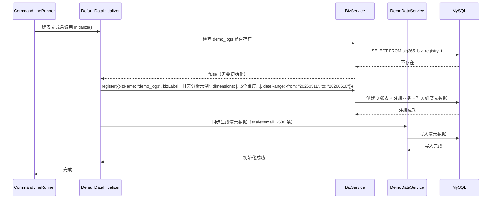

# Feature Specification: big365-v2

> Feature: `big365-v2`  
> 标识符: `FR-BIG365-V2`  
> 状态: `specified`  
> 优先级: `P1`  
> 作者: `usb`  
> 创建日期: `2026-06-10`  
> 输入来源: `.sddu/specs-tree-root/specs-tree-big365-v2/discovery.md`  
> 基于: `FR-BIG365-MVP` (已交付 MVP)  
> 拆分决策: 单一聚合 Feature，不拆分子 Feature

---

## 1. 元数据

| 字段 | 内容 |
|---|---|
| Feature 名称 | big365-v2 |
| Feature 标识符 | FR-BIG365-V2 |
| Feature 类型 | MVP 增强版本 |
| 当前阶段 | Spec / 规范编写 |
| 优先级 | P1 |
| 创建日期 | 2026-06-10 |
| 作者 | usb |
| 主要干系人 | 潜在中小业务用户、后端开发者、开源项目评估者、项目维护者 |
| 目标版本 | V2 |
| 规范目录 | `.sddu/specs-tree-root/specs-tree-big365-v2/` |
| 上游 Feature | `FR-BIG365-MVP` (MVP 已完成并验证) |

---

## 2. 上下文与问题定义

### 2.1 背景

big365 MVP 已成功交付端到端功能闭环（51 个 FR 中 43 个完全通过，90.2% 覆盖率），但在 MVP Review 和 Validation 阶段识别出 **5 类核心差距**，阻碍了北极星指标"新用户 30 分钟自助闭环"的真正实现。

V2 的定位是 **MVP 增强版本**：在 MVP 已验证的架构（Spring Boot 3.5.14 + MyBatis + Space 预计算物化数据空间模型 + React + Compose）基础上，通过增量增强将这 5 类差距逐一补齐，实现从"功能闭环"到"体验闭环"的升级。

### 2.2 五类核心差距

| # | 差距 | 严重程度 | MVP 现状 | V2 目标 |
|---|---|---|---|---|
| 1 | **首次用户体验路径不闭环** | 高 | Compose 启动 → 首页仅概念卡片+健康检查，无预置数据 | Compose 启动 → 首页直接展示预置演示数据 + 可交互查询 |
| 2 | **组合查询核心能力缺位** | 高 | 仅支持单日精确查询（`date=yyyyMMdd`），无通用列表/搜索 | 支持时间区间查询（`from→to`）+ 通用分页列表 + 条件筛选 |
| 3 | **CRUD 缺 D — 删除端点未实现** | 中 | Space Cell 删除端点不存在，采用覆盖写入替代 | 实现硬删除端点 + 级联处理 |
| 4 | **测试覆盖不均衡** | 中 | Java 单元测试 0 个；Playwright 测试已有 6/6 页面基础覆盖 | Java 单元测试 ≥3 个核心服务类；Playwright 补充 V2 新功能测试 |
| 5 | **概念模型理解门槛** | 中低 | Space 预计算模型精巧但理解门槛高，文档缺少"为什么"解释 | 新增 why-space-model.md 文档 + 前端可视化 |

### 2.3 目标用户

V2 用户画像与 MVP 一致，但对体验诉求更精细：

| 用户角色 | MVP 核心诉求 | V2 新增/增强诉求 | 成功判断 |
|---|---|---|---|
| 潜在中小业务用户 | 不引入复杂平台也能管理多维数据 | Compose 启动后立即可见演示效果，无需先理解"业务注册"概念 | 打开首页 30 秒内看到可交互的数据和查询 |
| 后端开发者 / 业务系统开发者 | 通过 REST API 写入、查询业务数据 | 支持按时间区间查询、通用列表/搜索、显式 DELETE 端点 | API 覆盖时间区间查询、列表搜索、删除操作 |
| 开源项目评估者 | 快速判断项目是否值得试用或二开 | 无需手动操作即可看到完整演示效果，文档清晰解释模型价值 | Compose 启动后前端自动展示演示数据 |
| 项目维护者 | 保持模型/API/前端/文档/测试一致 | Java 单元测试覆盖核心算法，Playwright 测试覆盖 V2 新功能 | 单元测试可快速验证核心算法变更 |

### 2.4 相关现有功能与资产

> **工程红线**：不推翻 ADR-002（Space 预计算模型）；不新增独立工程；所有改动在现有 `big365-api` 和 `big365-web` 内部增量进行。

| 类型 | 现有资产 | V2 处理方式 |
|---|---|---|
| 后端基础 | Spring Boot 3.5.14 + Java 21 + MyBatis，包结构清晰（biz/space/dimension/demo） | 在现有包内增量扩展 |
| Space 模型 | 坐标组合表 + 日期值表 + 空间配置表三表设计，0=ALL 哨兵机制 | 不改变存储结构，时间区间通过在应用层遍历日期列实现 |
| API 现状 | `POST /api/{biz}/space/write`、`GET /api/{biz}/space/query`（仅单日） | 扩展 query 支持区间，新增 list + delete |
| 数据库初始化 | `CommandLineRunner` 建表 `big365_biz_registry_t` | 新增 `DefaultDataInitializer` 自动创建默认业务+预置数据 |
| 前端 | React + Vite + TypeScript，7 页面 + 5 组件，HomePage 仅健康检查+概念卡片 | HomePage 改造为预置数据直展模式 |
| Playwright 测试 | 6 个 Python 测试文件，31 个测试用例，覆盖所有 6 页面基础交互 | 补充 V2 新功能测试用例 |
| Java 测试 | 0 个 JUnit 测试类 | 新增 ≥3 个核心服务类 JUnit 5 测试 |
| Compose | `compose.yml` / `compose.podman.yml` 三服务拓扑 | 不改变拓扑，后端容器启动时自动执行预置数据初始化 |

---

## 3. Goals / Non-Goals

### 3.1 Goals

| 编号 | 目标域 | 目标 | 成功判断 |
|---|---|---|---|
| G-V2-001 | 首次体验 | Compose 启动后自动初始化默认业务和预置演示数据，前端首页直接展示。 | 新用户 Compose 启动后 3 分钟内可在首页看到可交互数据。 |
| G-V2-002 | 查询能力 | 支持时间区间查询（from→to 日期范围）和通用列表/搜索端点。 | 用户可查询任意 1-365 天区间数据，可通过分页列表浏览数据。 |
| G-V2-003 | CRUD 完整 | 补齐 Space Cell 删除端点（DELETE）。 | 用户可显式删除指定坐标的数据记录，删除后查询验证结果。 |
| G-V2-004 | 测试覆盖 | Java 单元测试覆盖核心算法，Playwright 覆盖 V2 新功能。 | JUnit 5 测试 ≥3 个核心服务类，行覆盖 >80%；Playwright 新测试通过。 |
| G-V2-005 | 模型亲和力 | 通过新文档和前端可视化降低 Space 模型理解门槛。 | 新用户可通过文档和页面可视化理解 Space 模型设计动机。 |
| G-V2-006 | 架构一致 | 所有增强在 MVP 架构基础上增量实现，不推翻 ADR-002。 | V2 完成后 MVP 所有现有功能仍然可用。 |

### 3.2 Non-Goals

| 编号 | 不做事项 | 排除原因 |
|---|---|---|
| NG-V2-001 | 不推翻 ADR-002 的 Space 预计算模型 | 模型已验证有效，时间区间查询通过遍历日期列实现 |
| NG-V2-002 | 不做 MySQL 分区表迁移 | 属于后续版本路线图 |
| NG-V2-003 | 不做多数据库适配 | 保持 MVP 的 MySQL 单存储策略 |
| NG-V2-004 | 不做权限/多租户/审计 | 保持 MVP 的 Non-Goals |
| NG-V2-005 | 不做 Java SDK / Spring Boot Starter | 属于后续版本 |
| NG-V2-006 | 不做批量导入（CSV/JSON） | 属于后续版本 |
| NG-V2-007 | 不新增独立工程 | 在现有 `big365-api` 和 `big365-web` 内部增强 |
| NG-V2-008 | 不做大规模重构或代码搬迁 | 所有改动在现有包结构内增量进行 |
| NG-V2-009 | 不改变 Space 模型宽列表结构 | 日期区间通过遍历多列实现，不引入动态 UNION ALL |
| NG-V2-010 | 不做前端组件级 Playwright 重写 | 保持现有 6 页面的 Python Playwright 测试体系 |

---

## 4. 用户故事

| 编号 | 角色 | 我想要 | 以便 | 覆盖能力 |
|---|---|---|---|---|
| US-V2-01 | 新用户 / 开源评估者 | Compose 启动后打开前端首页就能看到预置的日志分析演示数据 | 无需任何手动操作即可快速判断 big365 的价值 | M1 预置数据 + M6 首页直展 |
| US-V2-02 | 新用户 / 开源评估者 | 在预置演示数据上进行下钻、过滤和时间区间切换 | 体验 big365 的核心查询能力 | M2 时间区间查询 + M3 列表搜索 |
| US-V2-03 | 后端开发者 | 通过接口按时间区间查询数据（比如查询最近 7 天/30 天的日志指标） | 满足业务监控和数据分析的基本需求 | M2 时间区间查询 |
| US-V2-04 | 后端开发者 | 通过列表接口浏览和搜索业务数据，不要求知道精确坐标 | 在不确定具体坐标值时也能找到需要的数据 | M3 通用列表/搜索 |
| US-V2-05 | 后端开发者 | 通过 DELETE 接口删除不再需要的数据记录 | 纠正错误写入或清理过期数据 | M4 Space Cell 删除 |
| US-V2-06 | 项目维护者 | 修改 Space 核心算法后运行 JUnit 测试获得秒级反馈 | 避免引入回归 bug | M5 Java 单元测试 |
| US-V2-07 | 项目评估者 | 阅读"为什么不是普通表"文档并看到前端可视化 | 理解 Space 预计算模型的独特价值，而不会误判"太复杂" | S2 文档 + S3 可视化 |

---

## 5. 功能需求

> **需求编号格式**: `FR-V2-XXX`（V2 独有）；复用 MVP FR 的用原编号。
> **优先级标记**: `[M]` Must Have、`[S]` Should Have、`[C]` Could Have
> 每条需求都给出可验证的验收标准，便于 Plan、Tasks、Review 和 Validate 阶段追踪。

### 5.1 预置数据自动初始化 [M1]

| 编号 | 优先级 | 需求 | 验收标准 |
|---|---|---|---|
| FR-V2-001 | [M] | Compose 启动时，后端必须在数据库初始化完成后自动检查是否存在默认业务。若不存在，自动创建名为 `demo_logs` 的默认业务。 | 首次 Compose 启动后，`GET /api/biz/list` 返回包含 `demo_logs` 业务的列表。 |
| FR-V2-002 | [M] | 默认业务必须包含预置的 5 个维度：`app`（应用）、`endpoint`（接口）、`statusCode`（状态码）、`env`（环境）、`region`（区域）。 | `GET /api/demo_logs/dimensions` 返回 5 个维度，每个维度有合法的 columnName、displayName、leafMin/leafMax。 |
| FR-V2-003 | [M] | 默认业务创建完成后，系统必须同步生成 ~500 条预置演示数据（小样例规模）。数据应覆盖 30 天日期范围、2-3 个应用、3-5 个接口、3 种状态码、2 个环境、2-3 个区域的有效组合。 | 创建完成后，对 `demo_logs` 执行单日查询（任意一天）能返回非零结果；查询返回记录数应在 300-700 条范围内。 |
| FR-V2-004 | [M] | 预置数据初始化必须是幂等操作：重复启动不重复创建默认业务或重复插入数据。 | 第二次 Compose 启动后，`demo_logs` 业务仍然存在且数据量不变（无重复数据）。 |
| FR-V2-005 | [M] | 预置数据初始化过程必须是同步的（在 Compose 启动流程内完成），完成后方可接受请求；若初始化失败，后端必须记录错误日志并以降级模式启动（健康检查返回 warning 状态，但不阻止服务启动）。 | 启动日志中可追踪初始化状态；初始化失败时健康检查反映 warning 状态。 |
| FR-V2-006 | [M] | 默认业务不得影响用户自定义业务的创建和使用。用户仍可注册新业务、定义维度、写入数据，且默认业务仅作为演示入口存在。 | 在 `demo_logs` 已存在的情况下，用户可正常注册另一个业务（如 `my_biz`）并进行完整 CRUD。 |

### 5.2 时间区间查询 [M2]

| 编号 | 优先级 | 需求 | 验收标准 |
|---|---|---|---|
| FR-V2-010 | [M] | Space 查询接口必须扩展支持 `dateFrom` 和 `dateTo` 可选参数，表示日期查询区间（含两端）。当两者同时存在时，遍历区间内所有日期列，对每列执行查询并汇总结果。 | 提交 `dateFrom=20260601&dateTo=20260605` 的查询，返回这 5 天的汇总值。 |
| FR-V2-011 | [M] | 当仅有 `dateFrom` 无 `dateTo` 时，系统视为单日查询，与现有 `date` 参数行为等价。当两者都不提供时，使用现有 `date` 参数保持向后兼容。 | 仅传 `dateFrom=20260601` 等同于 `date=20260601` 的查询结果。 |
| FR-V2-012 | [M] | 日期范围查询必须校验 `dateFrom ≤ dateTo`，格式为 `yyyyMMdd`。非法范围返回参数校验错误。 | 提交 `dateFrom=20260610&dateTo=20260601` 返回校验错误，错误码可理解。 |
| FR-V2-013 | [M] | 日期范围最大跨度建议限制为 365 天。超出限制时返回明确提示（非静默截断），但服务不拒绝请求（以 warning 级别处理）。 | 提交跨度为 400 天的查询，响应中包含 warning 提示但仍返回结果。 |
| FR-V2-014 | [M] | 时间区间查询的聚合方式为 SUM（对区间内各日期的值求和），并在响应中附带查询元数据（命中日期列数、实际遍历范围）。 | 查询响应中包含 `scannedDates` 字段（如 30），`aggregationMethod` 为 `SUM`。 |
| FR-V2-015 | [M] | 区间查询必须与维度过滤条件联动生效：用户可同时指定 `coordinates`（维度条件）+ `dateFrom`/`dateTo`（时间区间）。 | 指定 `app=1, statusCode=200, dateFrom=20260601, dateTo=20260605` 的查询，结果仅包含符合维度条件的 5 天汇总值。 |

### 5.3 通用列表/搜索端点 [M3]

| 编号 | 优先级 | 需求 | 验收标准 |
|---|---|---|---|
| FR-V2-020 | [M] | 系统必须新增 `GET /api/{biz}/space/list` 端点，支持分页查询业务数据记录列表。 | 对 `demo_logs` 执行 GET 请求，返回分页的 Space 数据列表，包含坐标、日期、值字段。 |
| FR-V2-021 | [M] | 列表端点必须支持分页参数：`pageNo`（页码，默认 1）和 `pageSize`（每页条数，默认 20，最大 200）。 | 设置 `pageSize=50` 返回至多 50 条记录，超过最大限制返回校验错误。 |
| FR-V2-022 | [M] | 列表端点必须支持按维度条件过滤（可选）：`dimensions` 参数接收 `key=value` 格式的维度过滤条件。不传则返回所有数据。 | 传 `dimensions=app:1,env:1` 仅返回符合 app=1 且 env=1 的记录。 |
| FR-V2-023 | [M] | 列表结果默认按日期倒序排列（最新日期在前），相同日期按坐标组合 ID 排序。 | 执行列表查询，第一条记录的日期 >= 最后一条记录的日期。 |
| FR-V2-024 | [M] | 列表端点必须返回分页元数据：`total`（总记录数）、`pageNo`、`pageSize`、`totalPages`。 | 响应中包含完整的 `PageResponse` 结构。 |
| FR-V2-025 | [M] | 列表端点的查询逻辑从坐标组合表 + 日期值表中获取数据，不做聚合（返回的是每次写入的原始坐标级别数据，不含 0=ALL 汇总行）。 | 列表结果中不包含 `coordinates` 中任意维度值为 0 的行（因为 0=ALL 是汇总行，不应出现在业务数据列表中）。 |

### 5.4 Space Cell 删除端点 [M4]

| 编号 | 优先级 | 需求 | 验收标准 |
|---|---|---|---|
| FR-V2-030 | [M] | 系统必须新增 `DELETE /api/{biz}/space/delete` 端点，接受 `coordinates`（维度坐标）和可选的 `date`（日期）参数，删除匹配的数据记录。 | 写入一条数据后，调用 DELETE 端点删除它，再次查询该坐标+日期的数据返回空或零值确认删除。 |
| FR-V2-031 | [M] | 删除操作必须是硬删除：从坐标组合表和日期值表中物理删除对应行。 | 删除后查询数据库表，对应行不存在。 |
| FR-V2-032 | [M] | 删除指定坐标组合的数据时，必须级联删除日期值表中所有日期的对应行（如果未指定 `date` 参数）。如果指定了 `date`，则仅删除该日期的行。 | 坐标组合对应 30 天数据，执行不指定 `date` 的 DELETE → 30 行全部被删除。执行指定 `date` 的 DELETE → 仅该日期行被删除，其余 29 行保留。 |
| FR-V2-033 | [M] | 禁止直接删除 `0=ALL` 汇总行（坐标中任意维度值为 0 的行）：删除请求若匹配到 ALL 汇总坐标，必须返回拒绝错误（如 `FORBIDDEN_DELETE_ALL_ROW`），原因说明为"汇总行由系统自动管理，不可直接删除"。 | 尝试删除 `coordinates={app:0, endpoint:1}` 的 ALL 行，返回错误响应，不执行删除。 |
| FR-V2-034 | [M] | 删除不存在的坐标或日期时，返回友好提示（如 `NOT_FOUND` 错误码），不报内部异常。 | 删除一个不存在的坐标组合，返回 `success: false, code: "NOT_FOUND"`。 |
| FR-V2-035 | [M] | 删除端点必须校验 `biz` 参数对应的业务是否存在，不存在则返回 404。 | 对不存在的 biz（如 `nonexistent`）调用 DELETE，返回 404 错误。 |

### 5.5 Java 单元测试 [M5]

| 编号 | 优先级 | 需求 | 验收标准 |
|---|---|---|---|
| FR-V2-040 | [M] | 系统必须为 `SpaceService.generateCoordinateCombinations()` 核心笛卡尔积算法编写 JUnit 5 单元测试。测试至少覆盖：2 维度、3 维度、5 维度、含 0=ALL 哨兵的边界场景。 | 运行 `mvn test -pl big365-api` 通过，覆盖率报告显示该方法行覆盖 >80%。 |
| FR-V2-041 | [M] | 系统必须为 `DimensionService` 核心逻辑编写单元测试。测试至少覆盖：创建维度（含唯一性校验）、更新维度、维度禁用、非法参数校验。 | JUnit 测试通过，覆盖正常路径和异常路径。 |
| FR-V2-042 | [M] | 系统必须为 `DemoDataService` / `DemoDataGenerator` 数据生成逻辑编写单元测试。测试至少覆盖：小样例生成数量验证、生成数据分布合理性（至少包含不同维度和日期）、边界参数处理。 | 测试 Mock Mapper 层，验证生成算法在不访问数据库的情况下产生正确的 Vector 记录数。 |
| FR-V2-043 | [M] | 单元测试必须使用 JUnit 5 + Mockito，集成在 `big365-api` 模块的 `src/test/java` 中，可通过 `mvn test` 命令运行。 | `mvn test` 命令执行成功，控制台输出包含至少 3 个测试类的结果。 |
| FR-V2-044 | [M] | 单元测试不替代现有的 Python 集成测试，两者互补——单元测试验证核心算法逻辑正确性，集成测试验证端到端 API 行为。 | 两类测试均可独立运行，不互相依赖。 |

### 5.6 首页预置数据直展 [M6]

| 编号 | 优先级 | 需求 | 验收标准 |
|---|---|---|---|
| FR-V2-050 | [M] | 前端 HomePage 必须在加载时自动检测默认业务（`demo_logs`）是否存在且有数据。若存在，自动获取预置数据并在首页展示汇总查询结果（替换或增强现有概念卡片区域）。 | Compose 启动后打开 `http://localhost:5173/`，首页直接展示预置演示数据表格或摘要，而非仅概念卡片。 |
| FR-V2-051 | [M] | 预置数据展示区域必须包含：至少一个按日汇总的数据表格（展示最近 7 天各应用的请求量趋势）、以及"查看详情"或"进入下钻分析"按钮（跳转到 `/biz/demo_logs/space`）。 | 首页可见最近 7 天的数据汇总表，表格包含 app、请求量、错误数等列；有可点击的下钻入口按钮。 |
| FR-V2-052 | [M] | 若无默认业务或无数据（如用户主动删除了演示数据），首页降级展示现有概念卡片 + 健康检查状态，不显示错误页面。 | 删除 `demo_logs` 业务后刷新首页，回退到概念卡片 + 健康检查模式（与当前 MVP 行为一致）。 |
| FR-V2-053 | [M] | 首页加载预置数据时显示 loading 状态，加载失败时显示错误提示，不阻塞页面其余部分渲染。 | 后端未就绪时打开首页：预置数据区域显示 loading 或错误提示，健康检查区域独立显示状态。 |
| FR-V2-054 | [M] | 首页预置数据的 API 调用必须使用 V2 的时间区间查询端点（`GET /api/demo_logs/space/query` 含 `dateFrom`/`dateTo`），以验证 M2 能力端到端可用。 | 首页发起的查询请求确实走到了时间区间查询路径（可通过浏览器 DevTools 网络面板或后端日志验证）。 |

### 5.7 Playwright 测试 — V2 新功能覆盖 [S1]

> **前置说明**：MVP 已完成 6/6 页面的基础 Playwright 测试覆盖（31 个测试用例），本节针对 V2 新增功能的测试补充。

| 编号 | 优先级 | 需求 | 验收标准 |
|---|---|---|---|
| FR-V2-060 | [S] | 为 `test_home.py` 补充预置数据直展测试用例：验证首页加载后显示预置数据汇总表、汇总表包含数据行（非空状态）、下钻入口按钮可点击跳转。 | 新增 ≥2 个测试用例，在 `demo_logs` 预置数据存在的前提下运行通过。 |
| FR-V2-061 | [S] | 为 `test_space.py` 补充 V2 新功能测试用例：时间区间查询交互（选择 from/to 日期并验证查询结果）、列表页面交互、删除按钮交互（删除一条数据后验证列表不再显示）。 | 新增 ≥3 个测试用例，覆盖时间区间查询、列表浏览、删除操作。 |
| FR-V2-062 | [S] | 验证 Playwright 测试在 V2 环境下的全量回归（所有 6 个文件 + 新增用例）通过。 | 运行 `pytest tests/ -v`，所有测试用例通过率 100%。 |

### 5.8 概念模型深度文档 [S2]

| 编号 | 优先级 | 需求 | 验收标准 |
|---|---|---|---|
| FR-V2-070 | [S] | 系统必须新增 `docs/why-space-model.md` 文档，至少覆盖以下章节：① 普通表的困境（为什么传统 CRUD 表做多维分析会"膨胀"）；② Space 预计算模型的解决思路（预计算 + 0=ALL 哨兵 + 零聚合 O(1) 查询）；③ 具体示例对比（3 维度的普通表 vs Space 模型的行数/查询复杂度）；④ Space 模型的代价（写放大、存储膨胀）和适用场景。 | 文档可读性良好，非技术用户也能通过对比表理解核心差异。 |
| FR-V2-071 | [S] | `docs/why-space-model.md` 必须与现有的 `docs/concepts.md` 互补而非重复：`concepts.md` 解释"是什么"，`why-space-model.md` 解释"为什么"。 | 两份文档交叉引用，但不包含重复段落。 |
| FR-V2-072 | [S] | 前端 DocsPage 必须将 `why-space-model.md` 加入文档列表卡片，用户可从前端直接打开阅读。 | DocsPage 中出现"为什么不是普通表"文档卡片，点击可渲染 Markdown。 |

### 5.9 Space 模型前端可视化 [S3]

| 编号 | 优先级 | 需求 | 验收标准 |
|---|---|---|---|
| FR-V2-075 | [S] | SpacePage 中增加一个可折叠的"模型原理"区域（折叠面板/Accordion），用简单图示展示当前业务的维度组合树结构（如 5 个维度 → 2^5=32 种坐标组合）。 | 切换到 SpacePage 时，可展开"模型原理"区域查看简化的维度组合示意图。 |
| FR-V2-076 | [S] | 可视化区域必须包含维度组合数的动态计算展示（基于当前业务的实际维度数，而非硬编码）。 | 切换到不同业务（不同维度数）时，显示的 2^d 数字随维度数变化。 |

### 5.10 Review 残留项修复 [S5, S6]

| 编号 | 优先级 | 需求 | 验收标准 |
|---|---|---|---|
| FR-V2-080 | [S] | 维度创建时添加数据库级唯一约束（`UNIQUE(biz_name, column_name)`），防止并发创建重复维度编码。 | 并发创建相同 columnName 的维度，只有一个成功，另一个返回唯一约束冲突错误。 |
| FR-V2-081 | [S] | 为 Space 数据更新/删除操作添加乐观锁（基于版本号或时间戳），防止并发覆盖。 | 两个并发请求修改同一坐标+日期的数据，至少一个收到乐观锁冲突提示。 |
| FR-V2-082 | [S] | 前端 DocsPage 中 Markdown 文档链接（如 `concepts.md` 中对其他文档的引用）必须以新窗口打开或使用 `<a target="_blank">` 方式处理。 | 在 DocsPage 中点击文档内链接，目标文档在新标签页打开而非当前页跳转。 |

### 5.11 Could Have 需求

| 编号 | 优先级 | 需求 | 说明 |
|---|---|---|---|
| FR-V2-090 | [C] | 预置数据多样化场景：除了日志分析，可选项提供电商订单或 IoT 传感器预置场景。 | 增强演示多样性 |
| FR-V2-091 | [C] | Swagger API 文档增加时间区间查询、列表查询、删除操作的请求/响应示例。 | 提升 API 文档可读性 |
| FR-V2-092 | [C] | 前端 TypeScript 类型完善：移除 `client.ts` 拦截器、`space.ts` 查询参数中的 `any` 类型。 | 类型安全 |
| FR-V2-093 | [C] | MyBatis SQL 日志按 Spring Profile 分离（`StdOutImpl` 仅 dev profile 启用）。 | 运维友好 |
| FR-V2-094 | [C] | 演示数据重复生成去重策略：对同一业务的重复生成请求提供"覆盖已有数据"或"追加新数据"选项。 | 避免数据膨胀 |
| FR-V2-095 | [C] | 删除维度时校验是否被 Space 数据引用，若被引用则提示用户并阻止删除或提供级联清理选项。 | 数据一致性保护 |

---

## 6. 非功能需求

| 编号 | 类别 | 要求 | 验收 / 度量方式 |
|---|---|---|---|
| NFR-V2-001 | 性能 / 启动 | 预置数据初始化（~500 条）在典型开发机上应在 10 秒内完成，不显著延长 Compose 启动时间。 | 记录首次 Compose 启动从数据库就绪到预置数据初始化完成的耗时。 |
| NFR-V2-002 | 性能 / 查询 | 时间区间查询在预置数据（500 条/30 天）范围内应在 1 秒内返回；万级数据/90 天范围内应在 3 秒内返回。 | 对应规模数据上执行区间查询并记录响应耗时。 |
| NFR-V2-003 | 性能 / 查询 | 通用列表端点单次查询应在 500ms 内返回（含分页）。 | 对预置数据执行列表查询并记录耗时。 |
| NFR-V2-004 | 可用性 / 向后兼容 | V2 新增端点不得破坏 MVP 现有 API 的请求/响应格式。已有 `GET /api/{biz}/space/query`（单日查询参数）必须保持兼容。 | 运行现有 Python 集成测试套件，全部通过。 |
| NFR-V2-005 | 可用性 / 错误 | 所有 V2 新增端点必须遵循 MVP 统一响应格式（`ApiResponse<T>`：success/code/message/data/error），错误信息可理解。 | 人工检查或测试验证新增端点的错误响应格式。 |
| NFR-V2-006 | 安全 / 输入 | 删除端点必须校验请求参数，防止 SQL 注入和越权删除（在业务边界内操作）。 | 安全测试覆盖恶意输入。 |
| NFR-V2-007 | 可测试性 | 每个 V2 功能需求必须能通过自动化测试、脚本或人工验收步骤验证。 | Traceability Matrix 中每个 FR-V2 均能映射到验证方式。 |
| NFR-V2-008 | 可维护性 / 文档 | `why-space-model.md` 与 `concepts.md` 必须保持术语一致，且与代码实现对应。 | Review 阶段检查文档术语与代码命名一致性。 |
| NFR-V2-009 | 可靠性 / 幂等 | 预置数据初始化必须幂等，多次 Compose 重启不产生重复数据或错误。 | 执行 3 次 Compose 重启，验证数据一致性。 |
| NFR-V2-010 | 可观测性 | 预置数据初始化过程、时间区间查询范围的 warning、删除操作的关键步骤应有日志记录。 | 检查日志输出覆盖关键路径。 |

---

## 7. 技术设计

### 7.1 V2 增量架构图

```mermaid
flowchart LR
    subgraph V2新增
        A[DefaultDataInitializer] --> B[预置业务+数据]
        C[SpaceController.list] --> D[GET /api/{biz}/space/list]
        E[SpaceController.delete] --> F[DELETE /api/{biz}/space/delete]
    end

    subgraph V2扩展
        G[SpaceController.query] -->|扩展| H[支持 dateFrom/dateTo]
        I[HomePage] -->|改造| J[预置数据直展]
    end

    subgraph MVP现有
        K[CommandLineRunner 建表]
        L[SpaceController.write]
        M[DimensionController CRUD]
        N[DemoDataController]
        O[BizController]
        P[Python集成测试]
        Q[Playwright 6/6]
    end

    A -.->|增强| K
    C -.->|新增| L
    E -.->|新增| L
    G -.->|扩展| L
    I -.->|改造| Q

    style A fill:#4caf50,color:#fff
    style C fill:#4caf50,color:#fff
    style E fill:#ff9800,color:#fff
    style G fill:#2196f3,color:#fff
    style I fill:#2196f3,color:#fff
```

### 7.2 API 资源变更

新增和变更的端点：

| 资源 | 方法 | 路径 | 说明 | 变更类型 |
|---|---|---|---|---|
| Space 查询 | GET | `/api/{biz}/space/query` | 扩展支持 `dateFrom`/`dateTo` 区间查询参数 | **扩展** |
| Space 列表 | GET | `/api/{biz}/space/list` | 分页列表查询，支持维度条件过滤 | **新增** |
| Space 删除 | DELETE | `/api/{biz}/space/delete` | 按坐标（+可选日期）硬删除数据记录 | **新增** |

现有端点保持不变：
- `POST /api/{biz}/space/write` — 无变更
- `POST /api/{biz}/biz/register` — 无变更
- `GET /api/{biz}/biz/list` — 无变更（现在会包含 `demo_logs`）
- 所有 Dimension 端点 — 无变更
- 所有 Demo Data 端点 — 无变更
- `GET /api/health` — 无变更（响应可扩展 warning 字段）

### 7.3 时间区间查询请求/响应草案

**请求**（扩展 `GET /api/{biz}/space/query`）：

```
GET /api/demo_logs/space/query?coordinates[app]=1&coordinates[endpoint]=2&dateFrom=20260601&dateTo=20260607
```

**响应**（扩展 `SpaceQueryResponse`）：

```json
{
  "success": true,
  "code": "OK",
  "data": {
    "coordinates": { "app": 1, "endpoint": 2 },
    "dateFrom": "20260601",
    "dateTo": "20260607",
    "value": 17500,
    "scannedDates": 7,
    "aggregationMethod": "SUM",
    "warning": null
  }
}
```

当日期范围超过 365 天时：
```json
{
  "success": true,
  "code": "OK",
  "data": {
    "coordinates": { "app": 1 },
    "dateFrom": "20250501",
    "dateTo": "20260610",
    "value": 452000,
    "scannedDates": 406,
    "aggregationMethod": "SUM",
    "warning": "Date range exceeds 365 days; query may be slow for large datasets."
  }
}
```

### 7.4 通用列表端点请求/响应草案

**请求**：
```
GET /api/demo_logs/space/list?pageNo=1&pageSize=20&dimensions=app:1,statusCode:200
```

**响应**：
```json
{
  "success": true,
  "code": "OK",
  "data": {
    "list": [
      {
        "id": 1001,
        "coordinates": { "app": 1, "endpoint": 3, "statusCode": 200, "env": 1, "region": 2 },
        "date": "20260610",
        "value": 250
      },
      {
        "id": 1002,
        "coordinates": { "app": 1, "endpoint": 3, "statusCode": 200, "env": 1, "region": 2 },
        "date": "20260609",
        "value": 180
      }
    ],
    "total": 156,
    "pageNo": 1,
    "pageSize": 20,
    "totalPages": 8
  }
}
```

### 7.5 删除端点请求/响应草案

**请求**：
```
DELETE /api/demo_logs/space/delete
Content-Type: application/json

{
  "coordinates": { "app": 1, "endpoint": 3, "statusCode": 200, "env": 1, "region": 2 },
  "date": "20260601"
}
```

或删除该坐标所有日期的数据（不传 `date`）：
```
DELETE /api/demo_logs/space/delete
Content-Type: application/json

{
  "coordinates": { "app": 1, "endpoint": 3, "statusCode": 200, "env": 1, "region": 2 }
}
```

**成功响应**：
```json
{
  "success": true,
  "code": "OK",
  "message": "deleted",
  "data": {
    "deletedRows": 1,
    "coordinates": { "app": 1, "endpoint": 3, "statusCode": 200, "env": 1, "region": 2 },
    "date": "20260601"
  }
}
```

**禁止删除 ALL 行时的响应**：
```json
{
  "success": false,
  "code": "FORBIDDEN_DELETE_ALL_ROW",
  "message": "Cannot delete ALL (value=0) summary rows. These rows are managed automatically by the Space model.",
  "data": null
}
```

### 7.6 预置数据初始化流程



**关键实现要点**：
- `DefaultDataInitializer` 实现 `CommandLineRunner`，`@Order` 值大于建表 Runner（确保表结构先就绪）
- 检查 `demo_logs` 是否存在通过查询 `big365_biz_registry_t` 实现
- 演示数据生成调用 `DemoDataService` 但不使用异步 Job 模式（同步完成），复用 `DemoDataGenerator` 的生成逻辑
- 初始化过程包裹在 try-catch 中，失败不阻止服务启动（降级 + 日志记录）

### 7.7 Space 删除的级联策略

```
删除坐标组合 (app=1, endpoint=2, statusCode=200, env=1, region=1) + date=20260601:
  ├── 从坐标组合表中查找: (1,2,200,1,1) → coordinate_id=42
  ├── 禁止删除规则检查: 坐标中无值为 0 → 允许删除
  ├── 日期值表中删除: WHERE coordinate_id=42 AND date='20260601' → 1 行
  └── 检查坐标组合表: coordinate_id=42 是否还有其他日期引用？
      ├── 有 → 保留坐标组合行
      └── 无 → 清理坐标组合行

删除坐标组合 (app=0, endpoint=1, statusCode=200, env=1, region=1):
  ├── 禁止删除规则检查: app=0 (ALL 哨兵) → 拒绝删除
  └── 返回 FORBIDDEN_DELETE_ALL_ROW
```

### 7.8 第三方依赖

| 依赖 | 类型 | V2 用途 | 备注 |
|---|---|---|---|
| MySQL | 数据库 | 现有，无变更 | — |
| Docker Compose | 部署工具 | 现有，无变更 | — |
| Podman Compose | 部署工具 | 现有，无变更 | — |
| React + Vite | 前端框架 | 现有，HomePage 改造 | — |
| JUnit 5 + Mockito | 测试框架 | **新增** Java 单元测试 | 需在 `big365-api/pom.xml` 中添加测试依赖 |
| MyBatis | ORM | 现有，扩展 Mapper XML | 新增 list、delete SQL 语句 |

外部 API 依赖：当前规范未发现必须调用的外部第三方 HTTP API。

---

## 8. 边界情况

| 编号 | 场景 | 预期处理 | 关联需求 |
|---|---|---|---|
| EC-V2-001 | 预置数据初始化时 MySQL 连接失败 | `DefaultDataInitializer` 捕获异常，记录 ERROR 日志，健康检查反映降级状态，服务正常启动。 | FR-V2-005, NFR-V2-009 |
| EC-V2-002 | Compose 多次重启后预置数据量不变 | 幂等检查：`demo_logs` 已存在 → 跳过初始化。 | FR-V2-004 |
| EC-V2-003 | 用户手动删除了 `demo_logs` 业务后重启 Compose | `demo_logs` 不存在 → 重新创建并初始化。 | FR-V2-001, FR-V2-004 |
| EC-V2-004 | 时间区间查询跨度为 0（dateFrom = dateTo） | 等同于单日查询，返回该日期的值。 | FR-V2-010 |
| EC-V2-005 | 时间区间查询中某些日期列无数据 | 该日期视为 value=0，不影响其他日期聚合，scannedDates 计数仍包含该列。 | FR-V2-014 |
| EC-V2-006 | 列表查询 pageSize 设为 0 或负数 | 返回参数校验错误，提示合法范围。 | FR-V2-021 |
| EC-V2-007 | 列表查询无匹配结果 | 返回空列表 + total=0，不报错。 | FR-V2-022 |
| EC-V2-008 | 删除请求中 coordinates 包含业务不存在的维度 | 返回校验错误（`INVALID_DIMENSION`），不执行删除。 | FR-V2-035 |
| EC-V2-009 | 删除坐标组合后，后续对该坐标的查询行为 | 查询返回 value=0（或空结果），不抛出异常。 | FR-V2-031 |
| EC-V2-010 | 并发删除同一坐标+日期的数据 | 第一个请求成功返回 deletedRows=1，第二个返回 NOT_FOUND 或 deletedRows=0。 | FR-V2-034 |
| EC-V2-011 | 预置数据初始化耗时超过预期（如低配机器） | 同步等待完成，启动时间延长但数据一致；若超过 30 秒可考虑未来切换异步模式。 | NFR-V2-001 |
| EC-V2-012 | 前端首页加载时后端服务尚未就绪 | 预置数据区域显示 loading 或连接错误提示，健康检查区域独立显示错误状态；不阻塞页面渲染。 | FR-V2-053 |
| EC-V2-013 | 用户通过 V2 删除端点删除了预置数据 | 正常删除即可；不影响系统稳定性。若用户想恢复，需手动重新生成或重启 Compose（幂等初始化仅当 `demo_logs` 不存在时触发）。 | FR-V2-030 |
| EC-V2-014 | 时间区间查询在百万级数据上性能差 | 响应中包含 warning 提示，建议缩小日期范围或使用单日查询。 | NFR-V2-002 |
| EC-V2-015 | 0=ALL 行被删除（如果绕过 API 直接操作数据库） | 系统不主动检测此异常状态，但级联更新逻辑依然可用（下次 write 会重新生成 ALL 行）。 | FR-V2-033 |

---

## 9. 成功指标与验收标准

| 指标 | V2 目标 | 验证方式 |
|---|---|---|
| 首次可见数据 | Compose 启动后 3 分钟内首页可见预置演示数据 | 新环境执行 Compose 启动，计时到首页数据渲染 |
| 自助闭环时间 | 预置数据路径 ≤15 分钟，自定义业务路径 ≤30 分钟 | 新用户试跑 |
| 时间区间查询 | 支持 1-365 天区间，预置数据查询 <1 秒 | 对 `demo_logs` 执行 30 天区间查询，记录响应耗时 |
| 列表查询 | 分页列表端点可用，500ms 内返回 | API 测试验证 |
| Space 删除 | DELETE 端点可用，硬删除 + 级联正确 | 手动或自动化测试验证删除后查询结果 |
| Java 单元测试 | ≥3 个核心服务类测试，行覆盖 >80% | `mvn test` + JaCoCo 覆盖率报告 |
| Playwright 测试 | 6/6 文件 + V2 新功能测试全部通过 | `pytest tests/ -v` |
| API 向后兼容 | 现有 5 个 Python 集成测试文件全部通过 | 运行现有测试套件 |
| 模型理解增强 | `why-space-model.md` 完成 + DocsPage 可访问 + SpacePage 可视化可用 | 人工审查 + 前端点检 |

---

## 10. 拆分确认处理（FR-111）

Discovery 阶段建议"不拆分子 Feature"，按单一聚合 Feature 推进。本次 Spec 阶段确认该决策。

| 项目 | 决策 / 说明 |
|---|---|
| 拆分决策 | **拒绝拆分** — 按 `big365-v2` 单一聚合 Feature 编写完整规范。 |
| 子 Feature 目录 | 不创建。 |
| 拒绝拆分原因 | V2 各项增强之间存在耦合（预置数据依赖 Space 模型，首页展示依赖预置数据，时间区间查询与列表端点共享 SpaceService），变更范围在同一后端/前端工程内部，交付独立性低，需一起交付才能形成完整体验闭环。 |
| 后续处理 | `@sddu-plan` 阶段按增强维度划分为工作包（Wave/Package），但不作为独立 Feature 管理。 |

---

## 11. 开放问题

| 编号 | 问题 | 建议决策阶段 | 影响范围 |
|---|---|---|---|
| OQ-V2-001 | 预置数据初始化使用同步还是异步模式？目前倾向同步以简化 Compose 启动体验，但需在低配机器上验证 ~500 条数据生成耗时。 | Plan | DefaultDataInitializer 实现方式、Compose 启动时序 |
| OQ-V2-002 | 时间区间查询的遍历策略：逐列 SELECT 后内存聚合 vs 单次多列 SELECT（UNION ALL）拼接 SQL？逐列 SELECT 更简单但网络往返多，拼接 SQL 单次查询但 SQL 更长。 | Plan | SpaceRepository 查询实现、性能特征 |
| OQ-V2-003 | 列表端点是否需要返回 0=ALL 汇总行？当前规范建议不返回（仅展示原始坐标级别数据），但需确认这个设计是否符合用户预期。 | Plan | 列表 SQL 过滤条件、前端展示 |
| OQ-V2-004 | 删除操作对"0=ALL 汇总行"的禁止策略：是阻止并报错，还是提供选项（如"删除汇总行将级联删除所有子节点数据"）？ | Plan | 删除端点语义、用户体验 |
| OQ-V2-005 | 预置数据的默认日期范围如何确定？建议使用当前日期倒推 30 天，但需考虑 Compose 启动时系统时间可能不准确的情况。 | Plan | DefaultDataInitializer 参数计算 |
| OQ-V2-006 | 首页预置数据展示形式：仅汇总表还是混合图表？汇总表简单直接，图表（如折线图）更直观。 | Plan / Build | HomePage 改造范围、前端依赖 |
| OQ-V2-007 | V2 是否需要更新 `compose.yml` / `compose.podman.yml`？如果预置数据初始化在后端 CommandLineRunner 中完成，则 Compose 文件可能不需要变更。 | Plan | 部署交付 |

---

## 12. 下游 Plan 阶段提示

`@sddu-plan big365-v2` 应重点将本规范转化为架构决策和实施步骤。

| 序号 | Plan 重点 | 预期输出 |
|---|---|---|
| 1 | DefaultDataInitializer 的时序设计（与现有 CommandLineRunner 的 @Order 协调） | 初始化时序图、降级策略 |
| 2 | 时间区间查询的遍历实现方案（逐列 vs UNION ALL） | 性能对比、方案选择 |
| 3 | 列表端点的 SQL 实现（分页 + 维度过滤 + 排除 ALL 行） | Mapper XML 设计 |
| 4 | 删除端点的级联策略确认（0=ALL 行处理、孤儿坐标清理） | 级联删除逻辑伪代码 |
| 5 | Java 单元测试的 Mock 策略和测试数据准备 | 测试基础设施搭建方案 |
| 6 | 前端 HomePage 改造方案：组件拆分、数据获取、降级展示 | 组件树、API 调用关系 |
| 7 | V2 对现有 Compose 文件的影响评估 | 是否需要更新 compose.yml |
| 8 | why-space-model.md 的详细大纲和与 concepts.md 的分工 | 文档大纲 |

---

## 13. Traceability Matrix

| Discovery Must Have | V2 Spec 覆盖 |
|---|---|
| M1 首次体验预置数据 | FR-V2-001 ~ FR-V2-006 |
| M2 时间区间查询 | FR-V2-010 ~ FR-V2-015 |
| M3 通用列表/搜索端点 | FR-V2-020 ~ FR-V2-025 |
| M4 Space Cell 删除端点 | FR-V2-030 ~ FR-V2-035 |
| M5 Java 单元测试 | FR-V2-040 ~ FR-V2-044 |
| M6 首页默认演示增强 | FR-V2-050 ~ FR-V2-054 |

| Discovery Should Have | V2 Spec 覆盖 |
|---|---|
| S1 Playwright 测试补齐 | FR-V2-060 ~ FR-V2-062 |
| S2 概念模型深度文档 | FR-V2-070 ~ FR-V2-072 |
| S3 Space 模型前端可视化 | FR-V2-075 ~ FR-V2-076 |
| S5 并发控制完善 | FR-V2-080 ~ FR-V2-081 |
| S6 文档链接修复 | FR-V2-082 |

| Discovery Could Have | V2 Spec 覆盖 |
|---|---|
| C1 预置数据多样化 | FR-V2-090 |
| C2 Swagger 示例增强 | FR-V2-091 |
| C3 TypeScript 类型完善 | FR-V2-092 |
| C4 SQL 日志 Profile 分离 | FR-V2-093 |
| C5/C6 去重策略等 | FR-V2-094 ~ FR-V2-095 |

---

## 14. V2 与 MVP 的内容对比摘要

| 维度 | MVP | V2 | 增量 |
|---|---|---|---|
| API 端点数 | 9 个 | 12 个（+3） | list + delete + query 扩展 |
| 启动体验 | 空白首页 | 预置数据直展 | DefaultDataInitializer |
| 查询能力 | 单日 O(1) 查询 | 单日 + 区间 + 列表 | 日期遍历 + 分页列表 |
| CRUD 完整度 | CRU（缺 D） | CRUD（完整） | 硬删除 + 级联 |
| Java 测试 | 0 个 JUnit | ≥3 个测试类 | 单元测试从无到有 |
| Playwright | 6/6 基础覆盖 | 6/6 + V2 新功能 | 补充 V2 新交互测试 |
| 文档 | 5 份 Markdown | 6 份（+why-space-model） | 概念模型动机解释 |
