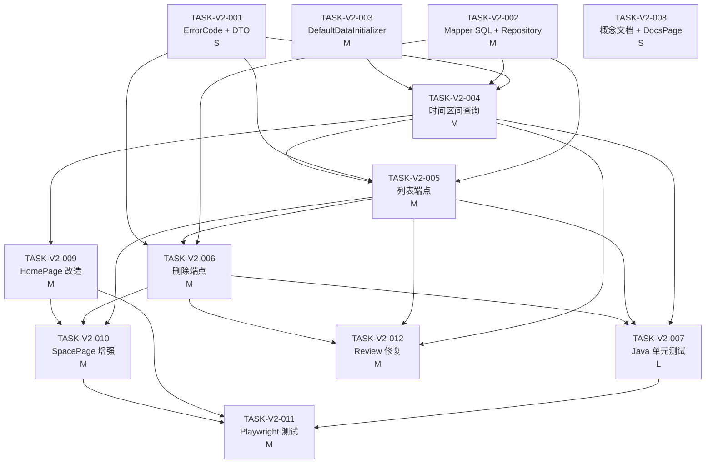

# Task Breakdown: big365-v2

> Feature: `big365-v2`  
> 标识符: `FR-BIG365-V2`  
> 状态: `tasked`  
> 来源计划: `.sddu/specs-tree-root/specs-tree-big365-v2/plan.md`  
> 创建日期: `2026-06-10`  
> 总任务数: 12 个  
> 执行波次: 5 个波次

---

## 任务汇总

| # | 任务 | 复杂度 | 波次 | 前置依赖 | 覆盖 FR | 主要产出 |
|---:|---|---:|---:|---|---|---|
| TASK-V2-001 | ErrorCode 新增 + DTO 新增 | S | 1 | 无 | M4 错误码, M3 DTO | ErrorCode.java(4 code) + 3 DTO 类 |
| TASK-V2-002 | SpaceMapper.xml SQL 扩展 + SpaceRepository 方法 | M | 1 | 无 | M3 列表SQL, M4 删除SQL | SpaceMapper.xml(5 SQL) + SpaceRepository.java(4 method) |
| TASK-V2-003 | DefaultDataInitializer 预置数据初始化 | M | 1 | 无（复用现有 BizService/DemoDataGenerator） | M1 全部 | DefaultDataInitializer.java |
| TASK-V2-004 | 时间区间查询实现 | M | 2 | TASK-V2-001, TASK-V2-002 | M2 全部 | queryRange() + Controller 扩展 |
| TASK-V2-005 | 列表端点实现 | M | 2 | TASK-V2-004 | M3 全部 | listCells() + Controller.list() ✅ |
| TASK-V2-006 | 删除端点实现 | M | 2 | TASK-V2-005 | M4 全部 | deleteCell() + Controller.delete() |
| TASK-V2-007 | Java 单元测试 | L | 3 | TASK-V2-004, TASK-V2-005, TASK-V2-006 | M5 全部 | 3 个 JUnit 5 测试类 |
| TASK-V2-008 | 概念模型文档 + DocsPage 更新 | S | 3 | 无 | S2 全部 + S6 链接修复 | why-space-model.md + DocsPage.tsx ✅ |
| TASK-V2-009 | 前端 HomePage 预置数据直展改造 | M | 3 | TASK-V2-004 | M6 全部 | HomePage.tsx + space.ts + types.ts |
| TASK-V2-010 | 前端 SpacePage 增强 | M | 4 | TASK-V2-005, TASK-V2-006, TASK-V2-009 | S3 可视化 + 列表/删除前端交互 | SpacePage.tsx + DateRangePicker.tsx |
| TASK-V2-011 | Playwright 测试补充 ✅ | M | 5 | TASK-V2-009, TASK-V2-010 | S1 全部 | test_home.py + test_space.py 新增用例 |
| TASK-V2-012 | Review 残留项修复 | M | 5 | TASK-V2-004, TASK-V2-005, TASK-V2-006 | S5 并发控制 | 维度唯一约束 DDL + 乐观锁 |

---

## Wave 1 — 后端基础设施（无依赖，可并行）

3 个任务完全独立，可同时开工。

### TASK-V2-001: ErrorCode 新增 + DTO 新增

**复杂度**: S  
**前置依赖**: 无  
**执行波次**: 1  

#### 描述
在现有 `ErrorCode.java` 枚举中新增 4 个 V2 错误码，并为列表和删除端点创建 3 个新的 DTO 类。DTOS 放在现有的 `space/dto/` 目录下，遵循 Lombok `@Builder` + `@Data` 风格。

新增错误码：
- `FORBIDDEN_DELETE_ALL_ROW` — 禁止删除 ALL 汇总行
- `DATE_RANGE_INVALID` — 日期范围无效（from > to 或格式错误）
- `DATE_RANGE_TOO_LARGE` — 日期范围超过软限制（warning 级别）
- 复用已有 `SPACE_CELL_NOT_FOUND`（跨日期范围查询中某坐标无数据时使用）

新增 DTO：
- `SpaceListResponse` — 列表响应，含 `list`（`SpaceCellDto[]`）、`total`、`pageNo`、`pageSize`、`totalPages`
- `DeleteSpaceRequest` — 删除请求，含 `coordinates`（`Map<String, Integer>`）和可选 `date`（`String`）
- `DeleteSpaceResponse` — 删除响应，含 `deletedRows`、`coordinates`、`date`

#### 涉及文件
- [MODIFY] `big365-api/src/main/java/org/big365/api/common/ErrorCode.java`
- [NEW] `big365-api/src/main/java/org/big365/api/space/dto/SpaceListResponse.java`
- [NEW] `big365-api/src/main/java/org/big365/api/space/dto/DeleteSpaceRequest.java`
- [NEW] `big365-api/src/main/java/org/big365/api/space/dto/DeleteSpaceResponse.java`

#### 验收标准
- [x] `ErrorCode.java` 包含 `FORBIDDEN_DELETE_ALL_ROW("FORBIDDEN_DELETE_ALL_ROW", "不能删除 ALL 汇总行。ALL 汇总行由 Space 模型自动管理。")`
- [x] `ErrorCode.java` 包含 `DATE_RANGE_INVALID("DATE_RANGE_INVALID", "日期范围无效：开始日期不能晚于结束日期")`
- [x] `ErrorCode.java` 包含 `DATE_RANGE_TOO_LARGE("DATE_RANGE_TOO_LARGE", "日期范围超过 365 天限制，查询可能较慢")`
- [x] `SpaceListResponse` 包含 `List<SpaceCellDto> list`, `long total`, `int pageNo`, `int pageSize`, `int totalPages` 字段
- [x] `DeleteSpaceRequest` 包含 `Map<String, Integer> coordinates` 和可选 `String date` 字段
- [x] `DeleteSpaceResponse` 包含 `int deletedRows`, `Map<String, Integer> coordinates`, `String date` 字段
- [x] 所有 DTO 使用 `@Data` `@Builder` `@NoArgsConstructor` `@AllArgsConstructor` 注解
- [x] `mvn compile -pl big365-api` 通过

#### FR 关联
FR-V2-033（FORBIDDEN_DELETE_ALL_ROW）、FR-V2-012（DATE_RANGE_INVALID）、FR-V2-013（DATE_RANGE_TOO_LARGE）、FR-V2-024（分页元数据）、FR-V2-030（删除请求/响应）

#### 验证命令
```bash
cd big365-api && mvn compile -q && echo "OK: compilation successful"
```

---

### TASK-V2-002: SpaceMapper.xml SQL 扩展 + SpaceRepository 方法

**复杂度**: M  
**前置依赖**: 无  
**执行波次**: 1  

#### 描述
在现有 `SpaceMapper.xml` 中新增 5 条 MyBatis SQL 语句，并在 `SpaceRepository.java` 中新增对应 Java 方法封装。本任务不修改 Controller 或 Service 层，仅提供底层数据访问能力。

新增 SQL 语句（`SpaceMapper.xml` 新增 `<select>`/`<update>`/`<delete>` 块）：
1. **listSpaceCells** — 动态查询列表，支持排除 ALL 行（`WHERE a!=0 AND b!=0...`）、维度过滤、分页（`LIMIT/OFFSET`）、日期倒序
2. **countSpaceCells** — COUNT(*) 配合相同 WHERE 条件，返回总数
3. **zeroOutColumn** — `UPDATE SET \`${dateColumn}\` = 0 WHERE` 坐标匹配，将指定日期列值归零
4. **deleteRow** — `DELETE FROM WHERE` 所有坐标列匹配，删除整行
5. **isAllColumnsZero** — 检查给定坐标组合的所有日期列是否都为 0（用于孤儿清理判断）

新增 Repository 方法：
- `listCells(bizName, coordColumns, dimFilters, pageNo, pageSize)` → 返回分页结果 + 总数
- `zeroOutColumn(bizName, coordinates, date)` → 将指定日期列归零
- `deleteRow(bizName, coordinates)` → 删除整行
- `isAllColumnsZero(bizName, coordinates)` → 返回 boolean

#### 涉及文件
- [MODIFY] `big365-api/src/main/resources/mapper/SpaceMapper.xml`
- [MODIFY] `big365-api/src/main/java/org/big365/api/space/SpaceRepository.java`

#### 验收标准
- [x] `listSpaceCells` SQL 使用 `<where>` + `<foreach>` 动态拼接排除 ALL 行条件（每个坐标列 `!= 0`）
- [x] `listSpaceCells` SQL 支持可选维度过滤（`<if test="dimFilters != null">`）
- [x] `listSpaceCells` SQL 按日期列 `DESC` 排序，支持 `LIMIT #{limit} OFFSET #{offset}`
- [x] `countSpaceCells` SQL 返回相同过滤条件下的总行数
- [x] `zeroOutColumn` SQL 使用 `UPDATE SET \`${dateColumn}\` = 0 WHERE` 精确匹配坐标条件
- [x] `deleteRow` SQL 使用 `DELETE FROM WHERE` 所有坐标列精确匹配
- [x] `isAllColumnsZero` SQL 动态遍历所有日期列，返回是否全部为 0
- [x] `SpaceRepository.listCells()` 返回包含 `list` 和 `total` 的结构化结果
- [x] `mvn compile -pl big365-api` 通过（SQL XML 语法正确）

#### FR 关联
FR-V2-025（排除 ALL 行）、FR-V2-021~023（分页 + 维度过滤 + 日期倒序）、FR-V2-031（硬删除 SQL）、FR-V2-032（级联删除 SQL）

#### 验证命令
```bash
cd big365-api && mvn compile -q && echo "OK: compilation successful"
# Mapper XML 语法正确即可通过编译；运行时验证在 TASK-V2-005/006 中完成
```

---

### TASK-V2-003: DefaultDataInitializer 预置数据初始化 ✅

**复杂度**: M  
**前置依赖**: 无（复用现有 `BizService`、`BizRepository`、`DemoDataGenerator`、`SpaceService`）  
**执行波次**: 1  
**状态**: ✅ completed  

#### 描述
创建 `DefaultDataInitializer` 作为独立的 `@Component` 类，实现 `CommandLineRunner`，使用 `@Order(1)` 确保在现有建表 Runner（默认 Order 0）之后执行。启动时同步检查 `demo_logs` 业务是否存在，若不存在则自动注册业务、创建表、生成 ~500 条预置数据并写入 space 表。初始化失败不阻止服务启动（降级 + 日志错误）。

预置数据规格：
- 业务名：`demo_logs`，标签：`日志分析示例`
- 5 个维度：`app`(1~3)、`endpoint`(1~5)、`statusCode`(200/404/500)、`env`(1~2)、`region`(1~3)
- 日期范围：当前日期倒推 30 天（`LocalDate.now().minusDays(30)` → `LocalDate.now()`）
- 数据量：~500 条
- 生成方式：同步调用 `DemoDataGenerator.generateBatch()` + 遍历 Vector 通过 `SpaceService.write()` 写入

关键设计要点：
- 使用 `@Order(1)` 确保在 `initDatabase()` Runner 之后执行
- 幂等检查：`bizRepository.bizExists("demo_logs")` → 已存在则跳过
- 降级策略：try-catch 包裹全部逻辑，异常仅 log.error，不 throw

#### 涉及文件
- [NEW] `big365-api/src/main/java/org/big365/api/demo/DefaultDataInitializer.java`

#### 验收标准
- [x] `DefaultDataInitializer` 实现 `CommandLineRunner`，注解 `@Component`、`@Order(1)`、`@Slf4j`、`@RequiredArgsConstructor`
- [x] `run()` 方法内：检查 `demo_logs` 是否存在 → 不存在则注册业务 + 生成 500 条数据 + 写入 space
- [x] 注册 `demo_logs` 使用 `BizService.register()`（事务性创建表+注册+维度定义）
- [x] 维度定义：`app`(1,3)、`endpoint`(1,5)、`statusCode`(200,500)、`env`(1,2)、`region`(1,3)
- [x] 日期范围 30 天，使用 `LocalDate.now()` 动态计算
- [x] 幂等：`bizRepository.bizExists("demo_logs")` 返回 true 时跳过全部逻辑
- [x] 异常处理：try-catch 全部逻辑，`log.error("Default data initialization failed: {}", e.getMessage(), e)`
- [x] 不影响自定义业务：用户仍可注册 `my_biz` 并正常 CRUD（初始化仅针对 demo_logs，不影响其他业务）

#### FR 关联
FR-V2-001（自动创建 demo_logs）、FR-V2-002（5 维度预置）、FR-V2-003（~500 条数据）、FR-V2-004（幂等初始化）、FR-V2-005（同步 + 降级）、FR-V2-006（不影响自定义业务）

#### 验证命令
```bash
cd big365-api && mvn compile -q && echo "OK: compilation successful"
# 运行时验证：Compose 首次启动后
# curl http://localhost:8080/api/biz/list | jq '.data.items[] | select(.bizName=="demo_logs")'
# curl "http://localhost:8080/api/demo_logs/space/query?app=0&endpoint=0&statusCode=0&env=0&region=0&date=$(date +%Y%m%d)"
```

---

## Wave 2 — 后端核心逻辑（依赖 Wave 1，顺序执行）

3 个任务均修改 `SpaceService.java` 和 `SpaceController.java`，必须按顺序执行以避免合并冲突。

### TASK-V2-004: 时间区间查询实现 ✅

**复杂度**: M  
**前置依赖**: TASK-V2-001（ErrorCode）、TASK-V2-002（SpaceRepository.queryCell 已可用）  
**执行波次**: 2  
**状态**: ✅ completed  

#### 描述
在 `SpaceService` 中新增 `queryRange()` 方法，实现应用层遍历日期列 + 内存 SUM 聚合策略。同时扩展 `SpaceController.query()` 方法以解析 `dateFrom`/`dateTo` 参数，将区间查询委托给 `queryRange()`，并保持对现有单日查询的向后兼容。

`queryRange()` 实现思路：
1. 校验 `dateFrom ≤ dateTo`（否则抛出 `DATE_RANGE_INVALID`）
2. 生成日期列表：从 `dateFrom` 到 `dateTo`（`yyyyMMdd` 格式）
3. 软限制：超过 365 天设置 warning 但不拒绝
4. 逐日调用 `spaceRepository.queryCell()` 查询相同坐标组合
5. 内存累加 SUM
6. 返回 `SpaceQueryResponse`，含 `scannedDates`、`aggregationMethod=SUM`、`warning`（如有）

`SpaceQueryResponse` 扩展字段：
- `dateFrom`、`dateTo`（当区间查询时回填）
- `scannedDates`（实际遍历的日期列数）
- `aggregationMethod`（固定 `"SUM"`）
- `warning`（超出 365 天时的提示）

`SpaceController.query()` 扩展：
- 从 `allParams` 中提取 `dateFrom`、`dateTo`
- 两者都存在 → 调用 `queryRange()`
- 仅 `dateFrom` → 视为单日查询（等价于 `date`）
- 都不存在 → 保持现有 `date` 参数行为

#### 涉及文件
- [MODIFY] `big365-api/src/main/java/org/big365/api/space/SpaceService.java`
- [MODIFY] `big365-api/src/main/java/org/big365/api/space/SpaceController.java`
- [MODIFY] `big365-api/src/main/java/org/big365/api/space/dto/SpaceQueryResponse.java`

#### 验收标准
- [x] `SpaceService.queryRange(biz, coords, dateFrom, dateTo)` 方法存在
- [x] 日期格式校验：`dateFrom`/`dateTo` 必须为 8 位 `yyyyMMdd`
- [x] `dateFrom > dateTo` → 抛出 `BusinessException(ErrorCode.DATE_RANGE_INVALID)`
- [x] 超过 365 天 → `warning` 字段填充提示，不拒绝请求
- [x] 遍历期间每日调用 `spaceRepository.queryCell()`，空值视为 0
- [x] 返回 `scannedDates` = 实际遍历天数，`aggregationMethod` = `"SUM"`
- [x] `SpaceController.query()` 正确解析 `dateFrom`/`dateTo` 参数
- [x] 向后兼容：无 `dateFrom`/`dateTo` 时行为与 MVP 一致
- [x] 仅 `dateFrom` 无 `dateTo` → 等同于单日 `date` 参数查询
- [x] `SpaceQueryResponse` 新增字段 `dateFrom`、`dateTo`、`scannedDates`、`aggregationMethod`、`warning`（均对单日查询为 null 或默认值）

#### FR 关联
FR-V2-010（dateFrom/dateTo 区间查询）、FR-V2-011（dateFrom 单日等价）、FR-V2-012（dateFrom ≤ dateTo 校验）、FR-V2-013（365 天 warning）、FR-V2-014（SUM + scannedDates 元数据）、FR-V2-015（维度过滤 + 区间联动）

#### 验证命令
```bash
# 编译验证
cd big365-api && mvn compile -q && echo "OK: compilation"

# 运行时验证（需要 demo_logs 已初始化）
# 30 天区间查询
# curl -s "http://localhost:8080/api/demo_logs/space/query?app=1&endpoint=0&statusCode=0&env=0&region=0&dateFrom=$(date -d '30 days ago' +%Y%m%d)&dateTo=$(date +%Y%m%d)" | python3 -c "
# import sys,json; d=json.load(sys.stdin)
# assert d['success']==True
# assert 'scannedDates' in d['data']
# assert d['data']['aggregationMethod']=='SUM'
# print('OK: queryRange works, scannedDates=' + str(d['data']['scannedDates']))
# "

# 反向日期校验
# curl -s "http://localhost:8080/api/demo_logs/space/query?app=0&endpoint=0&statusCode=0&env=0&region=0&dateFrom=20260610&dateTo=20260601" | python3 -c "
# import sys,json; d=json.load(sys.stdin)
# assert d['success']==False and d['code']=='DATE_RANGE_INVALID'
# print('OK: invalid date range rejected')
# "
```

---

### TASK-V2-005: 列表端点实现 ✅

**复杂度**: M  
**前置依赖**: TASK-V2-004（依赖 SpaceService/Controller 已有 V2 结构）、TASK-V2-001（DTO 就绪）、TASK-V2-002（Mapper SQL 就绪）  
**执行波次**: 2  
**状态**: ✅ completed  

#### 描述
在 `SpaceService` 中新增 `listCells()` 方法，在 `SpaceController` 中新增 `list()` 端点 `GET /api/{biz}/space/list`。列表查询从 space 表中获取原始坐标级别数据（排除 ALL 汇总行），支持分页和维度过滤。

`SpaceService.listCells()` 实现：
1. 校验 biz 存在
2. 获取该业务的维度定义（坐标列列表）
3. 解析维度过滤参数（`key:value` 逗号分隔格式 → `Map<String, Integer>`）
4. 过滤值解析失败或维度名不存在 → `VALIDATION_ERROR`
5. 调用 `spaceRepository.listCells(bizName, coordColumns, dimFilters, pageNo, pageSize)`
6. 将结果映射为 `SpaceListResponse`

`SpaceController.list()` 端点：
- `GET /api/{biz}/space/list?pageNo=1&pageSize=20&dimensions=app:1,statusCode:200`
- pageNo 默认 1，pageSize 默认 20，最大 200
- 参数校验：pageNo < 1 或 pageSize > 200 → `VALIDATION_ERROR`

排除 ALL 行的逻辑已由 TASK-V2-002 的 Mapper SQL 实现（`WHERE a!=0 AND b!=0...`）。

#### 涉及文件
- [MODIFY] `big365-api/src/main/java/org/big365/api/space/SpaceService.java`
- [MODIFY] `big365-api/src/main/java/org/big365/api/space/SpaceController.java`

#### 验收标准
- [x] `GET /api/{biz}/space/list` 返回分页列表（含 `list`、`total`、`pageNo`、`pageSize`、`totalPages`）
- [x] `pageNo` 默认 1，`pageSize` 默认 20
- [x] `pageSize` 超过 200 返回 `VALIDATION_ERROR`
- [x] 不传 `dimensions` → 返回所有原始坐标数据（排除 ALL 行）
- [x] 传 `dimensions=app:1,env:1` → 仅返回匹配记录
- [x] 结果按日期倒序排列
- [x] 列表不包含 ALL 汇总行（任意坐标值为 0 的行）
- [x] 无匹配结果时返回空列表 `total=0`，不报错
- [x] biz 不存在 → `BIZ_NOT_FOUND`

#### FR 关联
FR-V2-020（GET 列表端点）、FR-V2-021（pageNo/pageSize 分页）、FR-V2-022（dimensions 过滤）、FR-V2-023（日期倒序）、FR-V2-024（分页元数据）、FR-V2-025（排除 ALL 行）

#### 验证命令
```bash
# 编译验证
cd big365-api && mvn compile -q && echo "OK: compilation"

# 运行时验证（需要 demo_logs 已初始化并有数据）
# curl -s "http://localhost:8080/api/demo_logs/space/list?pageNo=1&pageSize=10" | python3 -c "
# import sys,json; d=json.load(sys.stdin)
# assert d['success']==True
# assert 'list' in d['data']
# assert d['data']['pageSize'] <= 10
# # 验证无 ALL 行（任意坐标不为 0）
# for row in d['data']['list']:
#     coords = row.get('coordinates', {})
#     assert all(v != 0 for v in coords.values()), f'ALL row found: {coords}'
# print('OK: list endpoint working, rows=' + str(len(d['data']['list'])))
# "
```

---

### TASK-V2-006: 删除端点实现 ✅

**复杂度**: M  
**前置依赖**: TASK-V2-005（依赖 SpaceService/Controller 已有 V2 结构）、TASK-V2-001（DTO + ErrorCode 就绪）、TASK-V2-002（Mapper SQL 就绪）  
**执行波次**: 2  
**状态**: ✅ completed  

#### 描述
在 `SpaceService` 中新增 `deleteCell()` 方法，在 `SpaceController` 中新增 `delete()` 端点 `DELETE /api/{biz}/space/delete`。实现硬删除策略：指定 date → 将该日期列值归零；未指定 date → 删除整行。删除后自动检查并清理孤儿坐标组合行。

`SpaceService.deleteCell()` 实现：
1. 校验 biz 存在
2. 禁止删除 ALL 行：`coordinates.values().stream().anyMatch(v -> v == 0)` → `FORBIDDEN_DELETE_ALL_ROW`
3. 校验 coordinates 的维度名与业务维度表一致
4. 坐标存在性检查（在 space 表中定位）
5. 若指定 date → `spaceRepository.zeroOutColumn()` 将该日期列归零 → 检查是否所有日期列都为 0 → 是则删除整行（孤儿清理）
6. 若未指定 date → `spaceRepository.deleteRow()` 删除整行
7. 返回 `DeleteSpaceResponse`（含 deletedRows、coordinates、date）

`SpaceController.delete()` 端点：
- `DELETE /api/{biz}/space/delete`
- 请求体：`DeleteSpaceRequest`（coordinates + 可选 date）
- 参数校验：coordinates 不能为空

#### 涉及文件
- [MODIFY] `big365-api/src/main/java/org/big365/api/space/SpaceService.java`
- [MODIFY] `big365-api/src/main/java/org/big365/api/space/SpaceController.java`

#### 验收标准
- [x] `DELETE /api/{biz}/space/delete` 接受 coordinates + 可选 date
- [x] 删除 ALL 行（任意维度=0）→ 返回 `FORBIDDEN_DELETE_ALL_ROW`
- [x] 指定 date 删除 → 该日期列归零，其他日期列不变
- [x] 未指定 date 删除 → 整行被删除
- [x] 删除后所有日期列为 0 → 坐标组合行被清理（孤儿清理）
- [x] 删除不存在的坐标 → `SPACE_CELL_NOT_FOUND`
- [x] biz 不存在 → `BIZ_NOT_FOUND`
- [x] 成功删除 → 返回 `deletedRows` 和坐标/日期信息
- [x] 删除后查询该坐标返回空或零值

#### FR 关联
FR-V2-030（DELETE 端点）、FR-V2-031（硬删除）、FR-V2-032（级联删除所有日期）、FR-V2-033（禁止删除 ALL 行）、FR-V2-034（不存在 NOT_FOUND）、FR-V2-035（biz 不存在 404）

#### 验证命令
```bash
# 编译验证
cd big365-api && mvn compile -q && echo "OK: compilation"

# 运行时验证
# 1. 尝试删除 ALL 行 → 应被拒绝
# curl -s -X DELETE http://localhost:8080/api/demo_logs/space/delete \
#   -H 'Content-Type: application/json' \
#   -d '{"coordinates":{"app":0,"endpoint":1,"statusCode":200,"env":1,"region":2}}' | python3 -c "
# import sys,json; d=json.load(sys.stdin)
# assert d['code']=='FORBIDDEN_DELETE_ALL_ROW'
# print('OK: ALL row deletion blocked')
# "

# 2. 删除不存在坐标 → NOT_FOUND
# curl -s -X DELETE http://localhost:8080/api/nonexistent/space/delete \
#   -H 'Content-Type: application/json' \
#   -d '{"coordinates":{"app":1,"endpoint":1}}' | python3 -c "
# import sys,json; d=json.load(sys.stdin)
# assert d['success']==False
# print('OK: nonexistent biz rejected')
# "
```

---

## Wave 3 — 测试 + 文档 + 首页（依赖 Wave 2，可并行）

3 个任务依赖关系不同但可并行推进：TASK-V2-007 依赖 Wave 2 全部完成，TASK-V2-008 无代码依赖，TASK-V2-009 依赖 TASK-V2-004（queryRange）。

### TASK-V2-007: Java 单元测试 ✅

**复杂度**: L  
**前置依赖**: TASK-V2-004, TASK-V2-005, TASK-V2-006  
**执行波次**: 3  
**状态**: ✅ completed  

#### 描述
为 3 个核心服务类编写 JUnit 5 + Mockito 单元测试，覆盖核心算法逻辑。Mock MyBatis Mapper 层（使用 `@Mock`），不依赖数据库。测试放在 `big365-api/src/test/java/org/big365/api/` 下。

测试类清单：
1. **SpaceServiceTest** (≥8 用例)：`generateCoordinateCombinations()` 笛卡尔积算法（2/3/5 维度 + 0 维度边界）、`queryRange()` 区间查询聚合（7 天 SUM 正确性）、`deleteCell()` 逻辑（ALL 行拒绝 + 单日删除 + 整行删除）
2. **DimensionServiceTest** (≥6 用例)：创建维度、重复编码校验、更新维度、禁用维度、非法参数校验
3. **DemoDataGeneratorTest** (≥5 用例)：`createParameters()` 参数生成、`generateBatch()` 批量生成（数量验证 + 数据分布合理性 + 边界参数处理）

Mock 策略：
- `SpaceRepository`、`BizRepository`、`DemoJobMapper` 使用 `@Mock`
- `SpaceService`、`DimensionService`、`DemoDataGenerator` 使用 `@InjectMocks`
- 使用 `@ExtendWith(MockitoExtension.class)`

#### 涉及文件
- [NEW] `big365-api/src/test/java/org/big365/api/space/SpaceServiceTest.java`
- [NEW] `big365-api/src/test/java/org/big365/api/dimension/DimensionServiceTest.java`
- [NEW] `big365-api/src/test/java/org/big365/api/demo/DemoDataGeneratorTest.java`

#### 验收标准
- [x] `SpaceServiceTest` 包含 `generateCoordinateCombinations_2dim_returns4()`、`_5dim_returns32()`、`_0dim_returns1()` 用例
- [x] `SpaceServiceTest` 包含 `queryRange_7days_sumsCorrectly()` — Mock queryCell 逐日返回不同值，验证 SUM
- [x] `SpaceServiceTest` 包含 `deleteCell_allRow_forbidden()`、`deleteCell_withDate_zeroesColumn()`、`deleteCell_withoutDate_deletesRow()` 用例
- [x] `DimensionServiceTest` 覆盖 CRUD 正常路径 + 异常路径（重复编码、不存在 ID）
- [x] `DemoDataGeneratorTest` 覆盖 `generateBatch_500_returnsCorrectCount()`、`createParameters_small_scale()`
- [x] `mvn test -pl big365-api` 全部通过，≥3 个测试类（3 测试类，52 用例）
- [x] 测试不依赖数据库（Mock Mapper 层）

#### FR 关联
FR-V2-040（SpaceService 笛卡尔积测试）、FR-V2-041（DimensionService CRUD 测试）、FR-V2-042（DemoDataGenerator 测试）、FR-V2-043（JUnit 5 + Mockito）、FR-V2-044（独立于集成测试）

#### 验证命令
```bash
cd big365-api && mvn test -q && echo "OK: all JUnit tests passed"
cd big365-api && mvn test -pl big365-api 2>&1 | grep -E "Tests run:" && echo "OK: test summary shown"
```

---

### TASK-V2-008: 概念模型文档 + DocsPage 更新 ✅

**复杂度**: S  
**前置依赖**: 无（纯文档任务，不依赖代码）  
**执行波次**: 3  
**状态**: ✅ completed  

#### 描述
编写 `docs/why-space-model.md` 深度文档，解释 Space 预计算模型的设计动机。同时更新 `docs/concepts.md` 添加交叉引用，并更新前端 `DocsPage.tsx` 添加"为什么不是普通表"文档卡片，同时修复文档链接以 `target="_blank"` 新窗口打开。

`why-space-model.md` 章节结构（参考 Spec FR-V2-070）：
1. 普通表的困境（为什么传统 CRUD 表做多维分析会"膨胀"）
2. Space 预计算模型的解决思路（预计算 + 0=ALL 哨兵 + 零聚合 O(1) 查询）
3. 具体示例对比（3 维度的普通表 vs Space 模型的行数/查询复杂度）
4. Space 模型的代价（写放大、存储膨胀）和适用场景

#### 涉及文件
- [NEW] `big365-web/public/docs/why-space-model.md`
- [MODIFY] `big365-web/public/docs/concepts.md`
- [MODIFY] `big365-web/src/pages/DocsPage.tsx`

#### 验收标准
- [x] `big365-web/public/docs/why-space-model.md` 存在，长度 998 词 / ~11KB (~6,000 字)，包含 4 个必需章节
- [x] `docs/concepts.md` 添加指向 `why-space-model.md` 的交叉引用段落（"为什么选择 Space 模型？"章节）
- [x] DocsPage 文档卡片列表新增"为什么不是普通表"卡片，链接到 `why-space-model.md`
- [x] 新卡片与其他卡片样式一致（相同 grid 布局 + inline style）
- [x] 所有文档卡片的 `<a>` 链接使用 `target="_blank"` 在新窗口打开
- [x] Swagger UI 链接保持 `target="_blank"` 单独处理

#### FR 关联
FR-V2-070（why-space-model.md 4 章节）、FR-V2-071（concepts.md 交叉引用）、FR-V2-072（DocsPage 新卡片）、FR-V2-082（文档链接 target=_blank）

#### 验证命令
```bash
# 验证文档文件
test -f docs/why-space-model.md && echo "OK: why-space-model.md exists"
wc -w docs/why-space-model.md | awk '{if ($1>=500) print "OK: doc >= 500 chars"; else print "WARN: doc too short"}'
grep -q "why-space-model" docs/concepts.md && echo "OK: concepts.md cross-reference"

# 前端编译
cd big365-web && npx tsc --noEmit && echo "OK: type check"
```

---

### TASK-V2-009: 前端 HomePage 预置数据直展改造 ✅

**复杂度**: M  
**前置依赖**: TASK-V2-004（需要 queryRange 端点可用）  
**执行波次**: 3  
**状态**: ✅ completed  

#### 描述
改造 `HomePage.tsx`，在加载时自动检测 `demo_logs` 业务是否存在且有数据。若存在，使用 V2 时间区间查询获取最近 7 天各 app（1/2/3）的汇总数据，并在首页渲染汇总表格替换/增强现有概念卡片区域。同时更新 `space.ts` API 方法以支持 `dateFrom`/`dateTo` 参数，扩展 `types.ts` 类型定义。

HomePage 状态机（参考 Plan §5.6）：
1. 加载中 → 尝试检测 demo_logs + 获取预置数据
2. demo_logs 存在且有数据 → 预置数据直展模式（汇总表 + 下钻入口）
3. demo_logs 不存在或查询失败 → 降级展示（概念卡片 + 健康检查，与 MVP 行为一致）

API 调用链：
1. 检查健康 `GET /api/health`
2. 检查 demo_logs 存在性 `GET /api/biz/list`
3. 若存在，对每个 app(1,2,3) 执行 `GET /api/demo_logs/space/query?app=X&endpoint=0&statusCode=0&env=0&region=0&dateFrom=7天前&dateTo=今天`
4. 构建汇总表数据

汇总表布局：最近 7 天 × 3 个 app 的请求量矩阵表格 + 汇总行 + "进入下钻分析"按钮（→ `/biz/demo_logs/space`）。

#### 涉及文件
- [MODIFY] `big365-web/src/pages/HomePage.tsx`
- [MODIFY] `big365-web/src/api/space.ts`
- [MODIFY] `big365-web/src/api/types.ts`

#### 验收标准
- [x] HomePage 加载时检测 `demo_logs` 是否存在（通过 `GET /api/biz/list`）
- [x] demo_logs 存在时，使用 `querySpace()` 携带 `dateFrom`/`dateTo` 参数调用区间查询
- [x] 首页展示最近 7 天各 app 请求量汇总表（表格式：日期 × app=1/app=2/app=3 + 汇总行）
- [x] 汇总表下方有"进入下钻分析"按钮，跳转 `/biz/demo_logs/space`
- [x] demo_logs 不存在时降级展示概念卡片 + 健康检查（保留现有 MVP 行为）
- [x] 加载失败时显示错误提示，不阻塞页面其余部分渲染
- [x] `space.ts` 新增 `querySpaceRange()` 方法或扩展现有 `querySpace()` 支持 `dateFrom`/`dateTo`
- [x] `types.ts` 新增 `SpaceListResponse`、`DemoSummaryData` 等 V2 类型
- [x] `npm run build` 通过，无 TypeScript 错误

#### FR 关联
FR-V2-050（HomePage 自动检测 demo_logs）、FR-V2-051（最近 7 天汇总 + 下钻入口）、FR-V2-052（无 demo_logs 降级展示）、FR-V2-053（loading/error 不阻塞渲染）、FR-V2-054（使用 V2 时间区间查询端点）

#### 验证命令
```bash
cd big365-web && npx tsc --noEmit && npm run build && echo "OK: build successful"
# 运行时验证：Compose 启动后 http://localhost:5173/ 首页应展示汇总表
```

---

## Wave 4 — 前端 SpacePage 增强（依赖 Wave 2+3）

### TASK-V2-010: 前端 SpacePage 增强 ✅

**复杂度**: M  
**前置依赖**: TASK-V2-005（列表端点可用）、TASK-V2-006（删除端点可用）、TASK-V2-009（types.ts/space.ts 已扩展）  
**执行波次**: 4  
**状态**: ✅ completed  

#### 描述
在 `SpacePage.tsx` 中增量添加 V2 新功能：时间区间查询 UI、列表视图 Tab、删除按钮交互、模型原理可视化 Accordion。同时创建 `DateRangePicker.tsx` 组件。

具体增强点：
1. **时间区间查询 UI**：在现有坐标查询区域增加 `DateRangePicker` 组件（from → to 日期选择器），替代单一日期输入
2. **列表视图 Tab**：添加 Tab 切换（查询 / 列表），列表模式调用 `listSpace()` API 渲染分页表格（含维度过滤输入框）
3. **删除按钮**：列表每行增加删除按钮，点击弹出确认弹窗，确认后调用 `deleteSpaceCell()` API
4. **模型原理 Accordion**：可折叠面板，展示当前业务的维度组合数（2^d）和简化示意图

`DateRangePicker` 组件：
- 两个日期输入框（from、to），格式 `yyyyMMdd`
- 快速选择按钮：最近 7 天、最近 30 天
- 校验 from ≤ to

#### 涉及文件
- [MODIFY] `big365-web/src/pages/SpacePage.tsx`
- [NEW] `big365-web/src/components/DateRangePicker.tsx`
- [MODIFY] `big365-web/src/api/space.ts`
- [MODIFY] `big365-web/src/api/types.ts`

#### 验收标准
- [x] SpacePage 查询区域新增 `DateRangePicker` 组件，支持 from/to 日期选择
- [x] DateRangePicker 包含"最近 7 天"、"最近 30 天"快捷按钮
- [x] SpacePage 新增 Tab 切换：查询模式 / 列表模式
- [x] 列表模式渲染分页表格，显示坐标、日期、指标值
- [x] 列表模式支持维度过滤（输入 `app:1,env:1` 格式）
- [x] 列表每行有删除按钮，点击弹出确认弹窗
- [x] 确认删除 → 调用 `deleteSpaceCell()` → 刷新列表
- [x] 模型原理 Accordion：展开显示"当前业务维度数: d → 坐标组合数: 2^d = N"
- [x] Accordion 包含简化图示（文字描述即可，不需要图表库）
- [x] `npm run build` 通过，无 TypeScript 错误

#### FR 关联
FR-V2-075（模型原理 Accordion）、FR-V2-076（动态 2^d 计算）；支持列表浏览、删除交互（M3/M4 前端集成）

#### 验证命令
```bash
cd big365-web && npx tsc --noEmit && npm run build && echo "OK: build successful"
```

---

## Wave 5 — 测试补充 + Review 修复（依赖 Wave 3+4，可并行）

### TASK-V2-011: Playwright 测试补充 ✅

**复杂度**: M  
**前置依赖**: TASK-V2-009, TASK-V2-010  
**执行波次**: 5  
**状态**: ✅ completed  

#### 描述
在现有 Python Playwright 测试套件中补充 V2 新功能的测试用例。遵循现有测试风格（pytest + playwright.sync_api），新增测试文件或在现有文件中追加用例。

测试补充：
- **`test_home.py`** 追加 ≥2 个用例：
  1. 验证首页加载后预置数据汇总表可见（`demo_logs` 存在时）
  2. 验证汇总表包含数据行（非空状态），下钻入口按钮可点击
- **`test_space.py`** 追加 ≥3 个用例：
  1. 时间区间查询交互：选择 from/to 日期并验证查询结果
  2. 列表页面交互：切换到列表 Tab，验证分页表格渲染和数据行存在
  3. 删除按钮交互：删除一条数据后验证列表不再显示该数据

#### 涉及文件
- [MODIFY] `big365-web/tests/test_home.py`
- [MODIFY] `big365-web/tests/test_space.py`

#### 验收标准
- [x] `test_home.py` 新增 ≥2 个测试用例，验证首页预置数据展示
- [x] `test_space.py` 新增 ≥3 个测试用例，覆盖时间区间查询、列表浏览、删除操作
- [x] 所有新增用例在 `demo_logs` 预置数据存在的前提下运行通过
- [x] 全量 Playwright 测试（现有 31 + 新增 ≥5）通过率 100%
- [x] `pytest big365-web/tests/ -v` 全部通过

#### FR 关联
FR-V2-060（test_home.py 补充）、FR-V2-061（test_space.py 补充）、FR-V2-062（全量回归通过）

#### 验证命令
```bash
cd big365-web/tests && pip install -r requirements.txt && playwright install chromium && pytest -v
```

---

### TASK-V2-012: Review 残留项修复 ✅

**复杂度**: M  
**前置依赖**: TASK-V2-004, TASK-V2-005, TASK-V2-006（需要维度/Space 层代码稳定）  
**执行波次**: 5  
**状态**: ✅ completed  

#### 描述
实现 MVP Review 阶段识别的数据库级约束和并发控制完善项。本任务包含 3 个子项：

1. **FR-V2-080 维度唯一约束 DDL**：在维度表创建 DDL 中确认/添加 `UNIQUE(biz_name, column_name)` 约束。当前 `BizRepository.buildDimensionsTableDDL()` 已有 `UNIQUE KEY uk_column_name (column_name)`，但跨业务的维度表是独立的（每业务一张表），不需要 biz_name 级别的复合约束。需确认现有约束已足够。

2. **FR-V2-081 乐观锁**：为 Space 数据表的更新/删除操作添加版本号校验。方案：
   - Space 表（`big365_swks_{biz}_space_t`）新增 `version` 列（`BIGINT NOT NULL DEFAULT 0`）
   - 写入时检查 version，匹配才执行 UPDATE
   - 删除时同样检查 version
   - 冲突时返回 `CONCURRENT_MODIFICATION` 错误

3. **回归验证**：确保上述变更不破坏现有功能。

#### 涉及文件
- [MODIFY] `big365-api/src/main/java/org/big365/api/biz/BizRepository.java`（确认唯一约束）
- [MODIFY] `big365-api/src/main/resources/mapper/SpaceMapper.xml`（UPDATE/DELETE 加 version 条件）
- [MODIFY] `big365-api/src/main/java/org/big365/api/space/SpaceRepository.java`（version 参数传递）
- [MODIFY] `big365-api/src/main/java/org/big365/api/space/SpaceService.java`（version 校验逻辑）
- [MODIFY] `big365-api/src/main/java/org/big365/api/common/ErrorCode.java`（新增 CONCURRENT_MODIFICATION）

#### 验收标准
- [x] 维度表的 `UNIQUE KEY uk_column_name (column_name)` 约束已确认存在且正常生效
- [x] Space 表 DDL 新增 `version BIGINT NOT NULL DEFAULT 0` 列
- [x] `writeCombination()` SQL 增加 `version` 列处理，`ON DUPLICATE KEY UPDATE` 后 `version = version + 1`
- [x] `zeroOutColumn()` 和 `deleteRow()` SQL 增加 `AND version = #{expectedVersion}` 条件
- [x] 并发写入同一坐标+日期时，至少一个请求收到 `CONCURRENT_MODIFICATION` 错误
- [x] `mvn test -pl big365-api` 通过（包括 TASK-V2-007 的测试）
- [x] 现有 MVP API 向后兼容（写入/查询不受影响）

#### FR 关联
FR-V2-080（维度唯一约束）、FR-V2-081（乐观锁）

#### 验证命令
```bash
cd big365-api && mvn compile -q && echo "OK: compilation"
cd big365-api && mvn test -q && echo "OK: tests pass"
# 运行时并发测试需要手动验证
```

---

## 依赖关系图



---

## 需求覆盖追踪

| 需求范围 | 覆盖任务 |
|---|---|
| M1 预置数据自动初始化 (FR-V2-001~006) | TASK-V2-003 |
| M2 时间区间查询 (FR-V2-010~015) | TASK-V2-004 |
| M3 通用列表/搜索 (FR-V2-020~025) | TASK-V2-001, TASK-V2-002, TASK-V2-005 |
| M4 Space Cell 删除 (FR-V2-030~035) | TASK-V2-001, TASK-V2-002, TASK-V2-006 |
| M5 Java 单元测试 (FR-V2-040~044) | TASK-V2-007 |
| M6 首页预置数据直展 (FR-V2-050~054) | TASK-V2-009 |
| S1 Playwright 测试 (FR-V2-060~062) | TASK-V2-011 |
| S2 概念模型文档 (FR-V2-070~072) | TASK-V2-008 |
| S3 Space 模型可视化 (FR-V2-075~076) | TASK-V2-010 |
| S5/S6 Review 残留 (FR-V2-080~082) | TASK-V2-008（链接修复）, TASK-V2-012（约束+锁） |

### NFR 覆盖

| NFR | 覆盖任务 | 验证方式 |
|---|---|---|
| NFR-V2-001 启动性能 | TASK-V2-003 | 记录 Compose 启动耗时 |
| NFR-V2-002 查询性能 | TASK-V2-004 | 区间查询响应耗时 |
| NFR-V2-003 列表性能 | TASK-V2-005 | 列表查询响应耗时 |
| NFR-V2-004 向后兼容 | TASK-V2-004, TASK-V2-005, TASK-V2-006 | 现有 Python 测试通过 |
| NFR-V2-005 统一响应格式 | TASK-V2-004, TASK-V2-005, TASK-V2-006 | 响应结构验证 |
| NFR-V2-006 输入安全 | TASK-V2-006 | 删除端点参数校验 |
| NFR-V2-007 可测试性 | TASK-V2-007, TASK-V2-011 | 自动化测试通过 |
| NFR-V2-008 文档一致性 | TASK-V2-008 | Review 阶段检查 |
| NFR-V2-009 幂等性 | TASK-V2-003 | 多次 Compose 重启验证 |
| NFR-V2-010 可观测性 | TASK-V2-003, TASK-V2-004, TASK-V2-006 | 日志输出覆盖 |

---

## 实施建议

1. **Wave 1 并行推进**：3 个后端基础设施任务完全独立，可由 3 个开发者同时开工，预计 1 天内完成。
2. **Wave 2 顺序执行**：3 个任务修改同一组文件（`SpaceService.java`、`SpaceController.java`），建议同一开发者按顺序完成，每个任务约 0.5-1 小时。
3. **Wave 3 三线并行**：Java 测试、文档、首页改造互不阻塞——即使首页改造依赖 questRange 端点，该端点在 Wave 2 第一个任务完成后即就绪。
4. **测试优先验证**：TASK-V2-007（Java 测试）完成后立即运行 `mvn test`，确保核心算法无回归。
5. **Should Have 不阻塞主流程**：TASK-V2-011（Playwright）和 TASK-V2-012（Review 修复）为 Should Have 优先级，可在 Must Have 完成后异步推进。

---

## 变更记录

| 日期 | 作者 | 变更 |
|---|---|---|
| 2026-06-10 | usb | 初始创建，12 个任务，5 个波次 |
