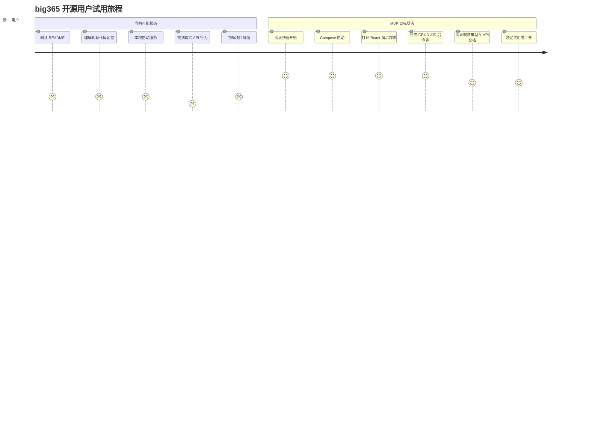
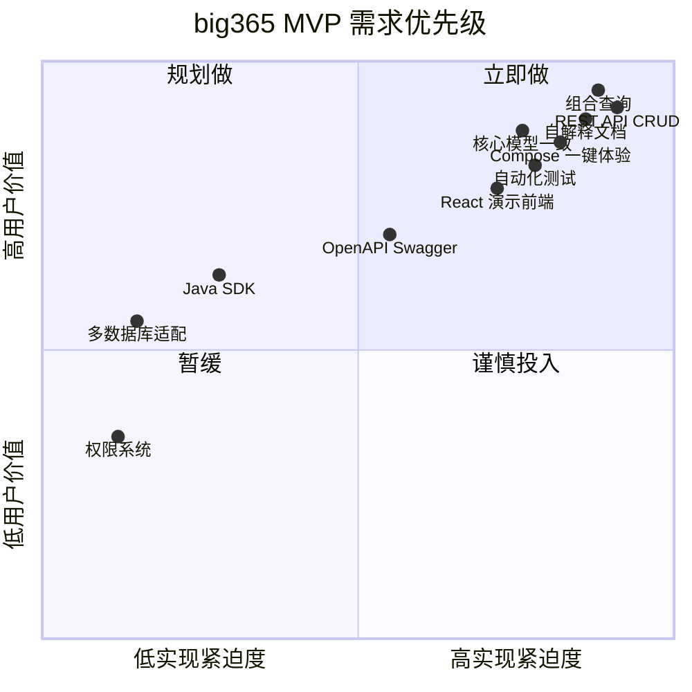
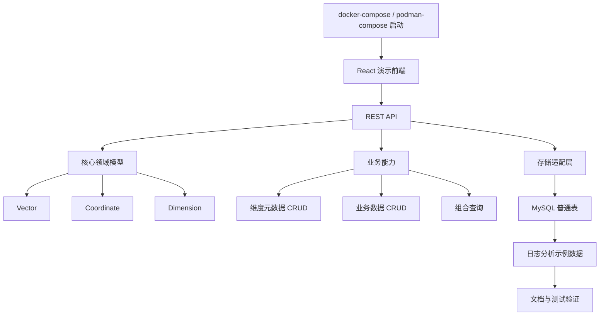
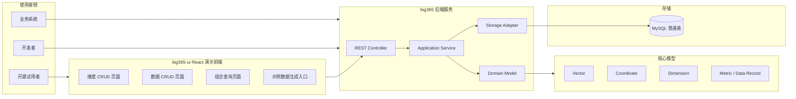
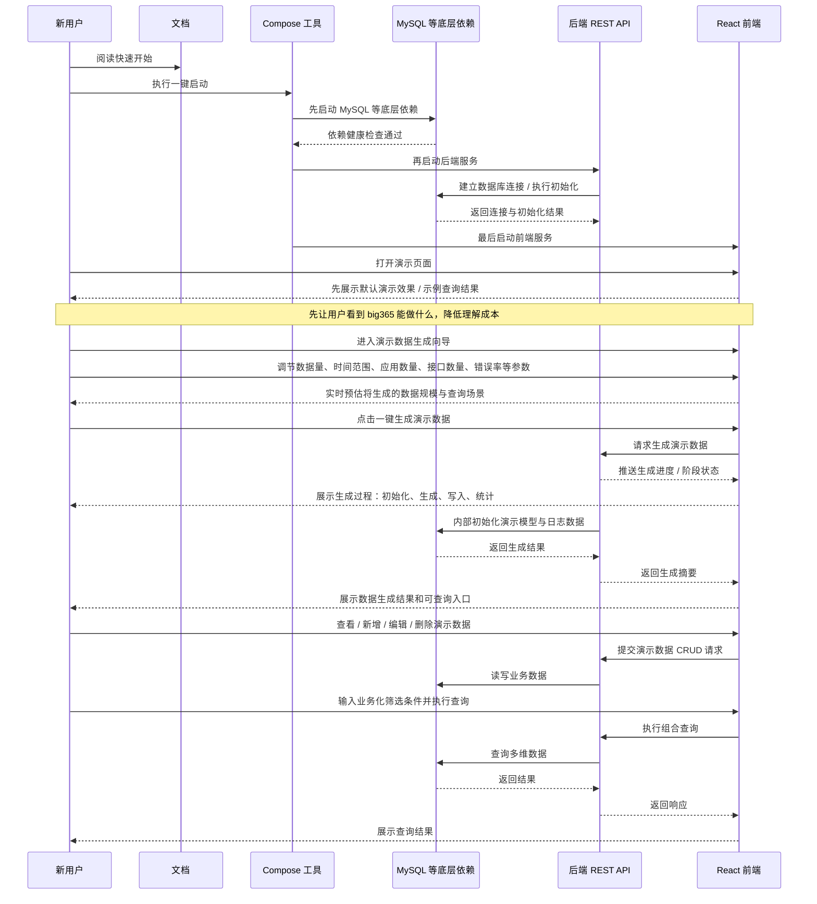
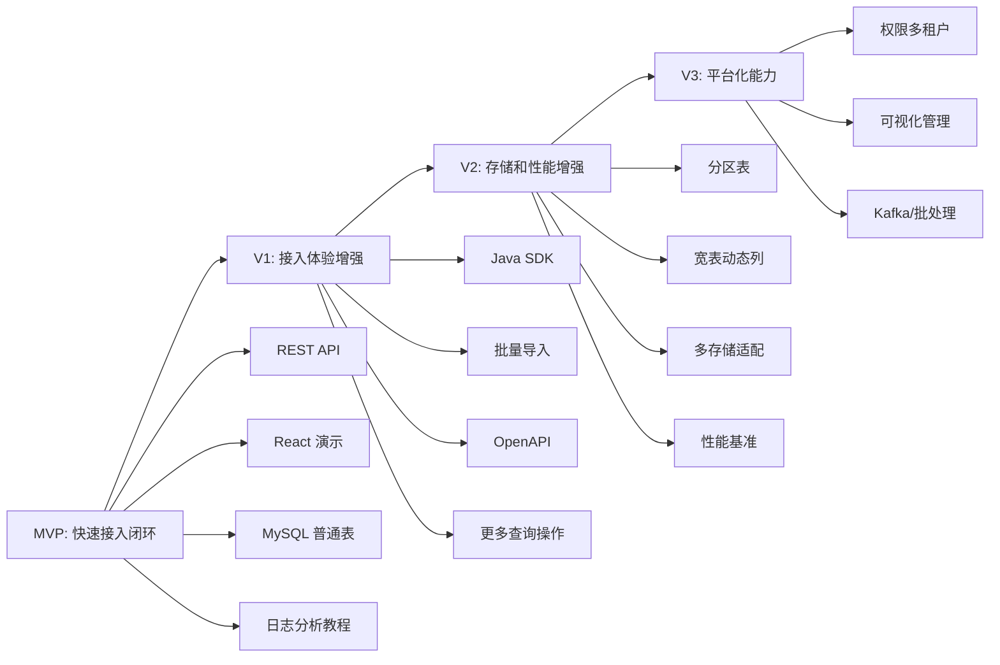
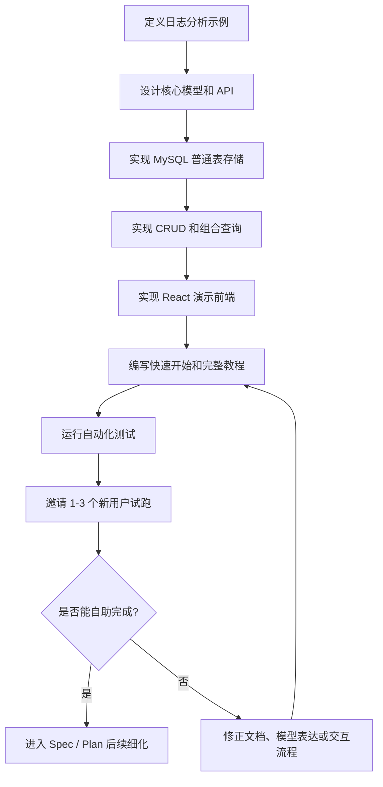
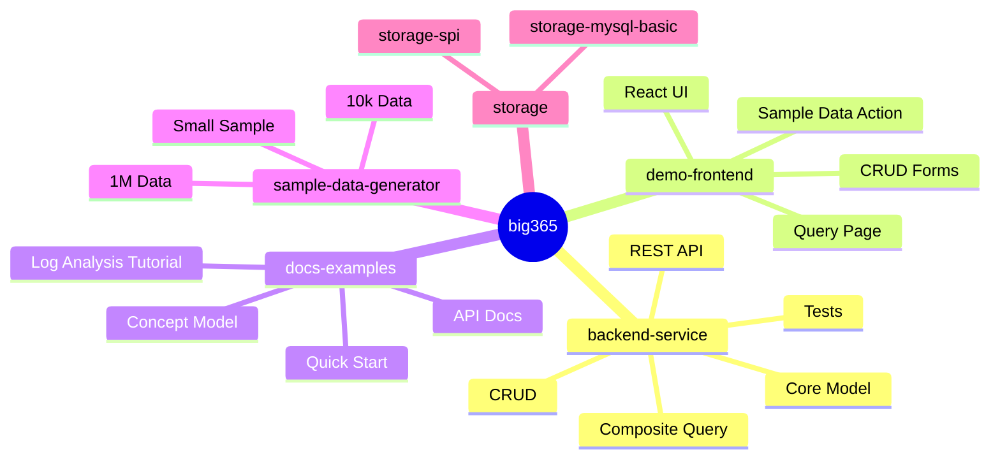

# 需求挖掘报告：big365

> Feature: `big365`  
> 阶段: Discovery 需求挖掘  
> 输入来源: 当前项目代码 + 用户访谈选择题  
> 结论摘要: big365 应定位为面向中小业务的开源多维数据服务，以“快速接入、完整 CRUD、组合查询、React 演示前端、自解释文档”为 MVP 核心。

---

## 0. Discovery 结论总览

### 0.1 一句话定位

big365 是一个面向中小业务的开源多维数据服务，帮助潜在用户以较低复杂度完成多维数据建模、CRUD、组合查询、前端演示和自助接入。

### 0.2 关键决策

| 维度 | 访谈结论 |
|---|---|
| 项目目标 | 开源项目 |
| 首要打动对象 | 潜在用户 |
| 核心痛点 | 现有方案整体复杂、成本高 |
| 目标场景 | 中小业务 |
| 核心价值 | 快速接入 |
| 首个接入方式 | REST API |
| MVP API 能力 | 完整 CRUD |
| 关键查询能力 | 多维条件 + 时间/周期范围组合查询 |
| 核心模型 | Vector / Coordinate / Dimension |
| 时间粒度 | 不限定，MVP 先简单化 |
| MVP 存储 | MySQL 普通表 |
| 存储长期方向 | 可插拔存储 |
| 部署体验 | 同时提供 docker-compose 与 podman-compose |
| 前端形态 | React 简单 API 演示前端 |
| 前后端组织 | 同仓分模块 |
| 示例场景 | 日志分析 |
| 文档要求 | 快速开始 + 概念模型 + API 文档 + 完整教程 |
| 验收底线 | 端到端、测试、文档、模型一致性都要达标 |
| 优先级冲突 | 优先保证功能闭环 |

### 0.3 MVP 用户体验闭环


---

## 1. 问题定义

### 1.1 核心问题

big365 要成为一个面向中小业务的开源多维数据服务，帮助潜在用户以低复杂度、低接入成本完成多维数据的建模、CRUD、组合查询和演示验证。

当前项目代码只是输入之一。真实目标不是简单修复现有 `bigdata_365` 示例，而是围绕以下目标重塑 MVP：

- 开源服务
- 快速接入
- Vector / Coordinate 核心模型
- REST API
- React 演示前端
- MySQL 首个存储实现
- 自解释文档
- 自动化测试

用户访谈中形成的原始取向包括：

> “开源项目”  
> “潜在用户”  
> “成本太高”  
> “整体复杂”  
> “中小业务”  
> “快速接入”  
> “REST API”  
> “完整 CRUD”  
> “组合查询”  
> “Vector/Coordinate 是核心模型”  
> “docker-compose / podman-compose”  
> “React 前端”  
> “文档自解释”

### 1.2 业务价值

为不想引入复杂 OLAP、大数据平台或完整 BI 系统的中小业务，提供一个轻量开源替代选择。

用户可以：

1. 通过 docker-compose 或 podman-compose 快速启动服务。
2. 通过 REST API 完成维度元数据和业务数据 CRUD。
3. 通过组合查询验证多维数据能力。
4. 通过 React 简单前端直观看到 API 效果。
5. 通过完整文档自助理解、试用和接入。

长期价值是沉淀一套围绕 Vector / Coordinate / Dimension 的多维数据建模与查询范式，后续可扩展到：

- 可插拔存储
- 性能优化
- Java SDK / Spring Boot Starter
- 批量导入
- 更多行业场景
- 更强前端管理与可视化能力

### 1.3 不做的成本

如果不做 big365，潜在中小业务用户在面对多维数据查询、数据管理和指标服务时，仍可能被迫选择复杂的大数据、OLAP 或 BI 方案，承担较高的：

- 部署成本
- 学习成本
- 开发成本
- 运维成本
- 整体复杂度成本

或者每个业务继续重复手写：

- 数据表结构
- CRUD 接口
- 查询条件组合
- 示例数据
- 文档
- 演示页面

这会导致接入慢、口径不统一、复用差。

对开源项目本身而言，如果没有完成端到端 MVP，项目会停留在早期实验代码状态，难以让潜在用户理解价值，也难以产生试用或二次开发意愿。

---

## 2. 用户画像

### 2.1 主要用户

| 用户角色 | 诉求 | 成功判断 |
|---|---|---|
| 潜在中小业务用户 | 有多维数据管理和查询需求，但不想引入复杂大数据平台 | 能快速启动、理解、试用并判断是否可接入 |
| 后端开发者 / 业务系统开发者 | 通过 REST API 写入和查询业务数据 | API 清晰、模型稳定、示例完整 |
| 开源项目评估者 | 快速判断项目是否值得试用或二次开发 | docker-compose / podman-compose、前端演示、教程、测试都能跑通 |
| 项目维护者 | 在现有 Spring Boot/MyBatis/MySQL 基础上重塑 MVP | 模型、API、前端、文档、测试一致 |

### 2.2 典型用户场景

#### 场景 A：开源用户首次试用

新用户进入 Git 仓库，只看 README/教程，通过 docker-compose 或 podman-compose 启动 big365 + MySQL，打开 React 演示前端，完成一组日志分析样例数据的维度定义、数据写入、更新、删除和组合查询。

#### 场景 B：业务开发者接入

业务开发者通过 REST API 创建维度，例如：

- 应用
- 接口
- 状态码
- 环境
- 区域
- 时间粒度

再写入日志指标数据，例如：

- 请求量
- 错误数
- 平均耗时

最后按应用 + 接口 + 状态码 + 时间范围进行查询。

#### 场景 C：项目评估

开源评估者不深入阅读源码，只通过前端和 API 文档判断：big365 是否能以较低成本替代手写 CRUD/查询，或替代部分重型数据方案能力。

### 2.3 当前用户旅程与目标用户旅程



### 2.4 关键痛点

- “现有方案整体太重、复杂度太高。”
- “中小业务需要快速接入，而不是先搭一整套大数据平台。”
- “开源项目必须文档自解释，否则潜在用户不会继续试用。”
- “只做后端接口不够，需要一个简单前端演示 API 效果。”
- “完整 CRUD 和组合查询是用户判断可用性的基础。”
- “Vector/Coordinate 是核心模型，但是否直接暴露给 API 用户还需要验证。”

---

## 3. 需求清单

### 3.1 Must Have（必备）

| 编号 | 需求 | 说明 |
|---|---|---|
| M1 | Compose 一键体验 | 同时提供 docker-compose 与 podman-compose 体验方式，至少包含 big365 后端服务和 MySQL，必要时包含前端或前端托管服务 |
| M2 | REST API 接入 | 作为 MVP 第一接入方式 |
| M3 | 维度元数据 CRUD | 支持创建、查询、更新、删除 Dimension |
| M4 | 业务数据 CRUD | 支持创建、查询、更新、删除业务数据记录 |
| M5 | 组合查询 | 支持多维条件过滤 + 时间/周期范围查询 |
| M6 | 核心模型一致 | Vector / Coordinate / Dimension 在代码、API、文档中形成一致解释 |
| M7 | MySQL 普通表存储 | 作为第一个存储实现，先保证功能闭环 |
| M8 | React 演示前端 | 用于 API 演示，可完成核心 CRUD 和组合查询 |
| M9 | 日志分析示例 | 贯穿建模、写入、查询、更新、删除 |
| M10 | 可配置数据生成 | 支持小样例、万级、百万级等不同数据规模 |
| M11 | 自解释文档 | 快速开始、概念模型、API 文档、完整教程 |
| M12 | 自动化测试 | 覆盖后端、关键 API、前端基础可用性或等效验证 |

### 3.2 Should Have（期望）

| 编号 | 需求 | 说明 |
|---|---|---|
| S1 | 同仓分模块 | 后端与 React 前端在同一仓库中分模块组织，例如新增 `big365-ui` |
| S2 | 统一 API 响应 | 标准响应结构、错误码、参数校验和异常处理 |
| S3 | OpenAPI / Swagger | 降低 REST API 试用成本 |
| S4 | 模型表达策略 | 基础 API 使用 dimensions/filters，高级能力再考虑 Vector/Coordinate |
| S5 | 自动建表 / 初始化 | 通过 docker-compose 或 podman-compose 启动后尽量开箱可用 |
| S6 | 端到端验证脚本 | 覆盖启动、建表、数据生成、CRUD、组合查询、前端演示 |

### 3.3 Could Have（惊喜）

| 编号 | 需求 | 说明 |
|---|---|---|
| C1 | Java SDK / Spring Boot Starter | REST API 之后的第二接入方式 |
| C2 | 批量导入 | 支持 CSV / JSON / SQL 文件导入示例数据 |
| C3 | 第二存储示例 | 例如内存存储用于测试，或后续支持分区表/宽表 |
| C4 | 性能基准演示 | 对比小样例、万级、百万级数据下组合查询耗时 |
| C5 | 更多行业教程 | 电商指标、IoT 设备、金融数据等 |

### 3.4 MoSCoW 优先级关系



---

## 4. 推荐方案

### 4.1 方案概述

以 `big365` 作为聚合型 Feature，MVP 定位为：

> 面向中小业务的开源多维数据服务快速接入版本。

从用户体验闭环倒推实现：



当前项目中的 Spring Boot、MyBatis、MySQL、core/web 模块可作为基础输入；但 MySQL 分区表、按日期列宽表、Kafka 等能力不作为 MVP 主路径，移到后续版本。

### 4.2 选择理由

用户最看重的是：

1. 开源项目让潜在用户快速接入。
2. 不在第一阶段追求极致性能或完整平台能力。
3. MVP 必须功能闭环、文档自解释、前端可演示、REST API 可用。

因此：

- MySQL 普通表能降低实现和理解成本。
- 同时提供 docker-compose 与 podman-compose 能覆盖 Docker 与 Podman 用户，降低首次体验门槛。
- React 演示前端能提升开源项目第一印象。
- 可插拔存储边界能保留未来扩展空间。
- 日志分析示例比抽象样例更容易被潜在用户理解。

### 4.3 差异化优势

big365 不直接与 ClickHouse、Doris、Elasticsearch、Hadoop 等重型方案正面竞争，而是为“不特定替代”的中小场景提供低复杂度选择。

差异化体现在：

- 标准 REST API 接入
- Vector / Coordinate / Dimension 模型
- 开箱可运行的 docker-compose / podman-compose
- 可演示的 React 前端
- 面向真实场景的完整教程
- 后续可插拔存储扩展能力

### 4.4 MVP 逻辑架构



---

## 5. 成功指标

### 5.1 北极星指标

新用户仅依赖文档，能够自助完成 big365 的启动、模型理解、数据 CRUD、组合查询和前端演示。

### 5.2 目标数值

| 指标 | 目标 |
|---|---|
| 文档自解释 | 新用户无需询问维护者，可按 README/教程完成端到端体验 |
| 快速启动 | docker-compose 或 podman-compose 10 分钟内启动后端、MySQL 和 React 前端 |
| 快速体验 | 30 分钟内完成日志分析示例的 CRUD 与组合查询 |
| 功能闭环 | 维度 CRUD、业务数据 CRUD、组合查询均可通过 API 和前端完成 |
| 测试质量 | 后端单测/集成测试、关键 API 测试、前端基础测试或等效验证通过率 100% |
| 模型一致性 | Vector / Coordinate / Dimension 在代码、API 文档、教程中定义一致 |
| 数据生成 | 至少支持小样例、万级、百万级 3 档数据规模 |

### 5.3 验收路径



---

## 6. 范围边界

### 6.1 MVP 范围

| 范围 | 内容 |
|---|---|
| 后端 | Spring Boot REST API，支持维度元数据和业务数据完整 CRUD，支持多维条件 + 时间/周期范围组合查询 |
| 模型 | 确立 Vector / Coordinate / Dimension 为核心模型；MVP 阶段 API 可使用 dimensions/filters 表达 |
| 存储 | 实现 MySQL 普通表作为第一个存储实现；保留可插拔存储架构边界 |
| 前端 | 新增 React 简单前端模块，用户打开后先看到默认演示效果，再通过向导参与演示数据生成；页面需展示生成进度和阶段状态，不要求用户直接理解维度等内部概念，不做复杂管理后台 |
| 示例 | 以日志分析作为首个完整教程和演示数据场景 |
| 数据生成 | 前端提供演示数据生成向导，允许用户调节数据量、时间范围、应用数量、接口数量、错误率等参数，并可感知初始化、生成、写入、统计等过程 |
| 部署 | 同时提供 docker-compose 与 podman-compose，一键启动后端、MySQL、前端或前端构建产物 |
| 文档 | 快速开始、概念模型、API 文档、完整教程 |
| 测试 | 覆盖核心闭环的自动化测试和端到端验证方式 |

### 6.2 V1 范围

- 增强可插拔存储接口，明确存储 SPI / Adapter 设计。
- 增加 Java SDK 或 Spring Boot Starter，提高 Java 生态接入体验。
- 增加批量导入能力，支持 CSV / JSON 等格式。
- 增强查询能力，例如排序、分页、聚合统计、更多过滤操作符。
- 增加 OpenAPI / Swagger 和更完善的错误码体系。
- 对 MySQL 查询进行初步索引和性能优化。

### 6.3 未来版本

- MySQL 分区表、宽表动态列、当前 `bigdata_365` 按周期列设计可作为性能优化或高级存储插件重新引入。
- 支持更多存储后端，例如 PostgreSQL、ClickHouse、Doris、Elasticsearch 等。
- 支持权限、多租户、审计、生产级安全能力。
- 支持更复杂前端管理后台和可视化分析。
- 支持 Kafka、批处理、异步写入和数据聚合链路。

### 6.4 明确不做

- MVP 不做权限系统、多租户、角色管理、审计等生产级安全体系。
- MVP 不做多数据库适配，虽然架构预留可插拔存储。
- MVP 不做复杂性能优化，不把 MySQL 分区表、宽表、百亿级压测作为主目标。
- MVP 不做完整数据平台，不追求覆盖建模、治理、BI、流处理、调度等所有能力。
- MVP 不把 Kafka 写入作为主路径。

### 6.5 版本演进路线



---

## 7. 风险与假设

### 7.1 关键假设

| 假设 | 验证方式 |
|---|---|
| 潜在用户主要来自中小业务，最大痛点是整体复杂和接入成本高 | 找 1-3 个目标用户按文档试用并访谈 |
| 开源项目第一价值是快速理解和快速试用 | 观察 README、docker-compose / podman-compose、前端演示的完成率 |
| REST API 是 MVP 最合适的第一接入方式 | 用日志分析示例验证 API 是否足够自然 |
| Vector/Coordinate 是核心模型，但是否直接暴露仍需验证 | 对比概念直露和 dimensions/filters 两种文档表达 |
| MySQL 普通表足以支撑 MVP 功能闭环 | 用小样例、万级、百万级数据验证响应边界 |
| React 前端能提升试用转化 | 对比仅 API 文档和有前端演示的试用体验 |

### 7.2 主要风险

| 风险 | 描述 | 缓解策略 |
|---|---|---|
| 定位风险 | 用户可能期待完整 OLAP/BI/权限/可视化平台 | 在 README 和文档中明确 MVP 边界 |
| 模型理解风险 | Vector/Coordinate 直露可能增加学习成本 | 基础 API 用 dimensions/filters，高级文档解释核心模型 |
| 技术范围风险 | 后端、前端、文档、测试、数据生成同时进入 MVP，范围较大 | 优先功能闭环，控制前端复杂度 |
| 架构风险 | 可插拔存储可能导致过度抽象 | MVP 只实现 MySQL 普通表，接口保持最小化 |
| 代码迁移风险 | 现有分区表/宽表/Kafka/Druid 痕迹和新 MVP 主线不完全一致 | 明确保留、后移、重构清单 |
| 文档维护风险 | 开源项目要求文档自解释，实现变更容易导致文档漂移 | 将文档示例纳入测试或端到端验证 |

### 7.3 验证计划



---

## 8. 下一步建议

### 8.1 进入规范编写阶段

建议下一步运行：

```text
@sddu-spec big365
```

规范编写阶段应重点明确：

1. 领域模型定义。
2. API 资源设计。
3. MySQL 普通表结构。
4. React 前端页面范围。
5. 日志分析示例数据结构。
6. docker-compose 与 podman-compose 交付形态。
7. 自动化测试和验收标准。

### 8.2 需要进一步调研

- 日志分析示例的具体维度和指标：例如 app、endpoint、statusCode、env、region、timeKey、requestCount、errorCount、avgLatency。
- 业务数据通用模型如何设计：是 Metric + Dimensions + TimeKey + Value，还是更接近事件/记录模型。
- Vector/Coordinate 在 API 中的暴露方式：直接暴露、半暴露、内部隐藏或分层暴露。
- MySQL 普通表的表结构和索引策略，如何兼顾 CRUD、组合查询和未来存储可插拔。
- React 前端的最小页面范围：默认演示效果页、演示数据生成向导、参数调节表单、生成过程进度展示、业务数据 CRUD 表单、查询表单、结果表格、文档链接；页面表达应尽量业务化，先让用户看到效果，再让用户参与数据生成过程，避免要求用户直接理解维度等内部概念。
- docker-compose 与 podman-compose 的交付边界：是否共用同一 compose 文件、是否需要分别提供适配文件、是否包含前端开发服务器，还是前端构建后由后端或 Nginx 托管。

---

## 9. Feature 拆分建议

用户已选择“暂不决定”是否拆分。因此本次 discovery 仍以 `big365` 作为聚合型 Feature 记录；后续 spec/plan 阶段再决定是否拆成子 Feature。

### 9.1 拆分机会总览



### 9.2 建议拆分项

| 拆分模式 | 子 Feature | 说明 |
|---|---|---|
| 前后端分离 | `backend-service` | REST API、核心模型、MySQL 存储、CRUD、组合查询、测试 |
| 前后端分离 | `demo-frontend` | React API 演示页面、CRUD 表单、组合查询页面、示例数据操作入口 |
| 文档示例 + 核心服务 | `docs-examples` | 快速开始、概念模型、API 文档、日志分析完整教程、示例数据说明 |
| 数据生成 | `sample-data-generator` | 可配置数据生成器，支持小样例、万级、百万级 |
| 存储可插拔 | `storage-mysql-basic` | MySQL 普通表存储实现 |
| 存储可插拔 | `storage-spi` | 后续抽象的存储接口和扩展点 |

### 9.3 当前处理结论

本阶段不强制拆分。建议在 `@sddu-spec big365` 中继续以聚合型 Feature 编写完整规范，并在 `@sddu-plan` 阶段根据实现边界决定是否拆分为多个交付单元。
