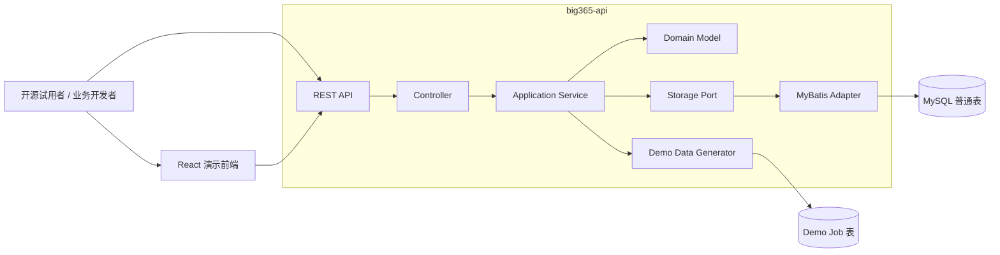
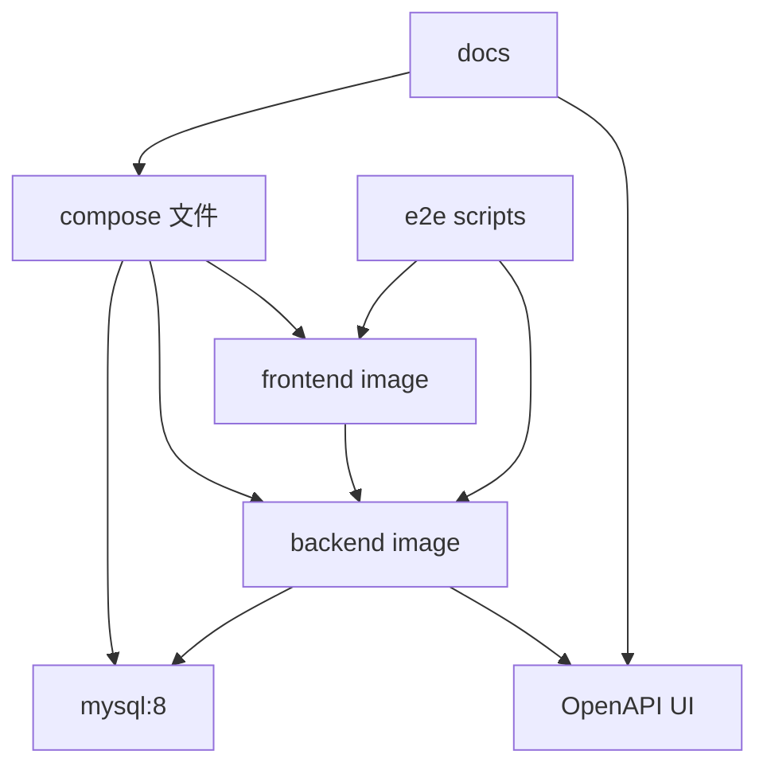

# Technical Plan: big365

> Feature: `big365`  
> 标识符: `FR-BIG365-MVP`  
> 状态: `planned`  
> 来源规范: `.sddu/specs-tree-root/specs-tree-big365/spec.md`  
> 创建日期: `2026-06-06`  
> Plan 阶段结论: 先将历史工程资产迁移到 `backup/legacy-20260606/`，再新建两个顶层独立工程 `big365-api` 与 `big365-web`；文档、端到端测试和 Compose 作为仓库级资产管理。

---

## 1. 前置条件检查

### 1.1 Spec 文件

| 检查项 | 结果 |
|---|---|
| 规范文件 | `.sddu/specs-tree-root/specs-tree-big365/spec.md` |
| 是否存在 | 是 |
| Feature | `big365` |
| 规范状态 | `specified` |

### 1.2 外部 API 文档缓存

规范第 7.7 节明确：当前规范未发现必须调用的外部第三方 HTTP API。因此 `.sddu/api-docs/` 不存在不阻塞本次规划。

| 外部服务 | 是否需要 API 文档缓存 | 处理 |
|---|---:|---|
| MySQL | 否，数据库依赖，不是外部 HTTP API | 使用 Compose 镜像和 JDBC 配置 |
| Docker Compose / Podman Compose | 否，部署工具 | 在文档中说明版本与命令 |
| React | 否，前端框架 | 使用本地前端工程依赖 |
| OpenAPI / Swagger | 否，内部 API 文档生成工具 | 由后端工程生成或静态导出 |

---

## 2. 架构分析

### 2.1 现有架构影响

现有仓库包含历史 Java 多模块工程：

```text
big365/
├── pom.xml
├── big365-core/
├── big365-web/
├── doc/
└── .sddu/
```

现有工程特征：

| 现有资产 | 当前状态 | 对新工程的影响 | Plan 处理 |
|---|---|---|---|
| `big365-core` | 已有 `Vector`、`Coordinate`、Manager 接口 | 可作为概念命名参考，但会占用 `big365-core` 命名空间 | 先迁移到 `backup/legacy-20260606/big365-core/`，后续如需新 core 再重新设计 |
| `big365-web` | Spring Boot 3.1.1、MyBatis、Druid、Kafka、历史 REST 接口 | 与新演示前端候选名 `big365-web` 冲突 | 先迁移到 `backup/legacy-20260606/big365-web/`，释放 `big365-web` 给 React 前端 |
| `pom.xml` | 历史 Maven 聚合父工程 | 会绑定历史模块路径 | 迁移到 `backup/legacy-20260606/pom.xml`，新根构建后续重新规划 |
| `doc/` | 历史 Navicat 数据模型与旧文档资产 | 可作为高级能力参考 | 迁移到 `backup/legacy-20260606/doc/` |
| `README.md` / `README.en.md` | 描述历史分区表平台定位 | 与新的轻量开源试用闭环不一致 | 迁移到 backup，根 README 后续重建为新入口 |
| `.gitee/` | 历史协作模板 | 可保留为仓库级资产，也可迁移 | 本次暂保留在根目录，避免影响托管平台配置 |
| `.opencode/`、`.sddu/` | AI/SDDU 工作流配置与规范产物 | 当前规划依赖 | 保留在根目录，不迁移 |

关键约束：Spec 第 2.3 节明确「当前项目代码只能作为参考、样例或可拷贝复用素材，不能直接基于现有工程就地修改」。因此技术计划第一步是将历史工程资产迁移到 `backup/legacy-20260606/`，再在仓库根目录创建 `big365-api` 与 `big365-web` 两个顶层独立工程，避免命名冲突和历史构建耦合。非业务工程资产不单独拆顶层工程。

### 2.2 新组件

推荐只新建两个顶层独立工程：`big365-api` 与 `big365-web`。文档、端到端测试、Compose 编排属于仓库级资产，不作为独立工程；演示数据生成属于后端业务能力，先作为 `big365-api` 内部包组织。

```text
big365/
├── backup/
│   └── legacy-20260606/       # 历史工程资产归档，仅作参考
│       ├── pom.xml
│       ├── big365-core/
│       ├── big365-web/
│       ├── doc/
│       ├── README.md
│       └── README.en.md
├── big365-api/                # Spring Boot 后端 API 独立工程
│   ├── Dockerfile             # 后端镜像构建文件
│   ├── README.md              # 后端开发、测试、部署说明
│   ├── src/main/java/...      # dimension、record、query、demo、model、storage 等内部包
│   ├── src/main/resources/db/ # 数据库初始化 / migration 脚本
│   └── src/test/              # 后端单元测试与集成测试
├── big365-web/                # React 演示前端独立工程
│   ├── Dockerfile             # 前端镜像构建文件
│   ├── nginx.conf             # 前端静态资源与 /api 代理配置
│   ├── README.md              # 前端开发、测试、部署说明
│   ├── src/                   # 页面、组件、API client
│   └── tests/                 # 前端测试
├── docs/                      # 快速开始、概念模型、API、教程；非独立工程
├── tests/
│   └── e2e/                   # 端到端验证脚本；非独立工程
├── compose.yml                # 根级 Docker Compose 编排
├── compose.podman.yml         # 可选，Podman Compose 覆盖配置
├── .env.example               # 本地启动环境变量示例
└── .sddu/specs-tree-root/specs-tree-big365/
    ├── spec.md
    ├── plan.md
    ├── ADR-001-big365-star-independent-project.md
    ├── ADR-002-mysql-ordinary-table-model.md
    ├── ADR-003-async-demo-data-generation.md
    └── ADR-004-frontend-delivery.md
```

### 2.3 目标逻辑架构



### 2.4 数据流变更

#### 维度 CRUD 数据流

```text
HTTP Request -> DimensionController -> DimensionService -> DimensionRepository -> MyBatis Mapper -> big365_dimensions
```

#### 业务数据 CRUD 数据流

```text
HTTP Request -> RecordController -> RecordService -> Dimension 校验 -> RecordRepository -> MyBatis Mapper -> big365_records
```

#### 组合查询数据流

```text
HTTP Request -> QueryController -> QueryService -> 参数校验 -> QueryRepository -> 动态 SQL 条件 -> 分页结果
```

#### 演示数据生成数据流

```text
POST /api/demo-data/jobs -> 创建 job -> 后台线程执行生成 -> 批量写入 records -> 更新 job 状态 -> GET job 查询进度
```

### 2.5 依赖关系图



---

## 3. 方案对比

### 方案 A：先归档历史工程，再新建 API/Web 两个顶层独立工程

| 项目 | 内容 |
|---|---|
| 描述 | 先将历史 `pom.xml`、`big365-core`、`big365-web`、`doc`、历史 README 迁移到 `backup/legacy-20260606/`，再在根目录新建 `big365-api` 与 `big365-web` 两个顶层独立工程；`docs/`、`tests/e2e/`、`compose.yml` 作为仓库级资产；演示数据生成作为 `big365-api` 内部业务包。 |
| 优点 | 完全符合 Spec 红线；释放 `big365-web` 给 React 前端；顶层工程数量少，认知成本低；每个独立工程都可独立构建、测试、部署；非业务资产不被误拆为工程。 |
| 缺点 | 后端初期承载 dimension、record、query、demo、storage 等多个业务包，需要内部边界设计清晰；若后续 data-gen/core/storage/query 复杂度显著上升，可能需要再拆。 |
| 风险评估 | 低到中等。当前两工程足以支撑端到端闭环，后续 3 个月内再拆顶层业务模块概率较低。 |
| 预估工作量 | 8-11 人日，另加 0.5 人日完成历史资产迁移与入口说明。 |

### 方案 B：保留历史工程，在根目录新增不同名称的新工程

| 项目 | 内容 |
|---|---|
| 描述 | 保留历史 `big365-core` / `big365-web` 不动，在根目录新增 `big365-api`、`big365-ui` 等不同命名的新工程。 |
| 优点 | 不移动历史资产，短期变更较小；可以随时对照历史代码。 |
| 缺点 | `big365-web` 名称被历史后端占用，新前端只能退而使用 `big365-ui`；根目录会同时存在新旧定位的工程，用户容易混淆；README 和构建链路仍受历史工程影响。 |
| 风险评估 | 中高。长期可能出现新旧工程互相影响，Review/Validate 难判断边界。 |
| 预估工作量 | 7-10 人日。 |

### 方案 C：就地改造现有 `big365-core` / `big365-web`

| 项目 | 内容 |
|---|---|
| 描述 | 直接修改现有模块，删除或绕过历史分区表、Kafka 等能力，补齐新 API、React、Compose、文档。 |
| 优点 | 表面上代码创建量最少；能复用现有启动入口、Mapper、测试脚本。 |
| 缺点 | 违反 Spec 红线；历史接口与新 API 共存会制造混乱；历史数据库模型与 MVP 普通表冲突；重构风险高。 |
| 风险评估 | 高。不推荐。 |
| 预估工作量 | 6-12 人日，但不可控返工概率高。 |

---

## 4. 推荐方案

推荐采用「方案 A：先归档历史工程，再新建 API/Web 两个顶层独立工程」。

推荐理由：

1. 与 Spec 第 2.3 节工程红线完全一致。
2. 释放 `big365-web` 名称，使其用于 React 演示前端。
3. 顶层独立工程只保留 `big365-api` 和 `big365-web`，与实际独立构建、测试、部署单元一致。
4. 文档、端到端测试、Compose 编排是仓库级资产，不作为非业务工程单独拆分。
5. 演示数据生成当前是 API 触发的后端业务能力，先放在 `big365-api` 内部 `demo` 包，避免过早拆分。
6. 更容易保证「模型、API、前端、文档、测试」围绕同一日志分析示例一致。
7. 更适合开源试用闭环：用户进入根目录 README 或 `docs/quick-start.md` 即可按 Compose 启动，不需要理解历史模块。
8. 为后续版本保留演进空间：历史高级能力保存在 `backup/legacy-20260606/`，可作为 V2/V3 输入，而不是提前污染首版。

对应 ADR：

- `ADR-001-big365-star-independent-project.md`

---

## 5. 关键技术决策

### 5.1 工程组织

采用两个顶层独立工程 + 仓库级辅助资产：

```text
backup/legacy-20260606       # 历史工程资产归档
big365-api                   # Spring Boot API 服务，包含后端业务能力
big365-web                   # React 演示前端
docs                         # 文档资产，不作为独立工程
tests/e2e                    # 端到端验证资产，不作为独立工程
compose.yml                  # 根级 Compose 编排
compose.podman.yml           # Podman Compose 覆盖配置，可选
.env.example                 # 启动环境变量示例
```

`big365-api` 可使用独立 Maven 工程，避免与历史 `pom.xml` 强耦合。历史根 `pom.xml` 迁移到 `backup/legacy-20260606/pom.xml` 后，新根构建文件可在后续按新工程重新规划。

后端业务能力不拆顶层工程，先在 `big365-api` 内部分包：

```text
org.big365.api.common      # 统一响应、异常、错误码、分页
org.big365.api.dimension   # 维度元数据 CRUD
org.big365.api.record      # 业务数据 CRUD
org.big365.api.query       # 多维组合查询
org.big365.api.demo        # 演示数据生成与 Job 状态
org.big365.api.model       # Vector / Coordinate / Dimension 概念模型
org.big365.api.storage     # MySQL 存储适配与 repository 边界
org.big365.api.config      # Spring / OpenAPI / Async / Web 配置
```

后续只有当出现独立部署、独立发布、跨工程复用或复杂度显著上升时，再考虑拆出 `big365-data-gen`、`big365-core`、`big365-storage-*`、`big365-query` 等顶层模块。

### 5.2 后端技术栈

| 类别 | 决策 |
|---|---|
| 语言 | Java 21 |
| 框架 | Spring Boot 3.5.14 |
| ORM | MyBatis 或 MyBatis Plus；MVP 推荐 MyBatis，显式 SQL 更利于控制普通表查询 |
| 数据库 | MySQL 8 |
| API 文档 | springdoc-openapi / Swagger UI 纳入 MVP 必做 |
| 校验 | Jakarta Validation |
| 测试 | JUnit 5、Spring Boot Test、Testcontainers 可选；Compose E2E 必做 |

### 5.3 数据模型与表结构

采用「结构化主表 + JSON 扩展字段」的折中普通表设计：常用日志维度作为普通列以便查询与索引，完整 `dimensions` / `metrics` 使用 JSON 保留通用性。

#### `big365_dimensions`

| 字段 | 类型 | 说明 |
|---|---|---|
| `id` | bigint pk auto_increment | 维度 ID |
| `code` | varchar(64) unique | 维度编码，例如 `app`、`endpoint` |
| `name` | varchar(128) | 展示名 |
| `type` | varchar(32) | string / number / time / enum |
| `description` | varchar(512) | 描述 |
| `enabled` | tinyint | 是否启用 |
| `created_at` | datetime | 创建时间 |
| `updated_at` | datetime | 更新时间 |

#### `big365_records`

| 字段 | 类型 | 说明 |
|---|---|---|
| `id` | bigint pk auto_increment | 记录 ID |
| `time_key` | datetime | 时间或周期 |
| `app` | varchar(128) | 常用维度列 |
| `endpoint` | varchar(255) | 常用维度列 |
| `status_code` | varchar(16) | 常用维度列 |
| `env` | varchar(64) | 常用维度列 |
| `region` | varchar(64) | 常用维度列 |
| `request_count` | bigint | 请求量 |
| `error_count` | bigint | 错误数 |
| `avg_latency` | decimal(12,2) | 平均耗时 |
| `dimensions_json` | json | 完整维度取值 |
| `metrics_json` | json | 完整指标集合 |
| `deleted` | tinyint | 软删除标记 |
| `created_at` | datetime | 创建时间 |
| `updated_at` | datetime | 更新时间 |

建议索引：

```sql
unique key uk_dimension_code (code);
index idx_record_time (time_key);
index idx_record_app_time (app, time_key);
index idx_record_endpoint_time (endpoint, time_key);
index idx_record_status_time (status_code, time_key);
index idx_record_env_region_time (env, region, time_key);
```

#### `big365_demo_jobs`

| 字段 | 类型 | 说明 |
|---|---|---|
| `job_id` | varchar(64) pk | 任务 ID |
| `scale` | varchar(32) | small / ten-thousand / million |
| `parameters_json` | json | 生成参数 |
| `status` | varchar(32) | pending / initializing / generating / writing / summarizing / completed / failed |
| `progress` | int | 0-100 |
| `summary_json` | json | 摘要或失败原因 |
| `created_at` | datetime | 创建时间 |
| `updated_at` | datetime | 更新时间 |

对应 ADR：

- `ADR-002-mysql-ordinary-table-model.md`

### 5.4 API 设计

统一前缀：`/api`

| 资源 | 方法 | 路径 | 说明 | 覆盖需求 |
|---|---|---|---|---|
| 健康检查 | GET | `/api/health` | 服务与数据库健康状态 | FR-004 |
| 维度列表 | GET | `/api/dimensions` | 分页/列表查询 | FR-011 |
| 创建维度 | POST | `/api/dimensions` | 创建维度 | FR-009, FR-014 |
| 维度详情 | GET | `/api/dimensions/{id}` | 查询维度 | FR-010 |
| 更新维度 | PUT | `/api/dimensions/{id}` | 更新名称、描述、启用状态 | FR-012 |
| 禁用维度 | DELETE | `/api/dimensions/{id}` | MVP 采用禁用策略 | FR-013 |
| 数据列表 | GET | `/api/records` | 分页/条件列表 | FR-017 |
| 创建数据 | POST | `/api/records` | 写入业务数据 | FR-015, FR-020 |
| 数据详情 | GET | `/api/records/{id}` | 查询业务数据 | FR-016 |
| 更新数据 | PUT | `/api/records/{id}` | 更新数据 | FR-018 |
| 删除数据 | DELETE | `/api/records/{id}` | 软删除业务数据 | FR-019 |
| 组合查询 | POST | `/api/query` | 多维过滤 + 时间范围 + 分页 | FR-021~FR-026 |
| 创建生成任务 | POST | `/api/demo-data/jobs` | 异步生成演示数据 | FR-027~FR-031 |
| 查询任务状态 | GET | `/api/demo-data/jobs/{jobId}` | 查询阶段、进度、摘要 | FR-031 |
| API 文档 | GET | `/swagger-ui.html` 或 `/swagger-ui/index.html` | Swagger UI | FR-041 |

统一响应：

```json
{
  "success": true,
  "code": "OK",
  "message": "success",
  "data": {},
  "error": null
}
```

分页响应建议：

```json
{
  "items": [],
  "pageNo": 1,
  "pageSize": 20,
  "total": 0
}
```

错误码建议：

| 错误码 | 场景 |
|---|---|
| `VALIDATION_ERROR` | 参数校验失败 |
| `DIMENSION_CODE_DUPLICATED` | 维度编码重复 |
| `DIMENSION_NOT_FOUND` | 维度不存在 |
| `DIMENSION_IN_USE` | 禁止删除被使用维度时使用；MVP 默认禁用不硬删 |
| `RECORD_NOT_FOUND` | 数据记录不存在 |
| `QUERY_TOO_BROAD` | 查询范围过大或 pageSize 超限 |
| `DEMO_JOB_NOT_FOUND` | 生成任务不存在 |
| `DEMO_JOB_FAILED` | 生成任务失败 |
| `DATABASE_UNAVAILABLE` | 数据库不可用 |

### 5.5 删除策略

| 对象 | MVP 策略 | 理由 |
|---|---|---|
| Dimension | 禁用，不物理删除 | 避免已写入记录引用维度后语义丢失 |
| Business Record | 软删除 | 支持一致 CRUD 语义并降低误删风险 |
| Demo Job | 保留历史任务摘要 | 便于前端展示与问题诊断 |

### 5.6 演示数据生成

采用异步任务模型。

| 规模 | 默认记录数 | 执行方式 | 体验策略 |
|---|---:|---|---|
| small | 100-1,000 | 异步但快速完成 | 适合首次打开前端自动演示 |
| ten-thousand | 10,000-50,000 | 异步批量写入 | 展示进度与摘要 |
| million | 1,000,000 | 异步分批写入 | 必须展示进度、耗时、失败原因；允许文档提示机器资源要求 |

状态流转：

```text
pending -> initializing -> generating -> writing -> summarizing -> completed
                                      \-> failed
```

对应 ADR：

- `ADR-003-async-demo-data-generation.md`

### 5.7 前端交付

推荐 React + Vite + TypeScript，前端以独立服务方式在 Compose 中运行，默认通过 Nginx 静态托管构建产物。

页面结构：

| 页面 | 路径 | 职责 |
|---|---|---|
| 首页 | `/` | 默认演示效果、关键指标、示例查询结果 |
| 数据生成 | `/demo-data` | 参数表单、创建任务、轮询状态、摘要展示 |
| 维度管理 | `/dimensions` | 维度列表、创建、编辑、禁用 |
| 数据管理 | `/records` | 业务数据列表、创建、编辑、删除 |
| 组合查询 | `/query` | 多维筛选、时间范围、分页结果 |
| 文档入口 | `/docs` | 链接快速开始、概念模型、API 文档、教程 |

对应 ADR：

- `ADR-004-frontend-delivery.md`

### 5.8 Compose 交付

建议提供根级主 Compose 文件兼容 Docker Compose 与 Podman Compose，必要时提供 Podman 覆盖文件。Compose 是仓库级部署编排资产，不单独作为工程；数据库结构由 `big365-api` 拥有。

```text
compose.yml                    # 根级 Docker Compose 编排
compose.podman.yml             # 可选，仅当 Podman 兼容性需要覆盖时创建
.env.example                   # 本地环境变量示例
big365-api/src/main/resources/db/
└── 001_schema.sql             # 数据库结构由 API 工程拥有
```

默认服务：

| 服务 | 镜像/构建 | 端口 | 健康检查 |
|---|---|---:|---|
| `mysql` | `mysql:8.0` | `3306` | `mysqladmin ping` |
| `backend` | 本地 Dockerfile | `8080` | `GET /api/health` |
| `frontend` | 本地 Dockerfile / nginx | `3000` | HTTP 访问首页 |

---

## 6. 文件影响分析

### 6.1 迁移/归档文件

```text
[MOVE] pom.xml -> backup/legacy-20260606/pom.xml
[MOVE] big365-core/ -> backup/legacy-20260606/big365-core/
[MOVE] big365-web/ -> backup/legacy-20260606/big365-web/
[MOVE] doc/ -> backup/legacy-20260606/doc/
[MOVE] README.md -> backup/legacy-20260606/README.md
[MOVE] README.en.md -> backup/legacy-20260606/README.en.md
[NEW] backup/legacy-20260606/README.md 或保留原 README 作为历史入口说明
```

### 6.2 新建文件

```text
[NEW] README.md
[NEW] big365-api/pom.xml
[NEW] big365-api/Dockerfile
[NEW] big365-api/src/main/java/org/big365/api/Big365ApiApplication.java
[NEW] big365-api/src/main/java/org/big365/api/controller/HealthController.java
[NEW] big365-api/src/main/java/org/big365/api/controller/DimensionController.java
[NEW] big365-api/src/main/java/org/big365/api/controller/RecordController.java
[NEW] big365-api/src/main/java/org/big365/api/controller/QueryController.java
[NEW] big365-api/src/main/java/org/big365/api/controller/DemoDataController.java
[NEW] big365-api/src/main/java/org/big365/api/controller/dto/ApiResponse.java
[NEW] big365-api/src/main/java/org/big365/api/controller/dto/PageResponse.java
[NEW] big365-api/src/main/java/org/big365/api/controller/dto/DimensionDtos.java
[NEW] big365-api/src/main/java/org/big365/api/controller/dto/RecordDtos.java
[NEW] big365-api/src/main/java/org/big365/api/controller/dto/QueryDtos.java
[NEW] big365-api/src/main/java/org/big365/api/controller/dto/DemoDataDtos.java
[NEW] big365-api/src/main/java/org/big365/api/domain/Dimension.java
[NEW] big365-api/src/main/java/org/big365/api/domain/Coordinate.java
[NEW] big365-api/src/main/java/org/big365/api/domain/Vector.java
[NEW] big365-api/src/main/java/org/big365/api/domain/BusinessRecord.java
[NEW] big365-api/src/main/java/org/big365/api/domain/DemoGenerationJob.java
[NEW] big365-api/src/main/java/org/big365/api/domain/DemoJobStatus.java
[NEW] big365-api/src/main/java/org/big365/api/service/DimensionService.java
[NEW] big365-api/src/main/java/org/big365/api/service/RecordService.java
[NEW] big365-api/src/main/java/org/big365/api/service/QueryService.java
[NEW] big365-api/src/main/java/org/big365/api/service/DemoDataService.java
[NEW] big365-api/src/main/java/org/big365/api/service/DemoDataGenerator.java
[NEW] big365-api/src/main/java/org/big365/api/repository/DimensionRepository.java
[NEW] big365-api/src/main/java/org/big365/api/repository/RecordRepository.java
[NEW] big365-api/src/main/java/org/big365/api/repository/DemoJobRepository.java
[NEW] big365-api/src/main/java/org/big365/api/mapper/DimensionMapper.java
[NEW] big365-api/src/main/java/org/big365/api/mapper/RecordMapper.java
[NEW] big365-api/src/main/java/org/big365/api/mapper/DemoJobMapper.java
[NEW] big365-api/src/main/java/org/big365/api/config/OpenApiConfig.java
[NEW] big365-api/src/main/java/org/big365/api/config/AsyncConfig.java
[NEW] big365-api/src/main/java/org/big365/api/config/WebConfig.java
[NEW] big365-api/src/main/java/org/big365/api/exception/GlobalExceptionHandler.java
[NEW] big365-api/src/main/java/org/big365/api/exception/BusinessException.java
[NEW] big365-api/src/main/java/org/big365/api/exception/ErrorCode.java
[NEW] big365-api/src/main/resources/application.yml
[NEW] big365-api/src/main/resources/mapper/DimensionMapper.xml
[NEW] big365-api/src/main/resources/mapper/RecordMapper.xml
[NEW] big365-api/src/main/resources/mapper/DemoJobMapper.xml
[NEW] big365-api/src/test/java/org/big365/api/DimensionServiceTest.java
[NEW] big365-api/src/test/java/org/big365/api/RecordServiceTest.java
[NEW] big365-api/src/test/java/org/big365/api/QueryServiceTest.java
[NEW] big365-api/src/test/java/org/big365/api/DemoDataServiceTest.java
[NEW] big365-api/src/test/java/org/big365/api/controller/DimensionApiTest.java
[NEW] big365-api/src/test/java/org/big365/api/controller/RecordApiTest.java
[NEW] big365-api/src/test/java/org/big365/api/controller/QueryApiTest.java
[NEW] big365-api/src/test/java/org/big365/api/controller/DemoDataApiTest.java
[NEW] big365-api/src/main/java/org/big365/api/demo/DemoDataGenerator.java
[NEW] big365-api/src/main/java/org/big365/api/demo/DemoDataParameters.java
[NEW] big365-api/src/main/java/org/big365/api/demo/DemoDataBatch.java
[NEW] big365-api/src/test/java/org/big365/api/demo/DemoDataGeneratorTest.java
[NEW] big365-web/package.json
[NEW] big365-web/index.html
[NEW] big365-web/vite.config.ts
[NEW] big365-web/tsconfig.json
[NEW] big365-web/Dockerfile
[NEW] big365-web/nginx.conf
[NEW] big365-web/src/main.tsx
[NEW] big365-web/src/App.tsx
[NEW] big365-web/src/api/client.ts
[NEW] big365-web/src/api/types.ts
[NEW] big365-web/src/pages/HomePage.tsx
[NEW] big365-web/src/pages/DemoDataPage.tsx
[NEW] big365-web/src/pages/DimensionsPage.tsx
[NEW] big365-web/src/pages/RecordsPage.tsx
[NEW] big365-web/src/pages/QueryPage.tsx
[NEW] big365-web/src/pages/DocsPage.tsx
[NEW] big365-web/src/components/Layout.tsx
[NEW] big365-web/src/components/ErrorBanner.tsx
[NEW] big365-web/src/components/Loading.tsx
[NEW] big365-web/src/styles.css
[NEW] big365-web/src/__tests__/App.test.tsx
[NEW] compose.yml
[NEW] compose.podman.yml
[NEW] .env.example
[NEW] big365-api/src/main/resources/db/001_schema.sql
[NEW] docs/quick-start.md
[NEW] docs/concepts.md
[NEW] docs/api.md
[NEW] docs/log-analysis-tutorial.md
[NEW] docs/troubleshooting.md
[NEW] tests/e2e/requirements.txt
[NEW] tests/e2e/run_e2e.py
[NEW] tests/e2e/test_health.py
[NEW] tests/e2e/test_dimension_crud.py
[NEW] tests/e2e/test_record_crud.py
[NEW] tests/e2e/test_query.py
[NEW] tests/e2e/test_demo_data.py
[NEW] tests/e2e/test_frontend.py
[NEW] .sddu/specs-tree-root/specs-tree-big365/ADR-001-big365-star-independent-project.md
[NEW] .sddu/specs-tree-root/specs-tree-big365/ADR-002-mysql-ordinary-table-model.md
[NEW] .sddu/specs-tree-root/specs-tree-big365/ADR-003-async-demo-data-generation.md
[NEW] .sddu/specs-tree-root/specs-tree-big365/ADR-004-frontend-delivery.md
```

### 6.3 修改文件

```text
[MODIFY] .sddu/specs-tree-root/specs-tree-big365/README.md
[MODIFY] .sddu/specs-tree-root/README.md
[MODIFY] .sddu/README.md
```

说明：上述 README 修改由 `@sddu-docs` 自动扫描更新导航；新工程实现阶段不应直接修改 `backup/legacy-20260606/` 中的历史工程代码。

根目录 `README.md` 在历史 README 迁移后应重建为新工程入口，指向 `docs/quick-start.md`、根级 `compose.yml` 和 API 文档。

### 6.4 删除文件

```text
[DELETE] 不适用
```

本阶段不删除历史工程文件，仅迁移归档，避免破坏现有可参考资产。

---

## 7. 风险评估与缓解措施

| 风险类别 | 风险 | 影响 | 概率 | 缓解措施 |
|---|---|---:|---:|---|
| 技术风险 | 两个顶层工程需要覆盖后端、前端、Compose、文档、测试闭环，交付面仍较大 | 高 | 中 | 按垂直切片推进：健康检查 -> 维度 CRUD -> 数据 CRUD -> 查询 -> 数据生成 -> 前端 -> E2E |
| 技术风险 | JSON 字段与结构化列混用导致模型复杂 | 中 | 中 | 明确 MVP 只对日志示例常用维度建索引列，其他维度保留 JSON；文档解释映射关系 |
| 技术风险 | 百万级数据生成在低配机器上耗时长或失败 | 中 | 中 | 异步任务、批量写入、进度展示、失败原因；文档标注资源要求，可配置降级记录数 |
| 技术风险 | 组合查询无边界导致慢查询 | 高 | 中 | 强制 pageSize 上限、时间范围校验、默认限制、必要索引、返回 `QUERY_TOO_BROAD` |
| 技术风险 | 前端与 API 字段漂移 | 中 | 中 | TypeScript 类型集中在 `src/api/types.ts`；E2E 覆盖核心 API；文档示例纳入验证脚本 |
| 依赖风险 | Docker Compose 与 Podman Compose 行为差异 | 中 | 中 | 主 compose 文件保持标准语法，提供 `compose.podman.yml` 覆盖；文档记录验证版本 |
| 依赖风险 | Maven/npm 依赖下载慢或失败 | 中 | 中 | 文档提供镜像配置建议；Dockerfile 分层缓存；避免非必要依赖 |
| 依赖风险 | MySQL 8 JSON/索引行为在不同小版本差异 | 中 | 低 | 锁定 compose 默认镜像版本；避免依赖高级 JSON 索引作为 MVP 主路径 |
| 时间风险 | 文档与自动化测试被压缩 | 高 | 中 | 将文档和 E2E 作为 Definition of Done；每个功能任务必须同步示例与验证 |
| 时间风险 | 方案争议导致返工 | 中 | 中 | 通过 ADR 固化关键决策；若需变更，新增 supersede ADR |
| 维护风险 | 新工程与历史工程归档并存造成用户困惑 | 中 | 中 | 历史资产统一放入 `backup/legacy-20260606/`；根 README 重建为新工程入口；归档目录 README 明确仅供参考 |
| 安全风险 | MVP 无权限系统但接口可大批量写入/查询 | 中 | 中 | 仅定位本地试用；参数校验、分页上限、Compose 默认本地端口；文档明确非生产配置 |

---

## 8. 实施顺序建议

| 阶段 | 工作包 | 主要产出 | 依赖 |
|---|---|---|---|
| 1 | 历史资产归档与工程骨架 | `backup/legacy-20260606/`、`big365-api`、`big365-web`、根级 `compose.yml` 可启动空壳 | 无 |
| 2 | 数据库与后端基础 | DDL、健康检查、统一响应、异常处理、OpenAPI | 阶段 1 |
| 3 | 维度 CRUD | 维度模型、Mapper、Service、API、测试 | 阶段 2 |
| 4 | 业务数据 CRUD | Record 模型、校验、Mapper、API、测试 | 阶段 3 |
| 5 | 组合查询 | Query DTO、动态 SQL、分页/限制、测试 | 阶段 4 |
| 6 | 演示数据生成 | Job 表、异步执行、批量写入、进度查询 | 阶段 4 |
| 7 | React 前端 | 首页、数据生成、维度/数据 CRUD、组合查询 | 阶段 3-6 |
| 8 | Compose 闭环 | MySQL/Backend/Frontend 编排、健康检查 | 阶段 2-7 |
| 9 | 文档与 E2E | 快速开始、概念、API、教程、验证脚本 | 全阶段同步，最终收敛 |

---

## 9. 测试与验证计划

### 9.1 后端测试

| 范围 | 测试 |
|---|---|
| 领域模型 | Dimension / Coordinate / Vector / BusinessRecord 映射测试 |
| 服务逻辑 | 维度唯一性、禁用策略、记录校验、查询参数校验 |
| API | MockMvc 或 SpringBootTest 覆盖 CRUD、查询、数据生成 |
| 异常 | 校验错误、重复编码、不存在资源、数据库不可用模拟 |

### 9.2 前端验证

| 范围 | 验证 |
|---|---|
| 构建 | `npm run build` |
| 基础测试 | 首页渲染、API 错误提示、页面路由 |
| 手工验收 | Compose 启动后访问默认演示、执行数据生成和查询 |

### 9.3 E2E 验证

建议 `tests/e2e/run_e2e.py` 覆盖：

1. 访问 `/api/health`。
2. 创建维度：`app`、`endpoint`、`statusCode`、`env`、`region`。
3. 重复创建维度并验证 `DIMENSION_CODE_DUPLICATED`。
4. 创建业务记录。
5. 查询业务记录详情与列表。
6. 执行组合查询：应用 + 接口 + 状态码 + 时间范围。
7. 创建小样例演示数据任务并轮询完成。
8. 访问前端首页。

---

## 10. 需求追踪矩阵

| 需求范围 | Plan 覆盖 |
|---|---|
| FR-001~FR-004 启动与部署 | Compose 服务拓扑、健康检查、初始化 SQL |
| FR-005~FR-008 核心模型 | Domain 模型、DTO 映射、概念文档 |
| FR-009~FR-014 维度 CRUD | Dimension API、Service、Mapper、唯一约束、禁用策略 |
| FR-015~FR-020 业务数据 CRUD | Record API、结构化列 + JSON、软删除、指标字段 |
| FR-021~FR-026 组合查询 | Query API、多维过滤、时间范围、分页限制 |
| FR-027~FR-031 演示数据生成 | 异步 Job、状态流转、批量写入、摘要 |
| FR-032~FR-038 React 前端 | 页面结构、API client、文档入口 |
| FR-039~FR-042 API 与响应 | REST API 表、统一响应、OpenAPI、参数校验 |
| FR-043~FR-047 文档与教程 | `docs/` 文档清单、示例一致性验证 |
| FR-048~FR-051 测试与验收 | 后端测试、前端构建、E2E 脚本 |
| NFR-001~NFR-012 | Compose 启动、查询限制、安全边界、错误提示、可观测日志 |

---

## 11. 开放问题决策结果

| Spec 开放问题 | Plan 决策 |
|---|---|
| OQ-001 业务数据通用模型 | 采用 BusinessRecord / Vector：`timeKey + dimensions + metrics`，日志示例常用字段结构化落表 |
| OQ-002 Vector/Coordinate API 暴露 | 基础 API 隐藏术语，使用 `dimensions`、`filters`、`metrics`；概念文档解释映射 |
| OQ-003 MySQL 普通表设计 | 采用结构化列 + JSON 扩展的普通表折中方案 |
| OQ-004 查询是否聚合 | MVP 先返回明细记录与指标字段，不做复杂聚合；首页可基于返回结果做简单展示 |
| OQ-005 百万级生成方式 | 异步任务执行，支持进度与失败原因，允许配置降级 |
| OQ-006 前端交付 | 独立 React 前端，Compose 中由 Nginx 托管静态文件 |
| OQ-007 Compose 文件 | 主 compose 文件复用；必要时提供 Podman override |
| OQ-008 OpenAPI/Swagger | 纳入 MVP 必做 |
| OQ-009 删除策略 | Dimension 禁用；Business Record 软删除 |
| OQ-010 文档 API 示例测试 | 纳入 E2E 验证范围，至少覆盖核心示例 |

---

## 12. ADR 清单

| ADR | 决策 |
|---|---|
| `ADR-001-big365-star-independent-project.md` | 归档历史工程并新建 `big365-api` / `big365-web` 两个顶层独立工程 |
| `ADR-002-mysql-ordinary-table-model.md` | MySQL 普通表采用结构化列 + JSON 扩展 |
| `ADR-003-async-demo-data-generation.md` | 演示数据生成采用异步 Job 模型 |
| `ADR-004-frontend-delivery.md` | React 前端独立构建并由 Nginx/Compose 交付 |

---

## 13. 下游 Tasks 阶段提示

`@sddu-tasks big365` 应将本计划拆分为可并行任务，建议按以下工作流分组：

1. 历史资产归档、`big365-api` / `big365-web` 工程骨架与根级 Compose 基础。
2. 后端数据库、统一响应、异常、OpenAPI。
3. 维度 CRUD 垂直切片。
4. 业务数据 CRUD 垂直切片。
5. 组合查询垂直切片。
6. 演示数据生成垂直切片。
7. React 前端页面与 API client。
8. 文档、教程、E2E 与验收脚本。

每个任务必须标注关联 FR/NFR，并包含验证命令或验收步骤。
