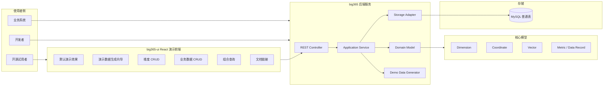

# Feature Specification: big365

> Feature: `big365`  
> 标识符: `FR-BIG365-MVP`  
> 状态: `specified`  
> 优先级: `P0`  
> 作者: `usb`  
> 创建日期: `2026-06-06`  
> 输入来源: `.sddu/specs-tree-root/specs-tree-big365/discovery.md`  
> 拆分决策: 暂不拆分，按单一聚合 Feature 创建完整 MVP 规范

---

## 1. 元数据

| 字段 | 内容 |
|---|---|
| Feature 名称 | big365 |
| Feature 标识符 | FR-BIG365-MVP |
| Feature 类型 | 开源多维数据服务 MVP |
| 当前阶段 | Spec / 规范编写 |
| 优先级 | P0 |
| 创建日期 | 2026-06-06 |
| 作者 | usb |
| 主要干系人 | 潜在中小业务用户、后端开发者、开源项目评估者、项目维护者 |
| 目标版本 | MVP |
| 规范目录 | `.sddu/specs-tree-root/specs-tree-big365/` |

---

## 2. 上下文与问题定义

### 2.1 背景

`big365` 定位为面向中小业务的开源多维数据服务。MVP 的核心不是构建完整数据平台，而是让潜在用户以低复杂度、低接入成本完成多维数据建模、CRUD、组合查询、演示验证和自助接入。

| 现状问题 | 用户影响 | MVP 应对方式 |
|---|---|---|
| 引入完整 OLAP、大数据平台或 BI 系统成本过高 | 部署、学习、开发、运维门槛高 | 提供轻量 REST API + MySQL 普通表 + Compose 一键体验 |
| 自行手写 CRUD、查询条件组合和示例数据 | 重复建设、口径不统一、接入慢 | 提供维度元数据、业务数据、组合查询的统一模型与接口 |
| 开源项目缺少可视化演示和自解释文档 | 潜在用户难以判断项目价值 | 提供 React 演示前端、日志分析教程和端到端验证 |

因此，MVP 应首先形成「快速理解 → 快速启动 → 快速试用 → 判断是否接入」的端到端闭环。

### 2.2 目标用户

| 用户角色 | 核心诉求 | 成功判断 |
|---|---|---|
| 潜在中小业务用户 | 不引入复杂平台，也能管理和查询多维业务数据 | 能在 30 分钟内完成启动、演示数据生成、CRUD 和组合查询 |
| 后端开发者 / 业务系统开发者 | 通过 REST API 写入、更新、查询业务数据 | API 清晰、示例完整、错误可理解 |
| 开源项目评估者 | 快速判断项目是否值得试用或二次开发 | Compose、前端演示、教程和测试都能跑通 |
| 项目维护者 | 在现有 Spring Boot/MyBatis/MySQL 基础上重塑 MVP | 模型、API、前端、文档、测试保持一致 |

### 2.3 相关现有功能与资产

> 工程红线：当前项目代码只能作为参考、样例或可拷贝复用的素材，不能直接基于现有工程就地修改。MVP 的所有工程代码必须以新的独立工程方式组织，避免被历史实现、目录结构和技术债绑定。

| 类型 | 当前资产 / 结论 | MVP 处理方式 | 红线 / 约束 |
|---|---|---|---|
| 后端基础 | 当前仓库已有 Java / Spring Boot / MyBatis / MySQL 基础 | 可参考架构、配置、依赖和局部实现；必要时可拷贝后重整 | 不允许直接在现有后端工程上改造；必须新建独立后端工程或模块 |
| 核心模型 | Discovery 明确 Vector / Coordinate / Dimension 是核心模型 | 在新工程中重新建立一致的领域模型、API 文档和教程表达 | 不直接继承历史模型命名和实现细节，除非经过重新设计确认 |
| 存储方向 | MVP 首选 MySQL 普通表 | 在新工程中实现 MVP 存储结构和初始化机制 | 不沿用历史分区表、宽表动态列等存储实现作为 MVP 主路径 |
| 后续能力 | MySQL 分区表、宽表动态列、Kafka 等能力已有线索 | 仅作为后续版本参考输入 | 不把历史高级能力迁入 MVP 主线，避免范围膨胀 |
| 缺口能力 | React 演示前端、Compose 启动、日志分析示例、文档、自动化测试 | 在新的独立工程结构中补齐 | 不以修补现有示例代码的方式交付 MVP |

---

## 3. Goals / Non-Goals

### 3.1 Goals

| 编号 | 目标域 | 目标 | 成功判断 |
|---|---|---|---|
| G-001 | 产品闭环 | 提供面向中小业务的开源多维数据服务 MVP，覆盖从启动到试用的端到端闭环。 | 用户可从 README/教程开始完成启动、演示数据生成、CRUD、组合查询。 |
| G-002 | 接入方式 | 支持 REST API 作为首个接入方式。 | 核心能力均可通过 HTTP API 完成。 |
| G-003 | 维度管理 | 支持维度元数据完整 CRUD。 | 创建、查询、更新、删除/禁用均可验证。 |
| G-004 | 数据管理 | 支持业务数据完整 CRUD。 | 业务数据写入、读取、修改、删除均可验证。 |
| G-005 | 查询能力 | 支持多维条件过滤与时间/周期范围组合查询。 | 日志分析示例可按多个维度和时间范围查询。 |
| G-006 | 模型一致性 | 确保 Vector / Coordinate / Dimension 在代码、API 文档、教程中定义一致。 | 同一概念在各交付物中无冲突解释。 |
| G-007 | 存储实现 | 使用 MySQL 普通表作为 MVP 第一个存储实现。 | Compose 启动后可直接初始化和读写数据。 |
| G-008 | 前端演示 | 提供 React 简单演示前端，让用户先看到默认演示效果，再参与数据生成和查询。 | 用户打开前端即可理解项目用途并完成核心操作。 |
| G-009 | 示例场景 | 提供日志分析场景作为贯穿式示例。 | 教程、前端、API 示例使用同一场景。 |
| G-010 | 数据生成 | 支持可配置演示数据生成，至少覆盖小样例、万级、百万级三档。 | 用户可配置参数并看到生成状态和摘要。 |
| G-011 | 部署体验 | 同时提供 docker-compose 与 podman-compose 体验方式。 | 两种方式均可启动后端、MySQL 和前端。 |
| G-012 | 文档体验 | 提供自解释文档：快速开始、概念模型、API 文档、完整教程。 | 新用户无需询问维护者即可完成端到端体验。 |
| G-013 | 质量保障 | 提供自动化测试和端到端验证方式，确保交付闭环可重复验证。 | 后端、API、前端基础验证和端到端验证均可运行。 |

### 3.2 Non-Goals

| 编号 | 不做事项 | 排除原因 / 边界说明 |
|---|---|---|
| NG-001 | 不做权限系统、多租户、角色管理、审计等生产级安全体系。 | MVP 目标是验证开源试用闭环，不进入生产级治理范围。 |
| NG-002 | 不做多数据库适配，只实现 MySQL 普通表存储。 | 降低首版复杂度，但保留未来可插拔存储边界。 |
| NG-003 | 不追求复杂性能优化，不以分区表、宽表动态列、百亿级压测作为主目标。 | MVP 优先功能闭环，性能优化放到后续版本。 |
| NG-004 | 不做完整数据平台，不覆盖建模治理、BI、流处理、调度等完整平台能力。 | 避免范围蔓延，保持轻量定位。 |
| NG-005 | 不把 Kafka 写入作为主路径。 | MVP 首先验证 REST API 接入体验。 |
| NG-006 | React 前端不做复杂管理后台或通用 BI 可视化平台。 | 前端定位为 API 演示和试用辅助。 |
| NG-007 | 不强制用户直接理解 Vector / Coordinate 内部概念。 | 基础 API 使用 dimensions/filters 等业务化表达，高级概念在文档中解释。 |

---

## 4. 用户故事

| 编号 | 角色 | 我想要 | 以便 | 覆盖能力 |
|---|---|---|---|---|
| US-001 | 开源试用者 | 通过 docker-compose 或 podman-compose 一键启动 big365 | 不搭建复杂环境也能快速体验 | Compose 启动 |
| US-002 | 开源试用者 | 打开 React 演示前端后先看到默认演示效果 | 快速理解 big365 能做什么 | React 演示 |
| US-003 | 业务开发者 | 通过 REST API 创建、查询、更新、删除维度元数据 | 定义我的业务分析维度 | 维度 CRUD |
| US-004 | 业务开发者 | 通过 REST API 创建、查询、更新、删除业务数据 | 将业务记录接入 big365 | 业务数据 CRUD |
| US-005 | 业务开发者 | 按应用、接口、状态码、环境、区域和时间范围组合查询日志指标 | 定位业务运行情况 | 组合查询 |
| US-006 | 开源评估者 | 在前端页面中生成不同规模的演示数据 | 观察项目在小样例、万级、百万级数据下的基本表现 | 演示数据生成 |
| US-007 | 开源评估者 | 阅读快速开始、概念模型、API 文档和完整教程 | 不询问维护者也能自助试用 | 文档教程 |
| US-008 | 项目维护者 | 让模型、API、前端、示例和测试保持一致 | 降低后续维护成本 | 模型一致性 |
| US-009 | 后端开发者 | 获得统一响应格式和清晰错误信息 | 更容易调试接入问题 | API 响应规范 |
| US-010 | 项目维护者 | 通过自动化测试验证核心闭环 | 避免文档、接口和实现漂移 | 测试验收 |

---

## 5. 功能需求

> 阅读说明：本章按能力域分组。每条需求都保留唯一 FR 编号，并给出可验证的验收标准，便于后续 Plan、Tasks、Review 和 Validate 阶段追踪。

### 5.1 启动与部署

| 编号 | 需求 | 验收标准 |
|---|---|---|
| FR-001 | 系统必须提供 `docker-compose` 启动方式，启动范围至少包含后端服务和 MySQL；若前端不由后端托管，则必须同时包含前端服务。 | 新用户执行文档中的 docker-compose 命令后，能够访问后端健康检查接口和前端演示入口。 |
| FR-002 | 系统必须提供 `podman-compose` 启动方式，能力与 docker-compose 等价。 | 新用户执行文档中的 podman-compose 命令后，能够访问后端健康检查接口和前端演示入口。 |
| FR-003 | Compose 启动必须自动初始化 MVP 所需数据库结构和基础演示配置。 | 首次启动后无需手工执行额外 SQL 即可创建维度、写入业务数据并执行查询。 |
| FR-004 | 后端服务必须提供健康检查接口，用于 Compose 健康检查和用户验证。 | 在依赖可用时健康检查返回成功；数据库不可用时返回可诊断的非成功状态。 |

### 5.2 核心模型

| 编号 | 模型/能力 | 需求 | 验收标准 |
|---|---|---|---|
| FR-005 | Dimension | 系统必须定义 Dimension，用于描述业务维度元数据，例如应用、接口、状态码、环境、区域、时间粒度。 | 文档、后端模型和 API 示例对 Dimension 的字段和含义保持一致。 |
| FR-006 | Coordinate | 系统必须定义 Coordinate，用于表示一条业务数据在多个 Dimension 上的坐标取值。 | 业务数据写入和查询结果中能够体现各维度取值，并可映射到 Coordinate 概念。 |
| FR-007 | Vector | 系统必须定义 Vector，用于表示可被多维查询的数据记录或指标集合。 | 文档说明 Vector 与业务数据记录、维度坐标、指标值之间的关系；测试覆盖至少一条 Vector 的写入和查询。 |
| FR-008 | API 表达 | MVP 基础 API 可以使用 `dimensions`、`filters`、`metrics`、`timeRange` 等业务化字段表达，不要求用户在基础路径直接提交 Vector/Coordinate 术语。 | API 文档同时说明业务化字段与核心模型之间的映射关系。 |

### 5.3 维度元数据 CRUD

| 编号 | 操作 | 需求 | 验收标准 |
|---|---|---|---|
| FR-009 | Create | 系统必须支持创建维度元数据。 | 提交合法维度名称、编码、类型、描述后，系统返回新维度唯一标识并可再次查询。 |
| FR-010 | Read | 系统必须支持按唯一标识查询单个维度元数据。 | 查询存在的维度返回完整字段；查询不存在的维度返回明确错误或空结果语义。 |
| FR-011 | List | 系统必须支持分页或列表查询维度元数据。 | 用户可获取全部或分页维度列表，结果包含维度编码、名称、类型、状态等核心字段。 |
| FR-012 | Update | 系统必须支持更新维度元数据的名称、描述、状态等可变字段。 | 更新成功后再次查询能看到变更；不可变字段若不允许更新必须返回明确错误。 |
| FR-013 | Delete/Disable | 系统必须支持删除或禁用维度元数据。 | 删除或禁用后，列表和查询结果体现正确状态；若维度已被数据使用，必须有明确处理策略和错误信息。 |
| FR-014 | Unique Constraint | 系统必须校验维度编码唯一性。 | 重复创建相同维度编码时请求失败，并返回可理解错误码或错误消息。 |

### 5.4 业务数据 CRUD

| 编号 | 操作 | 需求 | 验收标准 |
|---|---|---|---|
| FR-015 | Create | 系统必须支持创建业务数据记录，记录至少包含维度取值、时间/周期、一个或多个指标值。 | 提交合法日志指标数据后，系统返回数据记录唯一标识并可查询。 |
| FR-016 | Read | 系统必须支持按唯一标识查询业务数据记录。 | 查询存在记录返回维度取值、时间/周期和指标值；不存在记录返回明确结果。 |
| FR-017 | List/Search | 系统必须支持分页或条件列表查询业务数据记录。 | 用户可按基础条件查看业务数据列表，并能控制分页参数。 |
| FR-018 | Update | 系统必须支持更新业务数据记录的维度取值、时间/周期和指标值。 | 更新后再次查询能看到最新值；非法维度或非法指标类型返回校验错误。 |
| FR-019 | Delete | 系统必须支持删除业务数据记录。 | 删除后按 ID 查询不可再获得该记录，或返回已删除状态；删除不存在记录有明确语义。 |
| FR-020 | Log Metrics | 系统必须支持日志分析示例中的核心指标：请求量、错误数、平均耗时。 | 示例数据、API 文档和前端查询结果均能展示这三个指标。 |

### 5.5 组合查询

| 编号 | 能力 | 需求 | 验收标准 |
|---|---|---|---|
| FR-021 | 多维过滤 | 系统必须支持按多个维度条件组合过滤业务数据。 | 用户可同时按应用、接口、状态码、环境、区域等至少 3 个维度过滤，并获得符合条件的结果。 |
| FR-022 | 时间范围 | 系统必须支持时间或周期范围查询。 | 用户提交开始时间和结束时间后，只返回范围内数据。 |
| FR-023 | 条件组合 | 系统必须支持维度条件与时间/周期范围同时生效。 | 同一查询请求中同时包含维度过滤和时间范围时，结果满足所有条件。 |
| FR-024 | 返回控制 | 系统必须支持组合查询结果分页或限制返回条数。 | 用户可以限制返回数量，避免一次返回过大结果集。 |
| FR-025 | 参数校验 | 系统必须在查询请求非法时返回明确校验错误。 | 不存在的维度、非法时间范围、非法分页参数均返回可理解错误信息。 |
| FR-026 | 示例查询 | 系统必须提供日志分析组合查询示例。 | 文档和前端都包含按应用 + 接口 + 状态码 + 时间范围查询的示例。 |

### 5.6 演示数据生成

| 编号 | 能力 | 需求 | 验收标准 |
|---|---|---|---|
| FR-027 | 小样例 | 系统必须支持生成小样例演示数据。 | 用户触发小样例生成后，系统写入可在前端立即查询的数据。 |
| FR-028 | 万级数据 | 系统必须支持生成万级演示数据。 | 用户选择万级规模后，系统完成生成并返回生成摘要；组合查询可用。 |
| FR-029 | 百万级数据 | 系统必须支持生成百万级演示数据。 | 用户选择百万级规模后，系统能执行生成流程，并向用户展示进度、完成或失败原因。 |
| FR-030 | 参数配置 | 演示数据生成必须允许用户配置数据量、时间范围、应用数量、接口数量、错误率等参数。 | 前端提交这些参数后，后端按参数生成数据，并返回参数摘要。 |
| FR-031 | 阶段状态 | 演示数据生成必须展示阶段状态，至少包括初始化、生成、写入、统计、完成或失败。 | 前端可展示当前阶段和最终生成摘要。 |

### 5.7 React 演示前端

| 编号 | 页面/入口 | 需求 | 验收标准 |
|---|---|---|---|
| FR-032 | 前端交付 | 系统必须提供 React 演示前端模块或等效前端交付物。 | Compose 启动后用户可以通过浏览器访问演示页面。 |
| FR-033 | 首页演示 | 前端首页必须先展示默认演示效果或示例查询结果。 | 用户打开页面后无需先理解内部模型即可看到 big365 的用途。 |
| FR-034 | 数据生成向导 | 前端必须提供演示数据生成向导。 | 用户可配置生成参数、提交生成请求并看到进度或结果。 |
| FR-035 | 维度管理 | 前端必须提供维度元数据 CRUD 的基础操作入口。 | 用户可在前端创建、查看、编辑、删除或禁用维度。 |
| FR-036 | 数据管理 | 前端必须提供业务数据 CRUD 的基础操作入口。 | 用户可在前端创建、查看、编辑、删除业务数据。 |
| FR-037 | 组合查询 | 前端必须提供组合查询页面。 | 用户可输入业务化筛选条件和时间范围，执行查询并查看表格结果。 |
| FR-038 | 文档入口 | 前端必须提供文档/API 示例入口链接。 | 用户可以从前端跳转到快速开始、概念模型或 API 文档。 |

### 5.8 API 与响应规范

| 编号 | 能力 | 需求 | 验收标准 |
|---|---|---|---|
| FR-039 | REST API | 系统必须提供 REST API 作为 MVP 第一接入方式。 | 维度 CRUD、业务数据 CRUD、组合查询、演示数据生成均可通过 HTTP API 完成。 |
| FR-040 | 统一响应 | 系统应提供统一 API 响应结构。 | 成功和失败响应包含统一的状态、消息、数据和错误信息字段。 |
| FR-041 | API 文档 | 系统应提供 OpenAPI / Swagger 或等效 API 文档。 | 用户可查看接口路径、请求参数、响应结构和示例。 |
| FR-042 | 参数校验 | 系统必须对请求参数进行校验。 | 缺失必填字段、字段类型错误、枚举值非法时返回校验错误。 |

### 5.9 文档与教程

| 编号 | 文档类型 | 需求 | 验收标准 |
|---|---|---|---|
| FR-043 | 快速开始 | 系统必须提供快速开始文档。 | 新用户只依赖快速开始即可启动服务并打开前端。 |
| FR-044 | 概念模型 | 系统必须提供概念模型文档。 | 文档清楚解释 Dimension、Coordinate、Vector 及其与 API 字段的关系。 |
| FR-045 | API 文档 | 系统必须提供 API 文档。 | 文档覆盖维度 CRUD、业务数据 CRUD、组合查询、演示数据生成和健康检查。 |
| FR-046 | 完整教程 | 系统必须提供日志分析完整教程。 | 教程覆盖建模、数据生成、写入、更新、删除、组合查询和结果解释。 |
| FR-047 | 示例一致性 | 文档中的示例必须与实际 API 和前端行为一致。 | 示例请求可执行，示例字段与实现一致。 |

### 5.10 测试与验收

| 编号 | 验证范围 | 需求 | 验收标准 |
|---|---|---|---|
| FR-048 | 后端测试 | 系统必须提供后端核心模型和服务逻辑测试。 | 测试覆盖维度、业务数据、组合查询核心路径。 |
| FR-049 | API 测试 | 系统必须提供关键 REST API 测试或集成测试。 | 维度 CRUD、业务数据 CRUD、组合查询、数据生成接口均有可自动运行的验证。 |
| FR-050 | 前端验证 | 系统必须提供前端基础可用性测试或等效验证。 | 前端构建通过，核心页面或关键交互有自动化或脚本验证。 |
| FR-051 | 端到端验证 | 系统必须提供端到端验证方式。 | 能验证启动、初始化、数据生成、CRUD、组合查询、前端访问的完整链路。 |

---

## 6. 非功能需求

| 编号 | 类别 | 要求 | 验收 / 度量方式 |
|---|---|---|---|
| NFR-001 | 性能 / 启动 | 在常见开发机环境下，docker-compose 或 podman-compose 应在 10 分钟内完成后端、MySQL、前端启动。 | 记录从执行启动命令到健康检查和前端可访问的耗时。 |
| NFR-002 | 可用性 / 体验 | 新用户应能在 30 分钟内完成日志分析示例的 CRUD 与组合查询。 | 通过新用户试跑或端到端脚本验证。 |
| NFR-003 | 性能 / 查询 | 小样例和万级数据下，典型组合查询应达到交互式可用；百万级数据允许更慢，但必须有明确进度、限制或提示。 | 对小样例、万级、百万级分别执行典型查询并记录响应表现。 |
| NFR-004 | 安全 / 数据 | MVP 不提供生产级权限，但不得在仓库或镜像中包含真实密钥、真实账号或敏感数据。 | 代码审查、配置审查、镜像构建审查。 |
| NFR-005 | 安全 / 输入 | 所有写入和查询接口必须进行参数校验，避免明显 SQL 注入风险和无边界查询风险。 | API 测试覆盖非法参数、超大分页和异常过滤条件。 |
| NFR-006 | 可用性 / 错误 | 错误信息必须面向用户可理解，避免只返回底层异常堆栈。 | 人工检查或测试验证典型失败响应。 |
| NFR-007 | 兼容性 / 部署 | Compose 交付应覆盖 Docker Compose 与 Podman Compose；文档需说明已验证版本或最低要求。 | 分别按两种 Compose 工具执行快速开始。 |
| NFR-008 | 可维护性 / 术语 | 核心模型、API、存储、前端示例和文档术语必须保持一致。 | Review 阶段检查术语表、API 示例和代码命名。 |
| NFR-009 | 可测试性 | 每个功能需求都必须能通过自动化测试、脚本、API 调用或人工验收步骤验证。 | Traceability Matrix 中每个 FR 均能映射到验证方式。 |
| NFR-010 | 可扩展性 / 存储 | MVP 存储实现为 MySQL 普通表，但代码边界应避免把所有业务逻辑固化到 MySQL 细节中。 | Plan/Review 阶段检查存储适配边界。 |
| NFR-011 | 文档 / 自解释 | 新用户无需询问维护者，应能按 README/教程完成端到端体验。 | 邀请 1-3 个新用户按文档试跑并收集反馈。 |
| NFR-012 | 可观测性 | 演示数据生成、启动失败、数据库连接失败、查询参数错误等关键场景应有可诊断日志或用户提示。 | 触发典型失败场景，确认日志和前端/API 提示可定位问题。 |

---

## 7. 技术设计

### 7.1 逻辑架构



### 7.2 模块边界

| 模块 | 职责 | MVP 要求 |
|---|---|---|
| 后端 REST API | 对外提供维度、业务数据、查询、演示数据生成接口 | 必须完成 |
| 核心领域模型 | 定义 Dimension / Coordinate / Vector / Data Record | 必须完成 |
| MySQL 存储适配 | 基于普通表保存维度和业务数据 | 必须完成 |
| 演示数据生成器 | 按参数生成日志分析样例数据 | 必须完成 |
| React 演示前端 | 展示默认效果、数据生成、CRUD、组合查询 | 必须完成 |
| Compose 交付 | 启动 MySQL、后端、前端 | 必须完成 |
| 文档与测试 | 快速开始、模型、API、教程、自动化验证 | 必须完成 |

### 7.3 数据模型草案

> 具体字段可在 Plan 阶段结合现有代码细化，但必须满足以下语义。

#### Dimension

| 字段 | 说明 |
|---|---|
| id | 维度唯一标识 |
| code | 维度编码，全局唯一，例如 `app`、`endpoint` |
| name | 维度展示名称 |
| type | 维度类型，例如 string、number、time、enum |
| description | 维度说明 |
| enabled | 是否启用 |
| createdAt / updatedAt | 创建和更新时间 |

#### Business Data Record / Vector

| 字段 | 说明 |
|---|---|
| id | 数据记录唯一标识 |
| timeKey / period | 时间或周期字段 |
| dimensions | 多个维度取值，例如 app、endpoint、statusCode、env、region |
| metrics | 指标值集合，例如 requestCount、errorCount、avgLatency |
| createdAt / updatedAt | 创建和更新时间 |

#### Demo Generation Job

| 字段 | 说明 |
|---|---|
| jobId | 生成任务唯一标识 |
| scale | small / ten-thousand / million 等规模 |
| parameters | 数据量、时间范围、应用数量、接口数量、错误率等参数 |
| status | pending / initializing / generating / writing / summarizing / completed / failed |
| progress | 进度百分比或阶段信息 |
| summary | 生成记录数、维度数、耗时、失败原因等摘要 |

### 7.4 API 资源草案

| 资源 | 方法 | 路径示例 | 说明 |
|---|---|---|---|
| 健康检查 | GET | `/api/health` | 服务和依赖健康状态 |
| 维度列表 | GET | `/api/dimensions` | 查询维度列表 |
| 创建维度 | POST | `/api/dimensions` | 创建维度 |
| 维度详情 | GET | `/api/dimensions/{id}` | 查询单个维度 |
| 更新维度 | PUT/PATCH | `/api/dimensions/{id}` | 更新维度 |
| 删除维度 | DELETE | `/api/dimensions/{id}` | 删除或禁用维度 |
| 数据列表 | GET | `/api/records` | 查询业务数据列表 |
| 创建数据 | POST | `/api/records` | 创建业务数据 |
| 数据详情 | GET | `/api/records/{id}` | 查询单条业务数据 |
| 更新数据 | PUT/PATCH | `/api/records/{id}` | 更新业务数据 |
| 删除数据 | DELETE | `/api/records/{id}` | 删除业务数据 |
| 组合查询 | POST | `/api/query` | 多维条件 + 时间范围查询 |
| 创建演示数据 | POST | `/api/demo-data/jobs` | 创建演示数据生成任务 |
| 查询生成进度 | GET | `/api/demo-data/jobs/{jobId}` | 查询生成阶段和结果 |

### 7.5 组合查询请求草案

```json
{
  "filters": {
    "app": ["order-service"],
    "endpoint": ["/api/orders"],
    "statusCode": ["500"],
    "env": ["prod"],
    "region": ["cn-east"]
  },
  "timeRange": {
    "from": "2026-06-01T00:00:00Z",
    "to": "2026-06-06T23:59:59Z"
  },
  "metrics": ["requestCount", "errorCount", "avgLatency"],
  "page": {
    "pageNo": 1,
    "pageSize": 50
  }
}
```

### 7.6 API 响应草案

```json
{
  "success": true,
  "code": "OK",
  "message": "success",
  "data": {},
  "error": null
}
```

失败响应必须包含可理解错误码和消息，不得仅返回底层异常堆栈。

### 7.7 第三方依赖与外部 API

| 依赖 | 类型 | MVP 用途 | 备注 |
|---|---|---|---|
| MySQL | 数据库 | 普通表存储 | 必须提供 Compose 启动配置 |
| Docker Compose | 部署工具 | 一键体验 | 必须提供文档 |
| Podman Compose | 部署工具 | 一键体验 | 必须提供文档 |
| React | 前端框架 | 演示前端 | 可按现有技术栈选择构建工具 |
| OpenAPI/Swagger | API 文档工具 | 降低试用成本 | Should Have，但建议纳入 MVP |

外部 API 依赖：当前规范未发现必须调用的外部第三方 HTTP API。若后续引入外部 API，应先运行 `/sddu:api-docs` 缓存 API 文档，并在开放问题中记录。

---

## 8. 边界情况

| 编号 | 场景 | 预期处理 | 关联需求 |
|---|---|---|---|
| EC-001 | 用户重复创建相同维度编码 | 系统必须拒绝请求，并返回维度编码已存在的可理解错误。 | FR-009, FR-014 |
| EC-002 | 用户删除已被业务数据使用的维度 | 系统必须明确采用禁止删除、软删除或禁用策略，并返回一致结果。 | FR-013, FR-015 |
| EC-003 | 用户提交不存在的维度编码作为业务数据维度 | 系统必须返回参数校验错误，不写入非法数据。 | FR-015, FR-042 |
| EC-004 | 用户提交非法时间范围，例如开始时间晚于结束时间 | 系统必须返回校验错误。 | FR-022, FR-025 |
| EC-005 | 用户提交过大的 pageSize 或不分页查询 | 系统必须限制返回规模并提示用户。 | FR-017, FR-024, NFR-005 |
| EC-006 | 用户执行无过滤条件的大范围查询 | 系统必须有默认限制或明确警告，避免拖垮服务。 | FR-021, FR-024, NFR-003 |
| EC-007 | MySQL 启动失败或连接失败 | 健康检查和前端必须展示可诊断信息。 | FR-004, NFR-012 |
| EC-008 | 演示数据生成过程中断 | 系统必须记录失败状态和失败原因，前端必须展示失败状态。 | FR-031, NFR-012 |
| EC-009 | 演示数据重复生成 | 系统必须明确是追加、覆盖还是创建新批次。 | FR-027 ~ FR-031 |
| EC-010 | 百万级数据生成耗时较长 | 系统必须提供阶段状态，避免用户误以为页面卡死。 | FR-029, FR-031, NFR-003 |
| EC-011 | 并发创建相同维度编码 | 系统必须保证最终只有一个创建成功。 | FR-014 |
| EC-012 | 并发更新或删除同一业务数据 | 系统必须返回一致结果，避免前端展示脏状态。 | FR-018, FR-019 |
| EC-013 | 文档示例与实现不一致 | 端到端验证必须能暴露问题，避免文档漂移。 | FR-047, FR-051 |
| EC-014 | 前端无法访问后端 | 页面必须展示后端不可用提示，而不是空白页。 | FR-032, NFR-006 |
| EC-015 | Compose 环境端口冲突 | 文档必须说明如何修改端口或排查。 | FR-001, FR-002, FR-043 |

---

## 9. 成功指标与验收标准

| 指标 | MVP 目标 | 验证方式 |
|---|---|---|
| 快速启动 | 10 分钟内启动后端、MySQL、前端 | 按快速开始执行 Compose 命令 |
| 快速体验 | 30 分钟内完成日志分析示例 CRUD 与组合查询 | 新用户试跑或端到端脚本 |
| 功能闭环 | 维度 CRUD、业务数据 CRUD、组合查询均可通过 API 和前端完成 | API 测试 + 前端验证 |
| 文档自解释 | 新用户无需询问维护者即可完成端到端体验 | 1-3 个新用户试用反馈 |
| 模型一致性 | Vector / Coordinate / Dimension 在代码、API 文档、教程定义一致 | 文档审查 + 测试用例 |
| 数据生成 | 至少支持小样例、万级、百万级三档 | 数据生成接口和前端验证 |
| 测试质量 | 后端、关键 API、前端基础验证通过率 100% | CI 或本地测试命令 |

---

## 10. 拆分确认处理（FR-111）

Discovery 阶段提出了 backend-service、demo-frontend、docs-examples、sample-data-generator、storage-mysql-basic、storage-spi 等拆分机会。本次 Spec 阶段用户选择「暂不拆分」，因此按拒绝拆分处理。

| 项目 | 决策 / 说明 |
|---|---|
| 拆分决策 | 暂不拆分，按 `big365` 单一聚合 Feature 编写完整规范。 |
| 子 Feature 目录 | 不创建。 |
| Discovery 产物 | 不修改 Discovery 阶段产物；拒绝拆分原因仅记录在本 `spec.md` 中。 |
| 后续处理 | `@sddu-plan` 阶段仍可按工程实现边界拆分为工作包，但这些工作包不作为独立 Feature 管理。 |

| 拒绝拆分原因 | 说明 |
|---|---|
| 端到端闭环优先 | MVP 的主要目标是验证完整体验，而不是局部模块最优。 |
| 示例一致性要求高 | 后端、前端、文档、数据生成和测试需要围绕同一个日志分析示例保持一致。 |
| 降低协调成本 | 过早拆分会增加模型、API、示例、验收标准的同步成本。 |

---

## 11. 开放问题

| 编号 | 问题 | 建议决策阶段 | 影响范围 |
|---|---|---|---|
| OQ-001 | 业务数据通用模型最终采用 Metric + Dimensions + TimeKey + Value，还是更接近事件/记录模型？ | Plan | 数据模型、API、存储表结构 |
| OQ-002 | Vector / Coordinate 在 API 中应采用完全隐藏、半暴露还是高级接口暴露？ | Plan | API 设计、概念模型文档、前端表达 |
| OQ-003 | MySQL 普通表采用 JSON 字段保存维度/指标，还是采用更结构化的普通表设计？ | Plan | 存储模型、索引、查询性能 |
| OQ-004 | 组合查询 MVP 是否需要聚合统计，还是仅返回明细记录？ | Plan | 查询 API、前端结果展示、测试用例 |
| OQ-005 | 百万级演示数据生成是否同步执行、异步任务执行，还是根据环境自动降级？ | Plan | 数据生成器、前端进度展示、性能体验 |
| OQ-006 | 前端交付采用独立前端服务、构建后由后端托管，还是 Nginx 托管？ | Plan | Compose 文件、部署文档、前后端模块边界 |
| OQ-007 | docker-compose 与 podman-compose 是否共用同一 compose 文件，还是分别提供适配文件？ | Plan | 部署交付、快速开始文档 |
| OQ-008 | OpenAPI / Swagger 是否纳入 MVP 必做，还是作为 Should Have 延后？ | Plan | API 文档、试用体验 |
| OQ-009 | 删除维度和业务数据采用硬删除、软删除还是禁用策略？ | Plan | CRUD 语义、边界情况、测试用例 |
| OQ-010 | 是否需要把文档中的 API 示例纳入自动化测试，避免文档漂移？ | Plan / Tasks | 文档质量、端到端验证、CI |

---

## 12. 下游 Plan 阶段提示

`@sddu-plan big365` 应重点把本规范转化为架构决策、模块边界、数据模型、接口设计和可执行实施方案。

| 序号 | Plan 重点 | 预期输出 |
|---|---|---|
| 1 | 后端模块结构与现有代码迁移策略 | 模块划分、保留/重构/移除清单 |
| 2 | Dimension / Coordinate / Vector / Record 的最终数据模型 | 领域模型、DTO、表结构映射 |
| 3 | MySQL 普通表结构、索引和初始化脚本 | DDL、初始化数据、索引策略 |
| 4 | REST API 路径、请求/响应 DTO、错误码 | API 设计表、错误码表、示例请求响应 |
| 5 | 演示数据生成任务的同步/异步实现方案 | 任务模型、状态流转、进度查询方案 |
| 6 | React 前端页面结构与 API 调用边界 | 页面清单、组件边界、接口调用关系 |
| 7 | docker-compose / podman-compose 文件结构 | Compose 服务拓扑、端口、环境变量、健康检查 |
| 8 | 自动化测试、端到端验证和文档一致性检查 | 测试矩阵、验证脚本、CI 建议 |

---

## 13. Traceability Matrix

| Discovery Must Have | Spec 覆盖 |
|---|---|
| M1 Compose 一键体验 | FR-001, FR-002, FR-003, NFR-001 |
| M2 REST API 接入 | FR-039, FR-040, FR-041 |
| M3 维度元数据 CRUD | FR-009 ~ FR-014 |
| M4 业务数据 CRUD | FR-015 ~ FR-020 |
| M5 组合查询 | FR-021 ~ FR-026 |
| M6 核心模型一致 | FR-005 ~ FR-008, NFR-008 |
| M7 MySQL 普通表存储 | 技术设计 7.3, NFR-010 |
| M8 React 演示前端 | FR-032 ~ FR-038 |
| M9 日志分析示例 | FR-020, FR-026, FR-046 |
| M10 可配置数据生成 | FR-027 ~ FR-031 |
| M11 自解释文档 | FR-043 ~ FR-047, NFR-011 |
| M12 自动化测试 | FR-048 ~ FR-051 |
