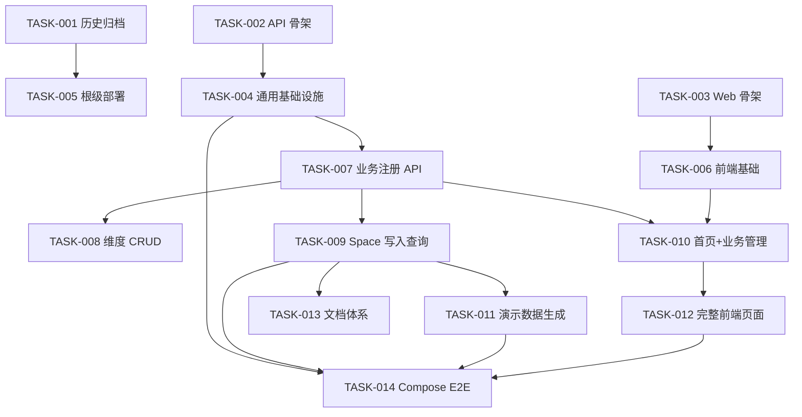

# Task Breakdown: big365

> Feature: `big365`
> 标识符: `FR-BIG365-MVP`
> 状态: `tasked`
> 来源计划: `.sddu/specs-tree-root/specs-tree-big365/plan.md`
> 创建日期: `2026-06-06`
> 总任务数: 14 个
> 执行波次: 6 个波次

---

## 任务汇总

| # | 任务 | 复杂度 | 波次 | 前置依赖 | 主要产出 |
|---:|---|---:|---:|---|---|
| TASK-001 | 历史资产归档 | S | 1 | 无 | `backup/legacy-20260606/` |
| TASK-002 | big365-api 工程骨架 | M | 1 | 无 | `big365-api/` 完整目录结构与基础文件 |
| TASK-003 | big365-web 工程骨架 | M | 1 | 无 | `big365-web/` 完整目录结构与基础文件 |
| TASK-004 | 后端通用基础设施 | M | 2 | TASK-002 | ApiResponse、ErrorCode、异常处理、健康检查、OpenAPI |
| TASK-005 | 根级部署与入口文件 | S | 2 | TASK-001 | compose.yml、.env.example、根 README.md |
| TASK-006 | 前端基础框架 | S | 2 | TASK-003 | API client、类型定义、Layout、路由、全局样式 |
| TASK-007 | 业务注册 API | L | 3 | TASK-004 | biz_registry DDL、动态建表、注册/列表接口 |
| TASK-008 | 维度 CRUD API + 测试 | M | 4 | TASK-007 | Dimension 模型、Mapper、Service、Controller、Python 测试 |
| TASK-009 | Space 写入查询 API + 测试 | L | 4 | TASK-007 | Space 模型、级联更新、坐标查询、Python 测试 |
| TASK-010 | 前端业务管理与首页 | M | 4 | TASK-006, TASK-007 | BizPage、HomePage、BizRegisterModal |
| TASK-011 | 演示数据生成 API + 测试 | L | 5 | TASK-009 | 异步 Job 模型、批量生成、进度查询、Python 测试 |
| TASK-012 | 前端维度/空间/演示/文档页面 | M | 5 | TASK-010 | DimensionsPage、SpacePage、DemoDataPage、DocsPage |
| TASK-013 | 文档体系 | M | 6 | TASK-009 | quick-start、concepts、api、tutorial、troubleshooting |
| TASK-014 | Compose 闭环与 E2E 验证 | M | 6 | TASK-004, TASK-009, TASK-011, TASK-012 | Dockerfiles、compose 调优、E2E 脚本、Playwright 测试 |

---

## Wave 1 — 工程骨架（无依赖，可并行）

### TASK-001: 历史资产归档

**复杂度**: S
**前置依赖**: 无
**执行波次**: 1

#### 描述
将现有 Java 多模块工程、文档和 README 迁移到 `backup/legacy-20260606/` 目录，为新 MVP 工程释放命名空间。迁移后的历史资产仅供参考，不被新工程依赖或引用。

#### 涉及文件
- [MOVE] `pom.xml` → `backup/legacy-20260606/pom.xml`
- [MOVE] `big365-core/` → `backup/legacy-20260606/big365-core/`
- [MOVE] `big365-web/` → `backup/legacy-20260606/big365-web/`
- [MOVE] `doc/` → `backup/legacy-20260606/doc/`
- [MOVE] `README.md` → `backup/legacy-20260606/README.md`
- [MOVE] `README.en.md` → `backup/legacy-20260606/README.en.md`
- [NEW] `backup/legacy-20260606/README.md`（历史资产说明）

#### 验收标准
- [ ] `backup/legacy-20260606/` 包含所有历史工程文件
- [ ] 根目录 `pom.xml`、`big365-core/`、`big365-web/`、`doc/` 不再存在
- [ ] `backup/legacy-20260606/README.md` 明确标注「仅供参考，非当前 MVP 代码」
- [ ] 根目录 `.gitee/`、`.opencode/`、`.sddu/` 未被迁移

#### 验证命令
```bash
# 验证历史文件已迁移
ls backup/legacy-20260606/pom.xml backup/legacy-20260606/big365-core backup/legacy-20260606/big365-web backup/legacy-20260606/doc

# 验证根目录不再有历史工程文件
test ! -f pom.xml && test ! -d big365-core && test ! -d big365-web && test ! -d doc && echo "OK: legacy files moved"

# 验证关键配置未被迁移
test -d .gitee && test -d .opencode && test -d .sddu && echo "OK: config dirs preserved"
```

---

### TASK-002: big365-api 工程骨架

**复杂度**: M
**前置依赖**: 无
**执行波次**: 1

#### 描述
创建 Spring Boot 3.5.14 + Java 21 + MyBatis 的独立 Maven 工程。包含完整的目录结构、构建配置、Spring Boot 主类和应用配置。工程应能通过 `mvn spring-boot:run` 启动（即使尚无业务代码）。

#### 涉及文件
- [NEW] `big365-api/pom.xml`
- [NEW] `big365-api/Dockerfile`
- [NEW] `big365-api/scripts/start.sh`
- [NEW] `big365-api/scripts/stop.sh`
- [NEW] `big365-api/src/main/java/org/big365/api/Big365ApiApplication.java`
- [NEW] `big365-api/src/main/resources/application.yml`
- [NEW] `big365-api/src/main/resources/db/001_schema.sql`（占位，内容由 TASK-007 填充）
- [NEW] `big365-api/.gitignore`

#### 验收标准
- [ ] `pom.xml` 包含 Spring Boot 3.5.14、MyBatis、MySQL Connector、springdoc-openapi、Jakarta Validation、JUnit 5 依赖
- [ ] Java 21 编译目标配置正确
- [ ] `application.yml` 包含 MySQL 连接配置（使用环境变量）、MyBatis 配置、server.port=8080
- [ ] `Big365ApiApplication.java` 为 `@SpringBootApplication` 主类
- [ ] 工程编译通过：`mvn compile`（在 big365-api/ 目录下）
- [ ] Dockerfile 基于 `eclipse-temurin:21-jre`，包含可运行的 JAR

#### 验证命令
```bash
cd big365-api && mvn compile -q && echo "OK: compilation successful"
cd big365-api && mvn test -q && echo "OK: tests pass (no tests yet is acceptable)"
```

---

### TASK-003: big365-web 工程骨架

**复杂度**: M
**前置依赖**: 无
**执行波次**: 1

#### 描述
创建 React + Vite + TypeScript 独立前端工程。包含完整的目录结构、构建配置、入口文件。工程应能通过 `npm run dev` 启动 Vite dev server（即使尚无页面内容）。

#### 涉及文件
- [NEW] `big365-web/package.json`
- [NEW] `big365-web/tsconfig.json`
- [NEW] `big365-web/vite.config.ts`（含 `/api` → `localhost:8080` 代理）
- [NEW] `big365-web/index.html`
- [NEW] `big365-web/Dockerfile`
- [NEW] `big365-web/scripts/start.sh`
- [NEW] `big365-web/scripts/stop.sh`
- [NEW] `big365-web/src/main.tsx`
- [NEW] `big365-web/src/App.tsx`（最小 `Hello big365` 占位）
- [NEW] `big365-web/src/styles/global.css`（基础样式重置）
- [NEW] `big365-web/.gitignore`

#### 验收标准
- [ ] `package.json` 包含 React 18+、TypeScript、Vite、react-router-dom、axios 依赖
- [ ] `vite.config.ts` 配置 `/api` 代理到 `http://localhost:8080`
- [ ] `npm run dev` 可在 3000 端口启动 dev server
- [ ] `npm run build` 可成功构建生产包
- [ ] Dockerfile 基于 `node:20-alpine`

#### 验证命令
```bash
cd big365-web && npm install && echo "OK: dependencies installed"
cd big365-web && npm run build && echo "OK: build successful"
# 验证 dev server 启动（不阻塞）：
cd big365-web && timeout 10 npm run dev -- --host 0.0.0.0 2>&1 | grep -q "Local:" && echo "OK: dev server starts"
```

---

## Wave 2 — 基础设施（依赖 Wave 1，可并行）

### TASK-004: 后端通用基础设施

**复杂度**: M
**前置依赖**: TASK-002
**执行波次**: 2

#### 描述
实现后端通用层：统一响应格式 `ApiResponse`、分页响应 `PageResponse`、错误码枚举 `ErrorCode`、业务异常 `BusinessException`、全局异常处理器 `GlobalExceptionHandler`、健康检查接口 `HealthController`、OpenAPI/Swagger 配置。

覆盖需求：FR-004 (健康检查)、FR-040 (统一响应)、FR-041 (API 文档)、FR-042 (参数校验)、NFR-006 (可理解错误)、NFR-012 (可诊断日志)

#### 涉及文件
- [NEW] `big365-api/src/main/java/org/big365/api/common/ApiResponse.java`
- [NEW] `big365-api/src/main/java/org/big365/api/common/PageResponse.java`
- [NEW] `big365-api/src/main/java/org/big365/api/common/ErrorCode.java`
- [NEW] `big365-api/src/main/java/org/big365/api/common/BusinessException.java`
- [NEW] `big365-api/src/main/java/org/big365/api/common/GlobalExceptionHandler.java`
- [NEW] `big365-api/src/main/java/org/big365/api/config/OpenApiConfig.java`
- [NEW] `big365-api/src/main/java/org/big365/api/config/AsyncConfig.java`
- [NEW] `big365-api/src/main/java/org/big365/api/config/WebConfig.java`
- [NEW] `big365-api/src/main/java/org/big365/api/controller/HealthController.java`

#### 验收标准
- [ ] `GET /api/health` 返回 `{"success": true, "code": "OK", "data": {"status": "UP", "database": "UP"}}`
- [ ] 数据库不可用时健康检查返回 `{"success": false, "code": "DATABASE_UNAVAILABLE", ...}`
- [ ] 所有 API 响应遵循统一格式 `{success, code, message, data, error}`
- [ ] `GlobalExceptionHandler` 拦截 `BusinessException`、`MethodArgumentNotValidException`、通用 `Exception`
- [ ] Swagger UI 可通过 `/swagger-ui.html` 访问
- [ ] 错误码枚举包含 PLAN-API 定义的全部 12 个错误码

#### 验证命令
```bash
# 启动服务后验证健康检查
curl -s http://localhost:8080/api/health | python3 -c "import sys,json; d=json.load(sys.stdin); assert d['success']==True, f'FAILED: {d}'" && echo "OK"

# 验证 Swagger UI 可访问
curl -s -o /dev/null -w "%{http_code}" http://localhost:8080/swagger-ui.html | grep -q 200 && echo "OK: swagger accessible"

# 验证统一异常响应格式（调用不存在接口）
curl -s http://localhost:8080/api/nonexistent | python3 -c "import sys,json; d=json.load(sys.stdin); assert 'success' in d and 'code' in d" && echo "OK: unified error response"
```

---

### TASK-005: 根级部署与入口文件

**复杂度**: S
**前置依赖**: TASK-001
**执行波次**: 2

#### 描述
创建仓库级部署编排文件和项目入口。包含根级 `compose.yml`（MySQL + backend + frontend 三服务拓扑）、`.env.example`（环境变量模板）和新的根 `README.md`（指向快速开始、Compose 启动、API 文档）。

覆盖需求：FR-001 (docker-compose)、FR-002 (podman-compose)、FR-043 (快速开始入口)

#### 涉及文件
- [NEW] `compose.yml`
- [NEW] `compose.podman.yml`（可选，Podman 覆盖）
- [NEW] `.env.example`
- [NEW] `README.md`

#### 验收标准
- [ ] `compose.yml` 定义 `mysql`（mysql:8.0，端口 3306）、`backend`（build big365-api/，端口 8080）、`frontend`（build big365-web/，端口 3000）三个服务
- [ ] `mysql` 服务配置健康检查 `mysqladmin ping`
- [ ] `backend` 服务配置健康检查 `GET /api/health`，依赖 `mysql` 健康
- [ ] `frontend` 服务依赖 `backend` 健康
- [ ] `.env.example` 包含 `MYSQL_ROOT_PASSWORD`、`MYSQL_DATABASE`、`BACKEND_PORT`、`FRONTEND_PORT`
- [ ] 根 `README.md` 包含项目简介、Compose 快速启动命令、文档链接

#### 验证命令
```bash
# 验证 compose 文件语法
docker compose -f compose.yml config --quiet && echo "OK: compose config valid"

# 验证 .env.example 关键变量存在
grep -q "MYSQL_ROOT_PASSWORD" .env.example && grep -q "MYSQL_DATABASE" .env.example && echo "OK: env vars"

# 验证 README 包含关键入口
grep -q "quick-start" README.md && grep -q "compose" README.md && echo "OK: README complete"
```

---

### TASK-006: 前端基础框架

**复杂度**: S
**前置依赖**: TASK-003
**执行波次**: 2

#### 描述
实现前端全局基础设施：Axios API client（带拦截器）、TypeScript 类型定义（API 响应、业务接口）、Layout 组件（Header/Breadcrumb/Toast）、React Router 路由配置、全局样式。

#### 涉及文件
- [NEW] `big365-web/src/api/client.ts`
- [NEW] `big365-web/src/api/types.ts`
- [NEW] `big365-web/src/components/Layout.tsx`
- [NEW] `big365-web/src/components/ErrorBanner.tsx`
- [NEW] `big365-web/src/components/Loading.tsx`
- [MODIFY] `big365-web/src/App.tsx`（添加路由配置）
- [MODIFY] `big365-web/src/main.tsx`（挂载 App）
- [NEW] `big365-web/src/pages/HomePage.tsx`（占位）
- [NEW] `big365-web/src/pages/BizPage.tsx`（占位）
- [NEW] `big365-web/src/pages/DimensionsPage.tsx`（占位）
- [NEW] `big365-web/src/pages/SpacePage.tsx`（占位）
- [NEW] `big365-web/src/pages/DemoDataPage.tsx`（占位）
- [NEW] `big365-web/src/pages/DocsPage.tsx`（占位）

#### 验收标准
- [ ] `client.ts` 使用 axios.create 配置 baseURL（读取 `VITE_API_BASE_URL`，默认 `/api`）、超时 10s
- [ ] 响应拦截器提取 `res.data`，错误拦截器提取 `err.response?.data?.message`
- [ ] `types.ts` 定义 `ApiResponse<T>`、`PageResponse<T>`、`BizInfo`、`DimensionInfo`、`SpaceCell`、`DemoJobInfo` 等 TypeScript 接口
- [ ] `Layout` 组件渲染 Header（Logo + 导航链接）、Breadcrumb、`<Outlet/>` 内容区
- [ ] 路由配置覆盖全部 6 个页面路由（`/`、`/biz`、`/biz/:biz/dimensions`、`/biz/:biz/space`、`/biz/:biz/demo-data`、`/docs`）
- [ ] `npm run build` 通过，无 TypeScript 类型错误

#### 验证命令
```bash
cd big365-web && npx tsc --noEmit && echo "OK: type check passed"
cd big365-web && npm run build && echo "OK: build with routing"
```

---

## Wave 3 — 业务注册（后端核心基础）

### TASK-007: 业务注册 API

**复杂度**: L
**前置依赖**: TASK-004
**执行波次**: 3

#### 描述
实现业务注册核心能力：系统表 `big365_biz_registry_t` 的 DDL 和 Mapper；业务注册接口（动态创建 3 张业务表：`dimensions_t`、`space_t`、`demo_jobs_t`）；业务列表查询接口。这是整个系统的基石——维度 CRUD、Space 写入查询、演示数据生成都依赖已注册的业务。

关键设计：
- `space_t` 坐标列数和类型由注册时维度参数动态决定
- `space_t` 日期列由注册时的 `date_range` 决定
- 维度表创建后自动 INSERT 注册请求中的维度定义

覆盖需求：FR-003 (自动初始化)、FR-005~FR-008 (核心模型关联)、NFR-010 (存储可扩展边界)

#### 涉及文件
- [NEW] `big365-api/src/main/java/org/big365/api/biz/BizController.java`
- [NEW] `big365-api/src/main/java/org/big365/api/biz/BizService.java`
- [NEW] `big365-api/src/main/java/org/big365/api/biz/BizRepository.java`（DDL 执行 + 查询）
- [NEW] `big365-api/src/main/java/org/big365/api/dto/BizRegisterRequest.java`
- [NEW] `big365-api/src/main/java/org/big365/api/dto/BizRegisterResponse.java`
- [NEW] `big365-api/src/main/java/org/big365/api/dto/BizInfo.java`
- [NEW] `big365-api/src/main/java/org/big365/api/dto/DimensionDef.java`
- [MODIFY] `big365-api/src/main/resources/db/001_schema.sql`（写入 `big365_biz_registry_t` DDL）
- [NEW] `big365-api/src/main/resources/mapper/BizRegistryMapper.xml`

#### 验收标准
- [ ] `POST /api/biz/register` 接收 `{biz_name, biz_label, dimensions[], date_range}`，创建成功返回 `{tables_created: [...]}`
- [ ] 注册业务时动态创建的 `big365_swks_{biz}_dimensions_t` 包含注册请求中的维度定义（INSERT 行数与 dimensions 数组长度一致）
- [ ] 注册业务时动态创建的 `big365_swks_{biz}_space_t` 的坐标列数和日期列数与参数一致
- [ ] 注册业务时动态创建的 `big365_swks_{biz}_demo_jobs_t` 按固定模板创建
- [ ] 重复注册相同 `biz_name` 返回 `BIZ_ALREADY_EXISTS` 错误
- [ ] `GET /api/biz/list` 返回已注册业务列表，包含 `biz_name`、`biz_label`、`dimension_count`、`status`、`created_at`
- [ ] `big365_biz_registry_t` 在应用启动时自动建表（如不存在）
- [ ] 维度数不支持为 0，最少 1 个维度

#### 验证命令
```bash
# 注册日志监控业务
curl -s -X POST http://localhost:8080/api/biz/register \
  -H 'Content-Type: application/json' \
  -d '{
    "biz_name": "log_monitor",
    "biz_label": "日志监控",
    "dimensions": [
      {"column_name": "a", "display_name": "app", "leaf_min": 1, "leaf_max": 10},
      {"column_name": "b", "display_name": "endpoint", "leaf_min": 1, "leaf_max": 100}
    ],
    "date_range": {"from": "20260101", "to": "20260107"}
  }' | python3 -c "import sys,json; d=json.load(sys.stdin); assert d['success']==True; print('OK:', d['data']['tables_created'])"

# 验证重复注册被拒绝
curl -s -X POST http://localhost:8080/api/biz/register \
  -H 'Content-Type: application/json' \
  -d '{"biz_name": "log_monitor", "biz_label": "dup", "dimensions": [{"column_name": "x", "display_name": "x", "leaf_min": 1, "leaf_max": 1}], "date_range": {"from": "20260101", "to": "20260101"}}' \
  | python3 -c "import sys,json; d=json.load(sys.stdin); assert d['code']=='BIZ_ALREADY_EXISTS'; print('OK: duplicate rejected')"

# 验证业务列表
curl -s http://localhost:8080/api/biz/list \
  | python3 -c "import sys,json; d=json.load(sys.stdin); assert any(b['biz_name']=='log_monitor' for b in d['data']['items']); print('OK: biz listed')"
```

---

## Wave 4 — 核心 API 与前端页面（依赖 Wave 3，可并行）

### TASK-008: 维度 CRUD API + 集成测试

**复杂度**: M
**前置依赖**: TASK-007
**执行波次**: 4

#### 描述
实现对已注册业务的维度元数据 CRUD 操作。维度数据存储在业务专属的 `big365_swks_{biz}_dimensions_t` 表中。维度只做禁用不做物理删除。同时编写 Python 集成测试。

覆盖需求：FR-009~FR-014（维度 CRUD）、FR-049（API 测试）

#### 涉及文件
- [NEW] `big365-api/src/main/java/org/big365/api/dimension/DimensionController.java`
- [NEW] `big365-api/src/main/java/org/big365/api/dimension/DimensionService.java`
- [NEW] `big365-api/src/main/java/org/big365/api/dimension/DimensionMapper.java`
- [NEW] `big365-api/src/main/java/org/big365/api/dimension/Dimension.java`
- [NEW] `big365-api/src/main/java/org/big365/api/dimension/dto/CreateDimensionRequest.java`
- [NEW] `big365-api/src/main/java/org/big365/api/dimension/dto/UpdateDimensionRequest.java`
- [NEW] `big365-api/src/main/resources/mapper/DimensionMapper.xml`
- [NEW] `big365-api/src/test/python/test_dimension_crud.py`
- [NEW] `big365-api/src/test/python/conftest.py`
- [NEW] `big365-api/src/test/python/requirements.txt`

#### 验收标准
- [ ] `GET /api/{biz}/dimensions` 返回该业务所有维度列表，支持分页
- [ ] `POST /api/{biz}/dimensions` 创建维度，重复 `column_name` 返回 `DIMENSION_CODE_DUPLICATED`
- [ ] `GET /api/{biz}/dimensions/{id}` 返回单个维度完整信息
- [ ] `PUT /api/{biz}/dimensions/{id}` 更新 `display_name`、`description`、`enabled` 等可变字段
- [ ] `DELETE /api/{biz}/dimensions/{id}` 执行禁用策略（`enabled=0`），不物理删除
- [ ] 禁用已禁用的维度返回 `DIMENSION_NOT_FOUND` 或明确语义
- [ ] `test_dimension_crud.py` 覆盖创建、列表、详情、更新、禁用全流程
- [ ] `conftest.py` 定义 `BASE_URL` fixture，支持通过环境变量 `BIG365_API_URL` 覆盖

#### 验证命令
```bash
cd big365-api/src/test/python && pip install -r requirements.txt && pytest test_dimension_crud.py -v
```

---

### TASK-009: Space 写入查询 API + 集成测试

**复杂度**: L
**前置依赖**: TASK-007
**执行波次**: 4

#### 描述
实现数据空间的写入（含级联更新 2^d 行）和查询（坐标定位 + 读取指标列）。这是 big365 最核心的能力——计算前置、零聚合查询。同时编写 Python 集成测试，覆盖 Grand Total 查询和下钻验证。

核心算法：
- 写入时通过笛卡尔积生成所有坐标组合（含 0=ALL 哨兵），执行 `INSERT ... ON DUPLICATE KEY UPDATE`
- 查询时按坐标主键直接 SELECT 日期列

覆盖需求：FR-015~FR-020（数据 CRUD）、FR-021~FR-026（组合查询）、FR-049（API 测试）、EC-003~EC-006（边界情况）

#### 涉及文件
- [NEW] `big365-api/src/main/java/org/big365/api/space/SpaceController.java`
- [NEW] `big365-api/src/main/java/org/big365/api/space/SpaceService.java`
- [NEW] `big365-api/src/main/java/org/big365/api/space/SpaceMapper.java`
- [NEW] `big365-api/src/main/java/org/big365/api/space/SpaceCell.java`
- [NEW] `big365-api/src/main/java/org/big365/api/space/dto/SpaceWriteRequest.java`
- [NEW] `big365-api/src/main/java/org/big365/api/space/dto/SpaceWriteResponse.java`
- [NEW] `big365-api/src/main/java/org/big365/api/space/dto/SpaceQueryRequest.java`
- [NEW] `big365-api/src/main/java/org/big365/api/space/dto/SpaceQueryResponse.java`
- [NEW] `big365-api/src/main/java/org/big365/api/model/Vector.java`
- [NEW] `big365-api/src/main/java/org/big365/api/model/Coordinate.java`
- [NEW] `big365-api/src/main/java/org/big365/api/model/DimensionConcept.java`
- [NEW] `big365-api/src/main/resources/mapper/SpaceMapper.xml`
- [NEW] `big365-api/src/test/python/test_space_write.py`
- [NEW] `big365-api/src/test/python/test_space_query.py`

#### 验收标准
- [ ] `POST /api/{biz}/space/write` 写入坐标+日期+指标值，返回 `rows_affected`（应为 2^维度数）
- [ ] 级联更新正确：用 Grand Total 查询验证写入后全局总量递增
- [ ] `GET /api/{biz}/space/query?{坐标参数}&date={日期}` 返回该坐标+日期的指标值
- [ ] Grand Total 查询（所有坐标=0）返回全局聚合值
- [ ] 单维度下钻：将某个坐标从 0 改为具体值，结果 ≤ Grand Total
- [ ] 写入不存在的坐标列返回 `VALIDATION_ERROR`
- [ ] 查询不存在的日期列返回明确错误
- [ ] 重复写入同一坐标+日期触发 ON DUPLICATE KEY UPDATE（累加）
- [ ] `test_space_write.py` 覆盖写入+验证级联更新
- [ ] `test_space_query.py` 覆盖 Grand Total 查询、下钻验证

#### 验证命令
```bash
cd big365-api/src/test/python && pytest test_space_write.py test_space_query.py -v
```

---

### TASK-010: 前端业务管理与首页

**复杂度**: M
**前置依赖**: TASK-006, TASK-007
**执行波次**: 4

#### 描述
实现前端首页（HomePage）和业务管理页（BizPage），包含业务注册 Modal。首页展示产品概念卡片和快速入口；业务管理页展示已注册业务列表，支持弹窗注册新业务。

覆盖需求：FR-032（前端交付）、FR-033（首页演示）

#### 涉及文件
- [MODIFY] `big365-web/src/pages/HomePage.tsx`（完整实现）
- [MODIFY] `big365-web/src/pages/BizPage.tsx`（完整实现）
- [NEW] `big365-web/src/components/BizSelector.tsx`
- [NEW] `big365-web/src/api/biz.ts`（业务相关 API 调用函数）

#### 验收标准
- [ ] 首页渲染后向 `GET /api/health` 发请求验证后端连通性，不可用时展示 ErrorBanner
- [ ] 首页展示 4 张概念卡片（坐标空间/上卷/级联更新/零聚合）
- [ ] 首页「注册新业务」按钮跳转 `/biz` 并自动弹出注册 Modal
- [ ] 首页如有已注册业务，展示快捷入口列表
- [ ] `/biz` 页面加载后调用 `GET /api/biz/list` 展示业务列表
- [ ] 列表为空时展示「暂无业务」引导文字
- [ ] 点击「注册新业务」弹出 Modal 表单，包含：业务名称、业务描述、维度定义（动态增删行，含 column_name/display_name/leaf_min/leaf_max）、日期范围
- [ ] 注册成功 → Toast 提示「已创建 N 张表」 + 刷新列表
- [ ] 注册失败 → Modal 内显示错误信息
- [ ] 列表每行包含「进入」按钮，跳转 `/biz/{biz}/space`

#### 验证命令
```bash
cd big365-web && npx tsc --noEmit && npm run build && echo "OK: build with Biz+Home pages"
```

---

## Wave 5 — 演示数据与完整前端（依赖 Wave 4，可并行）

### TASK-011: 演示数据生成 API + 集成测试

**复杂度**: L
**前置依赖**: TASK-009
**执行波次**: 5

#### 描述
实现异步演示数据生成能力。用户提交生成参数 → 创建 Job → 后台线程执行批量生成（随机坐标 + 指标值）→ 通过 SpaceService 写入数据空间 → 更新 Job 状态。支持小样例(small)、万级(medium)、百万级(large)三档规模。

覆盖需求：FR-027~FR-031（演示数据生成）、FR-049（API 测试）、EC-008~EC-010（边界情况）

#### 涉及文件
- [NEW] `big365-api/src/main/java/org/big365/api/demo/DemoDataController.java`
- [NEW] `big365-api/src/main/java/org/big365/api/demo/DemoDataService.java`
- [NEW] `big365-api/src/main/java/org/big365/api/demo/DemoDataGenerator.java`
- [NEW] `big365-api/src/main/java/org/big365/api/demo/DemoDataParameters.java`
- [NEW] `big365-api/src/main/java/org/big365/api/demo/DemoGenerationJob.java`
- [NEW] `big365-api/src/main/java/org/big365/api/demo/DemoJobStatus.java`
- [NEW] `big365-api/src/main/java/org/big365/api/demo/DemoJobMapper.java`
- [NEW] `big365-api/src/main/java/org/big365/api/demo/dto/CreateDemoJobRequest.java`
- [NEW] `big365-api/src/main/java/org/big365/api/demo/dto/DemoJobResponse.java`
- [NEW] `big365-api/src/main/resources/mapper/DemoJobMapper.xml`
- [NEW] `big365-api/src/test/python/test_demo_data.py`

#### 验收标准
- [ ] `POST /api/{biz}/demo-data/jobs` 接收 `{scale: "small"|"medium"|"large", date_range}`，返回 `{jobId}`
- [ ] 状态流转：`pending → initializing → generating → writing → summarizing → completed`（或 → `failed`）
- [ ] `GET /api/{biz}/demo-data/jobs/{jobId}` 返回 `{status, progress, summary}`
- [ ] small 规模（默认 100-1000 条）在 30 秒内完成
- [ ] medium 规模（默认 ~10000 条）展示进度更新
- [ ] 生成失败时状态为 `failed`，`summary` 包含失败原因
- [ ] 生成的随机坐标值在维度定义的 `leaf_min~leaf_max` 范围内
- [ ] `test_demo_data.py` 覆盖：创建任务 → 轮询状态 → 验证完成摘要（坐标数 + 写入行数）

#### 验证命令
```bash
cd big365-api/src/test/python && pytest test_demo_data.py -v
```

---

### TASK-012: 前端维度/空间/演示/文档页面

**复杂度**: M
**前置依赖**: TASK-010
**执行波次**: 5

#### 描述
实现前端剩余全部业务页面：维度管理页、数据空间页（含坐标查询 + 写入向导 + 下钻演示）、演示数据页（创建任务 + 进度轮询）、文档入口页。

覆盖需求：FR-034~FR-038（前端完整页面）、FR-033（默认演示效果）

#### 涉及文件
- [MODIFY] `big365-web/src/pages/DimensionsPage.tsx`（完整实现）
- [MODIFY] `big365-web/src/pages/SpacePage.tsx`（完整实现）
- [MODIFY] `big365-web/src/pages/DemoDataPage.tsx`（完整实现）
- [MODIFY] `big365-web/src/pages/DocsPage.tsx`（完整实现）
- [NEW] `big365-web/src/components/CoordinateInput.tsx`
- [NEW] `big365-web/src/api/dimensions.ts`
- [NEW] `big365-web/src/api/space.ts`
- [NEW] `big365-web/src/api/demo.ts`

#### 验收标准
- [ ] DimensionsPage：展示维度列表表（列名/展示名/取值范围/状态/操作）、新增/编辑维度弹窗、禁用二次确认
- [ ] SpacePage：根据业务维度数动态渲染坐标选择器（每维可选 0=ALL 或 1..N）、日期选择器、查询按钮、结果卡片、写入向导（坐标+日期+指标值→提交→提示 affected rows）
- [ ] SpacePage：右侧下钻演示区，逐维度将 0 改为具体值，展示聚合级别变化与数值对比
- [ ] DemoDataPage：规模选择器（small/medium/large）、日期范围选择器、「创建生成任务」按钮、任务列表（含进度条动画、状态标签）、任务详情展开（summary/failure reason）
- [ ] DemoDataPage：进行中任务每 2 秒轮询 `GET /api/{biz}/demo-data/jobs/{jobId}`
- [ ] DocsPage：4 张文档卡片，分别链接到 `docs/quick-start.md`、`docs/concepts.md`、`/swagger-ui.html`、`docs/log-analysis-tutorial.md`
- [ ] 前端 build 通过，无 TypeScript 错误

#### 验证命令
```bash
cd big365-web && npx tsc --noEmit && npm run build && echo "OK: all pages build"
```

---

## Wave 6 — 文档与闭环验证（依赖 Wave 4+5）

### TASK-013: 文档体系

**复杂度**: M
**前置依赖**: TASK-009
**执行波次**: 6

#### 描述
编写完整文档体系：快速开始、概念模型文档、API 文档入口说明、日志分析完整教程、故障排查指南。所有示例必须与实际 API 行为一致，覆盖建模→数据生成→写入→更新→删除→组合查询→结果解释的完整链路。

覆盖需求：FR-043~FR-047（文档）、FR-046（日志分析教程）、NFR-011（自解释文档）

#### 涉及文件
- [NEW] `docs/quick-start.md`
- [NEW] `docs/concepts.md`
- [NEW] `docs/api.md`
- [NEW] `docs/log-analysis-tutorial.md`
- [NEW] `docs/troubleshooting.md`

#### 验收标准
- [ ] `quick-start.md` 包含前置要求（Docker/Podman、Java 21、Node.js 20）、Compose 启动命令、验证步骤（健康检查 + 前端访问）
- [ ] `concepts.md` 解释 Dimension/Coordinate/Vector、0=ALL 哨兵、级联更新、零聚合查询、多业务隔离
- [ ] `api.md` 列出全部接口表（方法/路径/说明/请求示例/响应示例），指向 Swagger UI
- [ ] `log-analysis-tutorial.md` 覆盖完整闭环：注册 log_monitor 业务 → 定义维度 → 写入数据 → 查询验证 → Grand Total 与下钻 → 演示数据生成
- [ ] 教程中的 curl 示例与实际 API 行为一致（需要通过 TASK-009 验证过的接口）
- [ ] `troubleshooting.md` 覆盖端口冲突、MySQL 连接失败、Compose 启动慢、百万级生成耗时长等常见问题

#### 验证命令
```bash
# 验证文档文件存在
for f in docs/quick-start.md docs/concepts.md docs/api.md docs/log-analysis-tutorial.md docs/troubleshooting.md; do
  test -f "$f" && echo "OK: $f" || echo "MISSING: $f"
done

# 验证文档中的 curl 命令格式（基本检查）
grep -c 'curl' docs/log-analysis-tutorial.md > /dev/null && echo "OK: tutorial has curl examples"
```

---

### TASK-014: Compose 闭环与 E2E 验证

**复杂度**: M
**前置依赖**: TASK-004, TASK-009, TASK-011, TASK-012
**执行波次**: 6

#### 描述
完善两工程的 Dockerfile、调优 compose 编排、编写 Playwright 前端页面测试、编写端到端验证脚本。确保从零启动到全部功能验证的完整自动化闭环。

覆盖需求：FR-003（Compose 自动初始化）、FR-048~FR-051（测试验收）、NFR-001（10 分钟启动）、NFR-002（30 分钟体验）

#### 涉及文件
- [MODIFY] `big365-api/Dockerfile`（调优多阶段构建）
- [MODIFY] `big365-web/Dockerfile`（调优多阶段构建）
- [MODIFY] `compose.yml`（完善健康检查依赖、挂载卷）
- [NEW] `big365-web/tests/conftest.py`
- [NEW] `big365-web/tests/test_home.py`
- [NEW] `big365-web/tests/test_biz_register.py`
- [NEW] `big365-web/tests/test_dimensions.py`
- [NEW] `big365-web/tests/test_space.py`
- [NEW] `big365-web/tests/test_demo_data.py`
- [NEW] `big365-web/tests/requirements.txt`
- [NEW] `tests/e2e/run_all.sh`（端到端一键验证脚本）

#### 验收标准
- [ ] `big365-api/Dockerfile` 多阶段构建：maven 编译 → eclipse-temurin:21-jre 运行
- [ ] `big365-web/Dockerfile` 多阶段构建：npm build → node:20-alpine 运行（npm run dev）
- [ ] Compose 启动后，`docker compose ps` 显示三个服务均为 healthy
- [ ] `test_home.py`（Playwright）：首页加载、关键元素可见、健康检查状态显示
- [ ] `test_biz_register.py`（Playwright）：填写注册表单 → 提交 → 验证成功提示 → 列表出现新业务
- [ ] `test_dimensions.py`（Playwright）：维度列表加载、创建/编辑/禁用操作
- [ ] `test_space.py`（Playwright）：坐标查询、写入向导、下钻演示
- [ ] `test_demo_data.py`（Playwright）：创建生成任务 → 等待进度完成
- [ ] `tests/e2e/run_all.sh` 一键运行：Python API 测试 + Playwright 前端测试 + 报告生成
- [ ] 测试报告使用 pytest-html 生成，失败截图保存在 `reports/screenshots/`

#### 验证命令
```bash
# 验证 Compose 可正常解析
docker compose -f compose.yml config --quiet && echo "OK"

# 运行后端 Python 集成测试
cd big365-api/src/test/python && pytest -v --html=reports/report.html --self-contained-html

# 运行前端 Playwright 测试
cd big365-web/tests && pip install -r requirements.txt && playwright install chromium && pytest -v

# 端到端一键验证
bash tests/e2e/run_all.sh
```

---

## 依赖关系图



---

## 需求覆盖追踪

| 需求范围 | 覆盖任务 |
|---|---|
| FR-001~004 启动与部署 | TASK-002, TASK-004, TASK-005, TASK-014 |
| FR-005~008 核心模型 | TASK-007, TASK-009, TASK-013 |
| FR-009~014 维度 CRUD | TASK-008 |
| FR-015~020 业务数据 CRUD | TASK-009 |
| FR-021~026 组合查询 | TASK-009 |
| FR-027~031 演示数据生成 | TASK-011 |
| FR-032~038 React 前端 | TASK-006, TASK-010, TASK-012 |
| FR-039~042 API 响应 | TASK-004, TASK-007 |
| FR-043~047 文档教程 | TASK-013 |
| FR-048~051 测试验收 | TASK-008, TASK-009, TASK-011, TASK-014 |
| NFR-001~012 非功能需求 | 散布在 TASK-004~014 中 |

---

## 实施建议

1. **垂直切片优先**：Wave 1-2 完成骨架后，Wave 3-4 按「业务注册 → 维度 CRUD → Space 写入查询」的垂直切片推进，确保每个切片都有可验证的产出。
2. **前后端解耦**：前端开发（TASK-006, TASK-010, TASK-012）在与后端 API 契约明确后可独立推进，只需 mock API client 或依赖实际的 `/api` 代理。
3. **测试驱动**：每个后端 API 任务完成后立即编写 Python 集成测试，不等所有 API 完成再补测试。
4. **文档同步**：TASK-013 可提前启动（概念模型部分），但教程中的 curl 示例必须在 TASK-009 验证通过后编写。

---

## 变更记录

| 日期 | 作者 | 变更 |
|---|---|---|
| 2026-06-06 | usb | 初始创建，14 个任务，6 个波次 |
